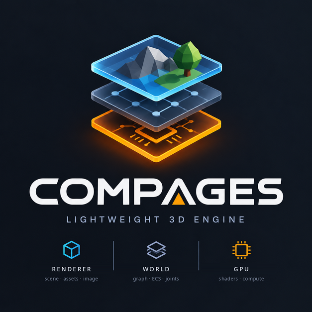

<p align="center"></p>

# 🧱 Compages

**A C++20 3D library you can take one layer at a time: draw with the GPU in a few lines, simulate a world without any screen, or build a full 3D scene like in Three.js. Each layer works without the ones above it.**

*Compages* is a Latin word: an assembly of parts that lock together into one whole. Here, three layers: GPU, world and renderer.

Compages is used for real work: 
- [RobotIK](https://github.com/Lecrapouille/RobotIK), a robot kinematics library, uses it for its world, its simulator and its painted canvases.

---

## 🤔 What is it for?

A 3D program does two jobs:

- **Simulate**: things exist and move. A robot arm turns its joints, heat spreads in a plate, a character walks. This is only numbers in memory, so it can run in a unit test, with no window.
- **Show**: a camera looks at this world and the graphics card draws it, sixty times per second.

Most 3D engines do both jobs at once and give you everything: a window, an editor, a scene format, a physics engine. You wanted to draw a curve, and you got a game engine. Compages gives you three layers instead. **Use the lowest layer that does your job**:

| Layer | Use it when you have… | You write… | Inspired by |
|-------|-----------------------|------------|-------------|
| 🟧 **GPU** | a shader and arrays of numbers | `drawable["position"] = list_of_points; drawable.draw();` | [Glumpy](https://glumpy.github.io/) |
| 🟦 **World** | things that move, with or without a screen | `world.entity("Ship").child("Gun")`, your structs as components | [Three.js](https://threejs.org/) + an ECS |
| 🟩 **Renderer** | a world you want to see | `scene.box("Cube", color(1, 0, 0)); scene.draw(frame);` | [Three.js](https://threejs.org/) |

Who it is for:

- 🔬 **Scientists** draw and compute on the GPU (a galaxy, heat in a plate) without learning the OpenGL state machine. The GPU layer is often enough.
- 🤖 **Robotics** gets a world that runs in unit tests and CI with no OpenGL context at all, and the same world drawn when you want to see it.
- 🎮 **Games** get short scene code like Three.js, glTF models, animations and cameras, in C++. They use all three layers.
- 🧑‍🏫 **Learners** get a gallery of more than seventy small demos, each adding one idea, with its source shown next to the picture, and tutorials that build a robot workshop step by step.

---

## 🚫 What it is not for?

Compages draws and simulates. It does not try to be a full game engine:

- 🧲 **No physics engine.** Bring your own (Bullet, Jolt, PhysX, MuJoCo…): mark an entity `PoseDriver::External` and the engine writes its pose each frame. The demo `07e_ExternalPhysics` shows how, in a few lines.
- 🔇 **No sound.** Use an audio library next to it (OpenAL, miniaudio…).
- 🌐 **No network, no multiplayer.**
- 🛠️ **No editor.** Your scene is code: your window, your loop.
- 🖥️ **One platform.** OpenGL 4.5 only, on Linux. No consoles, no web, no Vulkan or Metal. For these, look at Godot, Unity, Unreal, Three.js, or a renderer on every graphics API (bgfx, sokol, Filament).

---

## 👀 What it looks like

### 🟧 GPU — a triangle from a shader

Here is a hello-world example drawing a single triangle. The shader declares `position` and `color`; C++ fills them by name; `draw()` sends what changed.

```cpp
compages::gpu::Drawable triangle;

// At setup
COMPAGES_TRY(triangle.loadSources(VERTEX_SHADER, FRAGMENT_SHADER));   // GLSL: in vec2 position; in vec3 color;
triangle["position"] = { { -0.8f, -0.6f }, { 0.8f, -0.6f }, { 0.0f, 0.8f } };
triangle["color"]    = { { 1, 0, 0 }, { 0, 1, 0 }, { 0, 0, 1 } };

// Every frame
compages::gpu::clear({ 0.1f, 0.1f, 0.15f });
triangle.draw();
```

 

The same door leads to simulations: in `05f_Galaxy`, only 300 lines are needed to simulate 8000 stars attract each other in a compute shader, and the drawable reads the buffer the computation just wrote. This screenshot on the right shows initial step of the galaxy simulation.

### 🟦 World — things that move, without any screen

```cpp
struct Velocity { compages::Vector3f value; };      // your data: a plain struct

compages::world::World world;
compages::world::Entity ship = world.entity("Ship").set(Velocity{ { 1, 0, 0 } });
ship.child("Gun").position(0.0f, 0.5f, 0.0f);             // the gun follows the ship

world.each<Velocity>([&](compages::world::Entity e, Velocity& v) {   // a system: a plain loop
    e.position(e.position() + v.value * compages::toSeconds(step.elapsed));
});
world.update(step);                                       // routines, joints, matrices
```

This runs in a unit test, with no OpenGL. Joints too: `.revolute(axis, -90.0_deg, 90.0_deg).joint().angle(30.0_deg)`, and the children follow.

### 🟩 Renderer — a picture of that world

```cpp
using namespace compages::si::literals;   // 1.0_rad_per_s, 0.5_s, 90.0_deg
compages::renderer::Scene scene(world);

// At setup
scene.camera().position(0.0f, 1.0f, 3.0f).add<compages::world::Orbit>();
scene.sun("Sun", { 1.0f, 0.95f, 0.85f }, 1.4f);
compages::world::Entity cube = scene.box("Cube", compages::renderer::color(0.9f, 0.18f, 0.12f));

// Every frame
cube.rotate(1.0_rad_per_s * frame.elapsed, { 0.4f, 1.0f, 0.0f });   // a speed times a time is an angle
scene.draw(frame);
```

 

On the right, in `08b_GltfAnimation`, the `scene.loadFile(...)` reads glTF files and animations (used in games). The gallery has a small Doom-like game. STL and URDF files (for robotics with their joints) can also be loaded. The gallery also has a robot arm example moved by its joints (forward kinematics).

---

## 🎨 And bigger demos

The same three layers are enough for science and for games. Two demos of the gallery:

| 🔬 Heat in a plate, with live charts | 🌊 Water flowing over a terrain |
|---|---|
|  |  |
| `11h_Thermometers`: a heat equation on a `Field<float>`, probes and curves painted on a board. | `10f_FlowingWater`: water on a height field, with ripples and mist. |

Run them with `./build/linux-gcc-debug/bin/Compages-examples 11h_Thermometers` (or `10f_FlowingWater`).

---

## ✨ Why Compages?

| | 🧱 Compages | Raw OpenGL | Glumpy | Three.js | Unity / Godot |
|---|---|---|---|---|---|
| Language | C++20 | C | Python | JavaScript | C# / GDScript |
| Triangle in a few lines | ✅ the shader names the data | ❌ dozens of calls | ✅ | ✅ | ✅ (in the editor) |
| CPU → GPU copies hidden | ✅ one flush at `draw()` | ❌ | ✅ | ✅ | ✅ |
| Compute shaders, ping-pong | ✅ | ✅ (by hand) | ❌ ping-pong only, no compute | WebGL limits | ✅ |
| Scene graph in chained calls | ✅ | ❌ | ❌ | ✅ | ✅ (editor) |
| ECS, cache-friendly data | ✅ | — | ❌ | ❌ | Unity DOTS (separate) |
| Simulation without any screen | ✅ a whole layer for it | — | ❌ | ❌ | ✅ headless mode, but the whole engine |
| Use only the part you need | ✅ three independent layers | — | ✅ | ❌ | ❌ |
| A library, not an editor | ✅ your window, your loop | ✅ | ✅ | ✅ | ❌ |

Compages puts together the **Glumpy** way of talking to the GPU, the **Three.js** way of building scenes, an **ECS** world that runs **headless**, and **Unity**-like routines, as three layers you can use one at a time.

---

## 🚀 Quick installation

You need Linux, a C++20 compiler, Make, CMake, Git, `pkg-config`, GLFW and an **OpenGL 4.5** driver. 

**Note:**

- macOS stops at OpenGL 4.1 I will see how to manage this.
- Compages does not use CMake directly but uses Makefile.

All details (Fedora, CI without screen, system install) are given in the document [build and install](doc/guides/build-and-install.md).

```sh
git clone --recurse-submodules https://github.com/Lecrapouille/Compages.git

cd Compages
make
# Optional: sudo make install
```

You can run the demos:

```sh
./build/linux-gcc-debug/bin/Compages-examples
```

Keyboard keys: `PgUp` / `PgDn` change demo, `F1` hides the panels. Then follow [the tutorials](doc/tutorials/README.md).

---

## 📚 Documentation


Start with the [tutorials](doc/tutorials/README.md). They follow the three stacked-layer: a shader and some numbers on the GPU, then a robot arm in a World with no screen, then the workshop above drawn by the Renderer, one idea per page.

Then:

- the [guides](doc/guides/README.md) show how to do one task: load a model, light a scene, add a second view, compute on the GPU, find why a window is black;
- the [techniques](doc/techniques/README.md) explain one effect each, with when to use it and what it costs;
- the [case studies](doc/case-studies/README.md) follow a whole demo, from the equation or the paper to the picture;
- the [concepts](doc/concepts/README.md) explain why Compages is built this way;
- the [reference](doc/reference/README.md) lists the calls, the demos and the shader library.

Coding agents: [AGENTS.md](AGENTS.md) and the skills of `.claude/skills/`.

---

## 📖 The story

Compages comes from [SimTaDyn](https://github.com/Lecrapouille/SimTaDyn), a student project to draw maps, and from **OpenGLCppWrapper**, a C++ version of the [Glumpy](https://glumpy.github.io/) idea: the shader names its data and `draw()` hides the copies to the GPU. That wrapper could not do ping-pong passes nor a real scene graph, and the project stopped for some years. Compages is the rewrite that fixes this, with an ECS world ([EnTT](https://github.com/skypjack/entt)) and Unity-like routines without class inheritance.

---

## 📝 License

Compages is dual-licensed: GNU GPL v3 or later, or a commercial license for those who cannot use the GPL. See [LICENSING.md](LICENSING.md).
