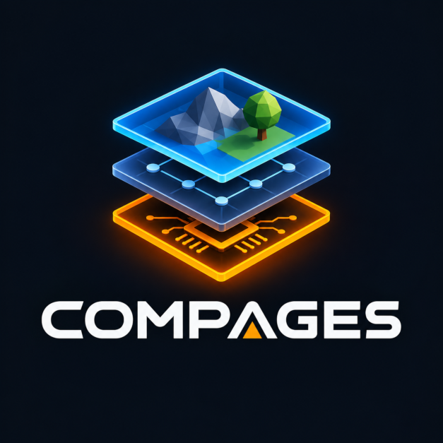
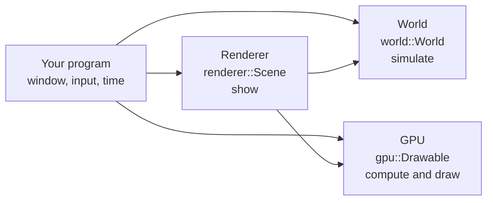
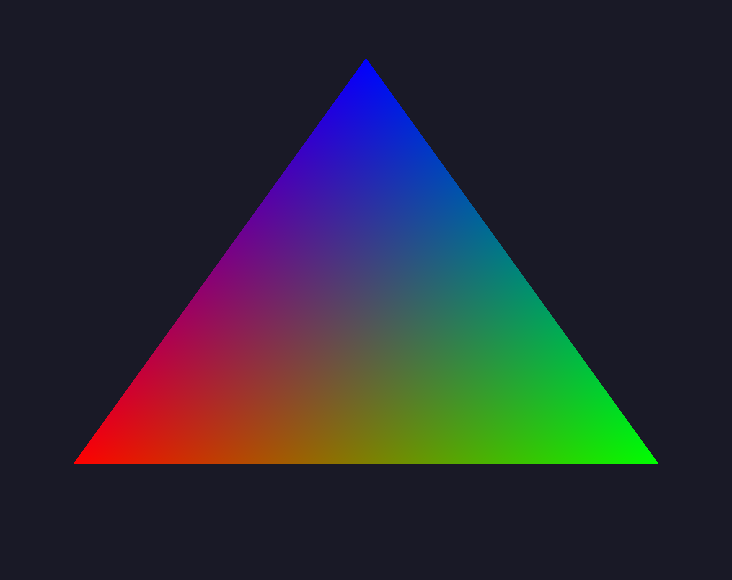
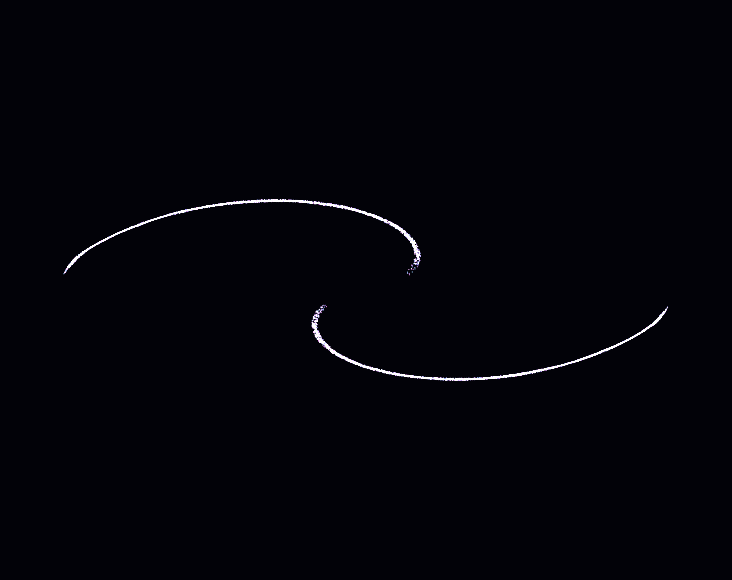
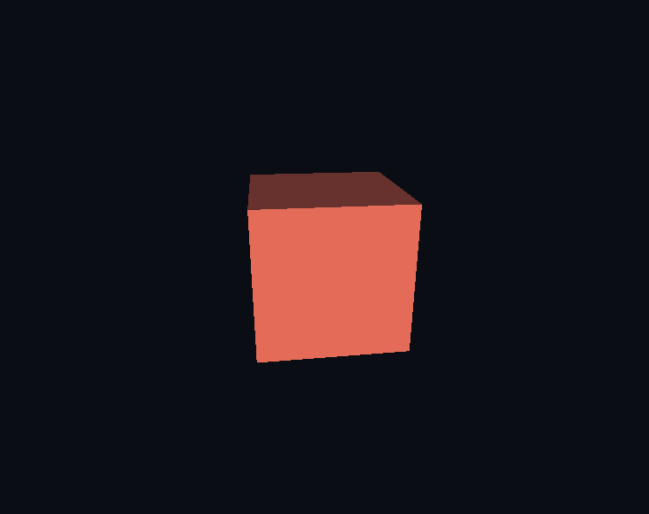
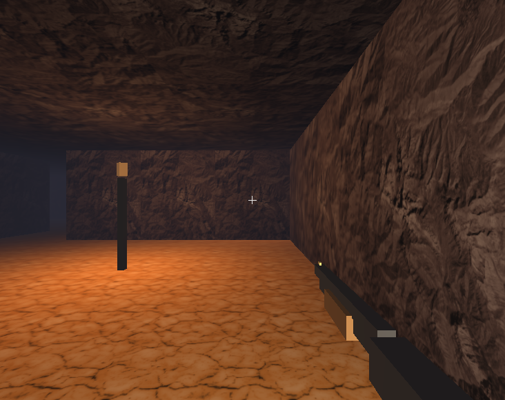

<p align="center"></p>

# 🧱 Compages — a 3D library in three layers

**Compages is a C++20 library for GPU computation, headless simulation and 3D scenes, built as three stacked layers. Each layer has a small API and builds and runs without the one above it: you write only the code your program needs.**

| Layer | You write | Entry point | Like |
|-------|-----------|-------------|------|
| 🟧 **1. GPU** | a GLSL shader, then data by the names it declares | `gpu::Drawable` | [Glumpy](https://glumpy.github.io/) |
| 🟦 **2. World** | entities, parents, your structs as components, a step | `world::World` | [Three.js](https://threejs.org/) + an ECS ([EnTT](https://github.com/skypjack/entt)) |
| 🟩 **3. Renderer** | `scene.box(...)`, `scene.load("robot.urdf")`, `scene.draw(frame)` | `renderer::Scene` | [Three.js](https://threejs.org/) |



- A particle simulation does not need a scene graph: use layer 1 alone.
- A robot planner or a unit test does not need a window: use layer 2 alone.
- A game or a robot simulator uses the three, with types that stay separate.

Most 3D engines and OpenGL wrappers are one block: you take everything or nothing. Compages lets you stop at the first layer that does the job.

*Compages* means an assembly: several parts that lock together into one whole. It is the new name of OpenGLCppWrapper, rewritten from scratch around these three layers ([the story](doc/11-Credits.md)).

---

## 👀 Code at a glance

### 🟧 Layer 1 — a triangle from a shader

The shader is the API: it declares `position` and `color`, C++ fills them by name, `draw()` sends what changed to the GPU. No `glBindBuffer`, no attribute location.

```cpp
#include <Compages/GPU/GPU.hpp>

compages::gpu::Drawable triangle;
COMPAGES_TRY(triangle.load(VERTEX_SHADER, FRAGMENT_SHADER));   // GLSL: in vec2 position; in vec3 color;
triangle["position"] = { { -0.8f, -0.6f }, { 0.8f, -0.6f }, { 0.0f, 0.8f } };
triangle["color"]    = { { 1, 0, 0 }, { 0, 1, 0 }, { 0, 0, 1 } };
COMPAGES_TRY(triangle.prepare());

// every frame
compages::gpu::clear({ 0.1f, 0.1f, 0.15f });
triangle.draw();
```

 

The same door leads to simulations: in `13_Galaxy`, eight thousand stars attract each other in a compute shader, and the drawable reads the buffer the computation just wrote.

### 🟦 Layer 2 — a world without any screen

Named entities, parents and children, your own structs iterated as in an ECS. No OpenGL context: this runs in a unit test.

```cpp
#include <Compages/World/Entity.hpp>

struct Velocity { compages::core::Vector3f value; };

compages::world::World world;
compages::world::Entity ship = world.entity("Ship").set(Velocity{ { 1, 0, 0 } });
ship.child("Gun").position(0.0f, 0.5f, 0.0f);

compages::core::Frame step;
step.elapsed = 1.0f / 60.0f;

world.each<Velocity>([&](compages::world::Entity e, Velocity& v) {
    e.position(e.position() + v.value * step.elapsed);
});
world.update(step);    // behaviors, joints, world matrices
```

Joints too: `.revolute(axis, -90.0_deg, 90.0_deg)` then `.angle(30.0_deg)`, and the children follow (forward kinematics, still headless).

### 🟩 Layer 3 — a picture of that world

```cpp
#include <Compages/Compages.hpp>

compages::world::World world;
compages::renderer::Scene scene(world);

scene.camera().position(0.0f, 1.0f, 3.0f).add<compages::world::Orbit>();
scene.sun("Sun", { 1.0f, 0.95f, 0.85f }, 1.4f);
compages::world::Entity cube =
    scene.box("Cube", compages::renderer::color(0.9f, 0.18f, 0.12f));
COMPAGES_TRY(scene.prepare());

// every frame
cube.rotate(frame.elapsed, { 0.4f, 1.0f, 0.0f });
scene.draw(frame);
```

 

`scene.load(...)` reads glTF, STL and URDF robots (with their joints). The gallery goes up to a small Doom-like game.

---

## 🚀 Quick start

You need a C++20 compiler, Make, CMake, Git, `pkg-config`, GLFW and an **OpenGL 4.5** driver (Linux; macOS stops at OpenGL 4.1).

```sh
git clone --recurse-submodules https://github.com/Lecrapouille/Compages.git
cd Compages
make download-external-libs
make compile-external-libs
make -j"$(nproc)"

./build/Compages-examples            # the gallery: every demo, its source, GPU counters
```

Unit tests: `make tests -j"$(nproc)"`. Install: `sudo make install` (then `pkg-config --cflags --libs Compages`). Details, Fedora, CI without screen: [doc/02-Getting-Started.md](doc/02-Getting-Started.md).

---

## 📚 Documentation

| # | Chapter | Contents |
|---|---------|----------|
| | [doc/README.md](doc/README.md) | 🧭 Reading order and quick paths |
| 1 | [Introduction](doc/01-Introduction.md) | 🌱 3D words, the three layers and why they are separate |
| 2 | [Getting started](doc/02-Getting-Started.md) | 🚀 Install, build, gallery, headless CI, system install |
| 3 | [Your first programs](doc/03-Tutorial.md) | 🎓 One program per layer, line by line |
| 4 | [The GPU layer](doc/04-GPU-Layer.md) | 🟧 Drawable, buffers, compute, several passes |
| 5 | [The World layer](doc/05-World-Layer.md) | 🟦 Scene graph, ECS, behaviors, joints |
| 6 | [The Renderer layer](doc/06-Renderer-Layer.md) | 🟩 Scene, assets, frame, live textures |
| 7 | [Architecture](doc/07-Architecture.md) | 🏗 Folders, includes, one frame |
| 8 | [API reference](doc/08-API-Reference.md) | 📖 The calls of the three layers |
| 9 | [Examples](doc/09-Examples.md) | 🖼 The gallery and its keys |
| 10 | [Debugging](doc/10-Debugging.md) | 🐞 Errors, driver messages, apitrace, RenderDoc |
| 11 | [Credits](doc/11-Credits.md) | 🙏 History, inspirations, third parties |

Coding agents: [AGENTS.md](AGENTS.md) and the skills of `.claude/skills/`.

---

## 📝 License

Compages is dual-licensed: GNU GPL v3 or later, or a commercial license for those who cannot use the GPL. See [LICENSING.md](LICENSING.md).
