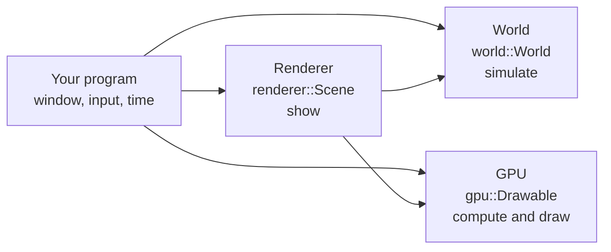

# 🌱 1. Introduction: 3D programming in fifteen minutes

This page is for people who never wrote a 3D program. It explains the words you will meet in the rest of the documentation, then the idea of Compages: three layers, and you use only the ones you need. No code here: only ideas and pictures.

If you already know OpenGL and ECS, read only [§3 Three layers](#-3-three-layers) and go to [02-Getting-Started.md](02-Getting-Started.md).

---

## 💻 1. What does a 3D program do?

A 3D program does two different jobs, and mixing them is the source of most pain:

```text
          ┌──────────────────────────┐       ┌──────────────────────────┐
          │  SIMULATE                │       │  SHOW                    │
 time ───►│  where are things?       │──────►│  what does the camera    │───► image
          │  how do they move?       │       │  see? draw it on the GPU │
          └──────────────────────────┘       └──────────────────────────┘
           runs without a screen               needs a window and a GPU
```

- **Simulate**: a robot arm turns its joints, particles fall, a character walks. This is numbers in memory. A unit test, a planner or a server needs it, without any window.
- **Show**: a camera looks at the world, and the **GPU** (the graphics card) draws triangles into an image, many times per second.

Compages keeps the two jobs apart, so that you can simulate without showing, or show without a scene.

---

## 📖 2. The words you will meet

### On the GPU side

| Word | Meaning |
|------|---------|
| **GPU** | The graphics card. Thousands of small cores that run the same small program on many data at the same time. |
| **OpenGL** | The interface a program uses to talk to the GPU. Compages uses OpenGL 4.5. |
| **Shader** | A small program, written in **GLSL**, that runs on the GPU. A **vertex shader** places each point; a **fragment shader** colors each pixel. |
| **Vertex** | A point of a shape, with its data: position, color, normal… A triangle has three vertices. |
| **Attribute** | A data given per vertex (`in vec2 position;` in the shader). |
| **Uniform** | A data given once for a whole draw (a color, a time, a matrix). |
| **Texture** | An image that a shader reads (a **sampler** in GLSL). |
| **Buffer** | A block of memory on the GPU: vertices, indices, any array. |
| **Draw call** | One order "draw these triangles with this shader". Fewer is faster. |
| **Compute shader** | A shader that does not draw: it computes on a grid of numbers (physics, particles). |
| **CPU mirror** | The copy of a buffer kept in normal memory. You change it; Compages sends the changed part to the GPU at the next draw. |

### On the World side

| Word | Meaning |
|------|---------|
| **Entity** | One thing of the world: a robot, a wheel, a camera, a light. Only an id and a name. |
| **Component** | A piece of data attached to an entity: a `Velocity`, a `Health`. Your own C++ structs. |
| **ECS** | *Entity Component System*: entities hold components, and **systems** (plain loops) process every entity that has some components. Data stays packed in memory, so loops are fast. |
| **Scene graph** | The tree of parents and children. A wheel is a child of the car: when the car moves, the wheel follows. |
| **Transform** | The position, rotation and scale of an entity, relative to its parent. |
| **World matrix** | The final placement of an entity in the world, computed from all its parents. |
| **Joint** | A child that moves in one way only: a **revolute** joint turns (an elbow), a **prismatic** joint slides. |
| **Behavior** | A small piece of code attached to one entity, called every frame (`update(dt)`). |
| **Frame** | One step of time: the time since the last step (`elapsed`) and since the start (`total`). |

### On the Renderer side

| Word | Meaning |
|------|---------|
| **Scene** | Everything needed to draw a world: camera, lights, meshes, materials. |
| **Mesh** | The triangles of a shape. |
| **Material** | How a surface looks: a color, a texture, how it reacts to light. |
| **Camera** | The point of view. Its view is read from the world matrix of its entity. |
| **Asset** | A resource loaded once and shared: a mesh, a texture, a glTF model, a URDF robot. |
| **glTF**, **URDF**, **STL** | File formats: 3D models (glTF), robots with joints (URDF), raw meshes (STL). |
| **Snapshot** | A copy of what must be drawn (cameras, lights, placements, asset ids), taken from the world before drawing. |

---

## 🧱 3. Three layers


Compages is a C++20 library in **three stacked layers**. Each layer has a small entry point, and **each one builds and runs without the one above it**. You stop at the first layer that does your job.



| You have… | Layer | Entry point | It leaves to the others |
|-----------|-------|-------------|-------------------------|
| GLSL and arrays of numbers | 1. **GPU** | `compages::gpu::Drawable` | entities, model files, the window |
| things that move, tests included | 2. **World** | `compages::world::World` | draw calls, the mesh catalog |
| a world you want to see | 3. **Renderer** | `compages::renderer::Scene` | the simulation itself: it stays in `World` |

- A particle simulation does not need a scene graph: layer 1 only.
- A robot planner does not need a window: layer 2 only.
- A game needs all three, but in this order, with types that stay separate.

### Layer 1 — the shader is the API

Inspired by [Glumpy](https://glumpy.github.io/) (Python):

- The shader declares `in vec2 position;`. The C++ code writes `drawable["position"] = …`. **The name is the contract.**
- Assignment changes the **CPU mirror**. The GPU is touched only at `draw()`, which sends what changed, then draws.
- Public headers contain no `GLenum`. The OpenGL 4.5 backend (with Direct State Access) is hidden and replaceable.

Glumpy alone would copy the vertices again for each shader that reads a mesh (shadow, depth, outline). Compages adds a vertex layout **on the C++ side** (`Buffer<Vertex>`, `Pipeline`), checked against each program: one buffer, several shaders.

### Layer 2 — the world exists without an image

One `World` holds two mechanisms:

- **A scene graph** (parent, children, transform), with a chained style like [Three.js](https://threejs.org/): `entity("Ship").child("Gun").position(...)`.
- **An ECS** ([EnTT](https://github.com/skypjack/entt)): your structs are the components; `world.each<Velocity>(...)` visits only the entities that have a `Velocity`.

Behaviors, joints, camera, lights and skeleton poses are simulation data. The view matrix is not hidden in the camera: it is the world matrix of the camera entity. **Headless mode is not an add-on: it is layer 2 used alone.**

### Layer 3 — showing without owning the simulation

`renderer::Scene` is a façade: `box`, `sphere`, `camera`, `sun`, `load`, `draw`, one line each, like a Three.js tutorial. Behind it, three jobs:

1. **The catalog** (`AssetManager`): meshes, textures, materials, animation clips. A world component never holds a GPU pointer, only an id.
2. **Render components** (`MeshRenderer`, `Animator`), attached to world entities.
3. **The snapshot** (`SceneExtractor` → `RenderSnapshot`): the renderer draws from a copy, not from the world.

Several `Scene` objects can share one `World` and one catalog: split screen, minimap.

---

## 🚨 4. Two moments for errors

| When | What happens | Where to read it |
|------|--------------|------------------|
| **Load** (a shader, a file) | the call fails at once | the returned `compages::Result`, often through `COMPAGES_TRY` |
| **Frame** (an unknown name, a wrong type) | the first error is kept, the next ones are counted | `gpu::takeFrameError()`, `prepare()` |

Checking every assignment at every frame would slow a simulation down. Call `prepare()` at the end of your setup: it reports these errors before your loop starts. [Chapter 10](10-Debugging.md) has the details.

---

## 🎮 5. OpenGL 4.5, and what comes after

- **4.3** brings compute shaders and storage buffers: particles, n-body, indirect draw.
- **4.5** brings Direct State Access: the backend sets objects up without binding them first.
- **macOS** stops at OpenGL 4.1: the CPU tests pass, but the gallery is limited there.
- The **web** would need a WebGPU backend for compute; WebGL 2 is not enough. The `Backends/` folder is ready for another backend; only `GL45` exists today.

---

## 🚪 6. What stays outside the library

- **The window** (GLFW, SDL, Qt) belongs to your application. `gpu::init` receives the function loader once your OpenGL context exists.
- **The editor, the asset store, a production pipeline** for a big game.
- **Physics**: the old ReactPhysics3D adapter waits in `attic/Physics/`, out of the build, to come back as world components and a system.

Compages targets **scientific simulations** first (fields, cellular automata, n-body, curves), then **games and robots** that reuse the same objects in space.

*Compages* means an assembly: several parts that lock together into one whole.

Next: [02-Getting-Started.md](02-Getting-Started.md).
