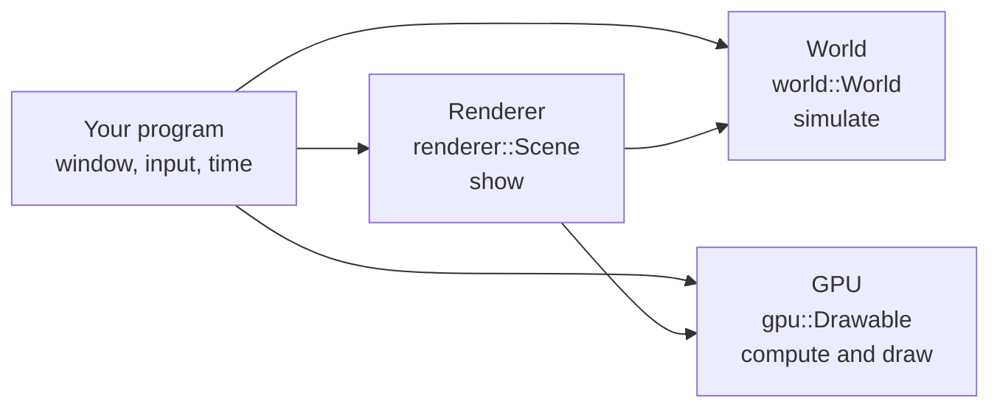

# 🌱 1. Introduction: from objects to pictures

This page is for people who never wrote a 3D program. It explains the words you will meet in the rest of the documentation, then the idea of Compages: three layers, and you use only the ones you need. Start with the everyday picture of a stage: objects occupy places, a camera chooses a view, and lights help reveal the shapes. You will learn to distinguish the simulation from its picture and choose the Compages layer for your first project.

You can read this chapter without knowing how to program. Later chapters ask you to write C++; they explain the 3D ideas as they appear.

If you already know OpenGL and ECS, read only [§3 Three layers](#-3-three-layers) and go to [02-Getting-Started.md](02-Getting-Started.md).

---

## 💻 1. What does a 3D program do?

A 3D program does two different jobs, and mixing them is the source of most pain:

```text
          ┌──────────────────────────┐       ┌──────────────────────────┐
          │  SIMULATE                │       │  SHOW                    │
 time ───►│  where are things?       │──────►│  what does the camera    │───► image
          │  how do they move?       │       │  see? draw it on the GPU │
          └──────────────────────────┘       └──────────────────────────┘
           runs without a screen               needs a graphics context
```

- **Simulate**: a robot arm turns its joints, particles fall, a character walks. This is numbers in memory. A unit test, a planner or a server needs it, without any window.
- **Show**: a camera looks at the world, and the **GPU** (the graphics card) draws triangles into an image, many times per second.

Compages keeps the two jobs apart, so that you can simulate without showing, or show without a scene.

---

### Places, directions and time

A point in space has three coordinates, written **(x, y, z)**. Think of a room: x goes sideways, y goes up, and z gives the third direction along the floor. The point **(0, 0, 0)** is the origin. Compages uses metres for scene distances; keep the same unit in your own data.

- A **position** says where something is. `(2, 0, 0)` is two metres along x from the origin.
- A **vector** is a group of numbers. A three-number vector can represent a position, a direction or a speed; the code tells you which.
- A **rotation** turns an object around an axis. A **scale** changes its size.
- A **local** position is measured from the parent. A **world** position includes the placement of every parent. A wheel at x = 1 relative to a car at x = 2 is at world x = 3 if the car has no rotation or scale.
- A **frame** is one step of the application. A speed of 2 metres per second moves an object by `2 × elapsed` metres at each step. This keeps the speed the same when the frame rate changes.

The examples use radians for calls such as `rotate`. A full turn is about 6.283 radians. Joint examples also use explicit degree values such as `90.0_deg`.

## 📖 2. The words you will meet

Use this as a dictionary. Read the words you need now and return when a later chapter introduces another one.

### On the GPU side

| Word | Meaning |
|------|---------|
| **GPU** | The graphics card. Thousands of small cores that run the same small program on many data at the same time. |
| **OpenGL** | The interface a program uses to talk to the GPU. Compages uses OpenGL 4.5. |
| **Shader** | A small program, written in **GLSL**, that runs on the GPU. A **vertex shader** places each point; a **fragment shader** colors each pixel. |
| **Vertex** | A point of a shape, with its data: position, color, normal… A triangle has three vertices. |
| **Attribute** | A value given per vertex (`in vec2 position;` in the shader). |
| **Uniform** | A value given once for a whole draw (a color, a time, a matrix). |
| **Texture** | An image that a shader reads (a **sampler** in GLSL). |
| **Buffer** | A block of memory on the GPU: vertices, indices, any array. |
| **Draw call** | One order "draw these triangles with this shader". Fewer is faster. |
| **Compute shader** | A shader that does not draw: it computes on a grid of numbers (physics, particles). |
| **CPU mirror** | The copy of a buffer kept in normal memory (a `BufferUsage::Dynamic` buffer, or a `Drawable`). You change it; Compages sends the changed parts to the GPU at the next draw. |

### On the World side

| Word | Meaning |
|------|---------|
| **Entity** | One thing of the world: a robot, a wheel, a camera, a light. Only an id and a name. |
| **Component** | A piece of data attached to an entity: a `Velocity`, a `Health`. Your own C++ structs. |
| **ECS** | *Entity Component System*: entities hold components, and **systems** (plain loops) process every entity that has some components. Data stays packed in memory, so loops are fast. |
| **Scene graph** | The tree of parents and children. A wheel is a child of the car: when the car moves, the wheel follows. |
| **Transform** | The position, rotation and scale of an entity, relative to its parent. |
| **World matrix** | The final placement of an entity in the world, computed from all its parents. |
| **Joint** | A child that moves in one way only: a **revolute** joint turns (an elbow), a **prismatic** joint slides. |
| **Routine** | A small piece of code attached to one entity, called at each step (`update(dt)`, `fixedUpdate(dt)`…), like a Unity `MonoBehaviour`. Not a behavior tree: a routine can host one. |
| **Frame** | One step of time: the time since the last step (`elapsed`) and since the start (`total`). |

### On the Renderer side

| Word | Meaning |
|------|---------|
| **Scene** | Everything needed to draw a world: camera, lights, meshes, materials. |
| **Mesh** | The triangles of a shape. |
| **Material** | How a surface looks: a color, a texture, how it reacts to light. |
| **Camera** | The point of view. Its view is read from the world matrix of its entity. |
| **Asset** | A resource loaded once and shared: a mesh, a texture, a glTF model, a URDF robot. |
| **glTF**, **URDF**, **STL** | File formats: 3D models (glTF), robots with joints (URDF), raw meshes (STL). |
| **Normal** | A direction perpendicular to a surface. Lighting uses it to decide how much light reaches that surface. |
| **UV coordinates** | Two coordinates that say where a vertex lies on a texture image. Usually 0 to 1 across the image. |
| **PBR** | *Physically Based Rendering*: a surface model that uses properties such as roughness and metallic appearance to respond to light. |
| **Depth** | Distance information used to keep a nearer surface in front of a farther one. |
| **Render pass** | A drawing session that chooses the destination image and its size. Your application opens one before drawing. |
| **Graphics context** | The driver state your application creates before using OpenGL. It can belong to a window or to an offscreen program. |
| **Headless** | Running without a visible window. World-only simulation uses no graphics context; headless rendering still needs one. |
| **Snapshot** | A copy of what must be drawn (cameras, lights, placements, asset ids), taken from the world before drawing. |

---

## 🧱 3. Three layers


Compages is a C++20 library in **three stacked layers**. Each layer has a small entry point. **World and GPU are independent; Renderer uses both.** The numbered layers describe responsibilities, not a course you must complete from bottom to top. Start with Renderer if you want a visible scene; start with World for simulation alone.



| You have… | Layer | Entry point | It leaves to the others |
|-----------|-------|-------------|-------------------------|
| GLSL and arrays of numbers | 1. **GPU** | `compages::gpu::Drawable` | entities, model files, the window |
| things that move, tests included | 2. **World** | `compages::world::World` | draw calls, the mesh catalog |
| a world you want to see | 3. **Renderer** | `compages::renderer::Scene` | the simulation itself: it stays in `World` |

- A particle simulation does not need a scene graph: layer 1 only.
- A robot planner does not need a window: layer 2 only.
- A game needs all three, but in this order, with types that stay separate.

### Layer 1 — the shader is the API

Inspired by [Glumpy](https://glumpy.github.io/) (Python):

- The shader declares `in vec2 position;`. The C++ code writes `drawable["position"] = …`. **The name is the contract.**
- Assignment changes the **CPU mirror**. The GPU is touched only at `draw()`, which sends what changed, then draws.
- Public headers contain no `GLenum`. The OpenGL 4.5 backend (with Direct State Access) is hidden and replaceable.

Glumpy alone would copy the vertices again for each shader that reads a mesh (shadow, depth, outline). Compages adds a vertex layout **on the C++ side** (`VertexBuffer<Vertex>`, `Pipeline`), checked against each program: one buffer, several shaders.

### Layer 2 — the world exists without an image

One `World` holds two mechanisms:

- **A scene graph** (parent, children, transform), with a chained style like [Three.js](https://threejs.org/): `entity("Ship").child("Gun").position(...)`.
- **An ECS** ([EnTT](https://github.com/skypjack/entt)): your structs are the components; `world.each<Velocity>(...)` visits only the entities that have a `Velocity`.

Routines, joints, camera, lights and skeleton poses are simulation data. The camera entity has a world placement. The renderer derives the view matrix from the inverse of that placement. **Headless mode is not an add-on: it is layer 2 used alone.**

### Layer 3 — showing without owning the simulation

`renderer::Scene` is a façade: one place to call operations such as `box`, `sphere`, `camera`, `sun`, `loadFile` and `draw`. Behind it, three jobs:

1. **The catalog** (`AssetManager`): meshes, textures, materials, animation clips. A world component never holds a GPU pointer, only an id.
2. **Render components** (`MeshRenderer`, `Animator`), attached to world entities.
3. **The snapshot** (`SceneExtractor` → `RenderSnapshot`): the renderer draws from a copy, not from the world.

Several `Scene` objects can share one `World` and one catalog: split screen, minimap.

### Where does my data live?

A simple API must not force one memory layout. Pick the place by the number of things and by who computes them:

| Your data | Put it in | Why | Example |
|-----------|-----------|-----|---------|
| A few objects with their own logic (a door, an enemy, a camera) | a **`Routine`** on the entity | start, update, timers, messages; one object, virtual calls: fine for tens or hundreds | `07b_Routines` |
| Many things with the same data (robots, agents, bullets) | **components** + `world.each<A, B>(...)` | your structs packed together in memory, one loop over all of them | `07a_HeadlessWorld` |
| Vertices the CPU changes from time to time | a **`Drawable`** (`setVertices`, `editVertex`) or a `Dynamic` buffer | a CPU copy, `draw()` sends only what changed | `02b_DynamicGeometry` |
| A movement that is a formula of the time (orbits, waves) | the **vertex shader**, with a time uniform | sent once, nothing written per frame but the time | `05e_SpiralGalaxy` |
| Millions of things whose next state depends on the previous one (particles, cells, stars) | a **`StorageBuffer`** or a `PingPong` + a compute shader | stays on the GPU; the `Drawable` reads it without a copy | `05f_Galaxy`, `05b_GameOfLife` |

A million particles do not need to become a million entities: keep them on the GPU.

---

## 🚨 4. Two moments for errors

| When | What happens | Where to read it |
|------|--------------|------------------|
| **Load** (a shader, a file) | the call fails at once | the returned `compages::Result`, often through `COMPAGES_TRY` |
| **Frame** (an unknown name, a wrong type) | the first error is kept, the next ones are counted | `gpu::takeFrameError()`, `prepare()` |

Checking every assignment at every frame would slow a simulation down. Call `prepare()` at the end of your setup: it reports these errors before your loop starts. [Chapter 10](10-Debugging.md) has the details.

---

## 🎮 5. OpenGL 4.5, and what comes after

- **4.3** brings compute shaders and storage buffers: particles, n-body, indirect draw.
- **4.5** brings Direct State Access: the backend sets objects up without binding them first.
- **macOS** stops at OpenGL 4.1: it cannot provide the 4.5 context required by the current drawing backend. World-only code needs no context.
- The **web** would need a WebGPU backend for compute; WebGL 2 is not enough. The `Backends/` folder is ready for another backend; only `GL45` exists today.

---

## 🚪 6. What stays outside the library

- **The window** (GLFW, SDL, Qt) belongs to your application. `gpu::init` receives the function loader once your OpenGL context exists.
- **The editor, the asset store, a production pipeline** for a big game.
- **Physics**: Compages has no physics engine. Your engine computes the poses and writes them into the world entities; the renderer shows them.

Compages targets **scientific simulations** first (fields, cellular automata, n-body, curves), then **games and robots** that reuse the same objects in space.

*Compages* means an assembly: several parts that lock together into one whole.

## ✅ Before you continue

You should be able to answer these questions:

- Can a robot move without being drawn? Yes: its World can run alone.
- Do you need to write a shader to show a box? No: the Renderer supplies the drawing code.
- Does moving the camera move the robot? No: it changes the view of the world.

Next: [Getting started](02-Getting-Started.md), where you build Compages and see your first scene.
