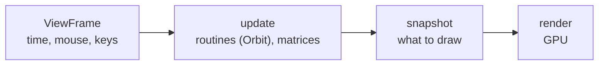

# 🎓 3. Your first programs

You will run a simulation in a terminal, understand how Compages draws a shape, and build a complete application with your own window. First finish [Getting started](02-Getting-Started.md): the library and gallery must already be built.

**Suggested first reading:** §2 (numbers moving without graphics) → §3 (a picture of a world) → §5 (your own complete application). Read §0–1 when you want to write shaders yourself. You do not need to master GPU programming before using `Scene`. Section numbers stay fixed so other chapters can link to them.

The first and third programs are demos of the gallery: open them with `./build/linux-gcc-debug/bin/Compages-examples 01c_Triangle` and `./build/linux-gcc-debug/bin/Compages-examples 06a_FirstScene`, and read their source in the **Source** panel. The second one runs in a terminal; its output below is real.

**How to use the code:** blocks marked “Setup” or “Every frame” are excerpts inside a gallery class, not separate files to compile. `m_` marks a member of that class; `p_` marks a function parameter. Capital names such as `VERTEX_SHADER` are constants. The complete programs in §2 and §5 include `main()` and can be saved as files.

`COMPAGES_TRY(call)` returns early from a function returning `compages::Status` or `Result<T>` if `call` fails. `COMPAGES_TRY_ASSIGN(variable, call)` also stores a successful result. Inside `main()`, which returns an integer, use `if (!result)` and print `result.error()` instead; §5 shows this.

---

## 🔌 0. Before any drawing: the GPU device

Layers 1 and 3 need an OpenGL 4.5 core context, then a call to `compages::gpu::init`. **Compages does not open a window for you**: your application (or the gallery) does.

```cpp
#include <Compages/GPU/GPU.hpp>

if (auto ready = compages::gpu::init(
        reinterpret_cast<compages::gpu::LoadProc>(glfwGetProcAddress)); !ready)
{
    std::cerr << ready.error() << '\n';
    return 1;
}

// ... frames ...

compages::gpu::shutdown();
```

`glfwGetProcAddress` is one example; SDL and Qt give their own function. Layer 2 needs none of this.

A context lets Compages talk to OpenGL. A **render pass** says where to draw. The gallery opens that pass before calling a demo, so its snippets can go straight to `draw()`. In your own application, open a `compages::gpu::RenderPass` with the current framebuffer width and height. Section 5 contains the complete loop.

GPU objects must be destroyed before `gpu::shutdown()`, and shutdown must happen while the context still exists. A C++ scope (a pair of braces) makes that order explicit in §5.

---

## 🔺 1. A triangle named by the shader

📁 `examples/01_FirstSteps/01c_Triangle.cpp` · more in [chapter 4](04-GPU-Layer.md)

**Goal:** draw one triangle whose three corners have different colours. Open `01c_Triangle` in the gallery before reading the code.

The positions in this example are already in screen coordinates: x and y run from −1 to 1 across the image. No 3D camera is needed yet. The `f` suffix in C++ numbers such as `0.8f` means a `float` value.

The vertex shader declares two attributes, `position` and `color`. These names are all the C++ side needs to know:

```cpp
constexpr const char* VERTEX_SHADER = R"(#version 450 core

in vec2 position;
in vec3 color;

out vec3 vColor;

void main()
{
    vColor = color;
    gl_Position = vec4(position, 0.0, 1.0);
}
)";

constexpr const char* FRAGMENT_SHADER = R"(#version 450 core

in vec3 vColor;
out vec4 oColor;

void main()
{
    oColor = vec4(vColor, 1.0);
}
)";
```

Setup, once:

```cpp
compages::gpu::Drawable m_triangle;

// The one step that can fail for a reason outside the program: a shader
// that does not compile. COMPAGES_TRY hands the compiler log to the caller.
COMPAGES_TRY(m_triangle.loadSources(VERTEX_SHADER, FRAGMENT_SHADER));

// One value per vertex, attribute by attribute.
m_triangle["position"] = { { -0.8f, -0.6f },
                           { 0.8f, -0.6f },
                           { 0.0f, 0.8f } };
m_triangle["color"] = { { 1, 0, 0 }, { 0, 1, 0 }, { 0, 0, 1 } };

// Optional: checks everything now rather than at the first frame.
return m_triangle.prepare();
```

Every frame:

```cpp
compages::gpu::clear({ 0.1f, 0.1f, 0.15f });
m_triangle.draw();      // sends what changed, then draws
```


What happened:

- `load` compiled the shaders and read the names they declare.
- `m_triangle["position"] = …` filled the **CPU mirror**. The values of the two attributes are stored **interleaved** (position, color, position, color…), the layout the GPU reads best.
- `draw()` sent the changed bytes to the GPU, then drew. No `glBindBuffer`, no attribute location.

A wrong name, or a `vec2` given three numbers, does not crash: the message is kept and lists what the shader really declares. `prepare()` returns it before your loop; during the loop, read it with `compages::gpu::takeFrameError()` ([chapter 10](10-Debugging.md)).

**Try it:** change the top corner from `{ 0.0f, 0.8f }` to `{ 0.0f, 0.3f }` in `01c_Triangle.cpp`, run `make`, and reopen the demo. The top moves down; the other two corners stay put. Restore it before continuing.

When your vertices are already a struct, the field names must match the shader. You also say whether they will change. In `01d_InterleavedTriangle` they never do, so they are `Static`: sent once, then the CPU frees its copy:

```cpp
struct Vertex
{
    compages::Vector2f position;
    compages::Vector3f color;
};

m_triangle.setVertices<Vertex>(
    { { { -0.8f, -0.6f }, { 0.1f, 0.9f, 0.9f } },
      { { 0.8f, -0.6f }, { 0.9f, 0.1f, 0.9f } },
      { { 0.0f, 0.8f }, { 0.9f, 0.9f, 0.1f } } });
```

`01e_BorrowedTriangle` keeps the corners in a `Buffer` you own, read by two drawables with `borrowVertices()`. `02b_DynamicGeometry` gives the other answer, `BufferUsage::Dynamic`, and moves one corner with `editVertex()`; `01f_VertexSyntax` shows every syntax side by side. [Chapter 4 §3](04-GPU-Layer.md#-3-typed-vertices) has the table of the choices.

📌 Remember: **the shader names, C++ fills, `draw()` sends.** Next steps in the gallery: `02b_DynamicGeometry` (only the moved corner is sent), then `05_Simulation/` (Game of Life, particles, galaxy).

---

## 🌍 2. A world without a screen

📁 `examples/07_World/07a_HeadlessWorld.cpp` · more in [chapter 5](05-World-Layer.md)

No `gpu::init` here, no window, no OpenGL. The container is `compages::world::World`. An `Entity` is a handle that you chain, like a Three.js object.

### Step 1 — components and a system

Create `world.cpp`:

```cpp
#include <Compages/World/Entity.hpp>
#include <iostream>

struct Position { compages::Vector3f value{ 0, 0, 0 }; };
struct Velocity { compages::Vector3f value{ 0, 0, 0 }; };

int main()
{
    compages::world::World world;

    // The rock has a position but no velocity: the loop below skips it.
    world.entity("player").set(Position{}).set(Velocity{ { 1, 0, 0 } });
    world.entity("rock").set(Position{ { 0, 5, 0 } });

    compages::Frame step;
    step.elapsed = 1.0f / 60.0f;

    for (int i = 0; i < 60; ++i)
    {
        world.each<Position, Velocity>(
            [&](compages::world::Entity, Position& p, Velocity& v)
            { p.value += v.value * step.elapsed; });
        world.update(step);
    }

    compages::world::Entity player = world.lookup("player");
    compages::Vector3f const& x = player.get<Position>().value;
    std::cout << "player after 1 s: " << x.x << " " << x.y << " " << x.z << "\n";

    // The scene graph: a child follows its parent.
    compages::world::Entity ship = world.entity("Ship").position(2, 0, 0);
    compages::world::Entity gun = ship.child("Gun").position(0, 0.5f, 0);
    world.update(step);
    std::cout << "Ship/Gun found: " << (world.lookup("Ship/Gun") ? "yes" : "no") << "\n";
    return 0;
}
```

Build it from the root of your clone, against the static library, and run it:

```sh
export PKG_CONFIG_PATH="$PWD/build/linux-gcc-debug/lib/pkgconfig${PKG_CONFIG_PATH:+:$PKG_CONFIG_PATH}"
g++ -std=c++20 world.cpp $(pkg-config --cflags Compages) \
    build/linux-gcc-debug/lib/libCompages.a -o world
./world
```

```text
player after 1 s: 1 0 0
Ship/Gun found: yes
```

- `each<Position, Velocity>` is a **system**: a loop over the entities that have **both** components. The rock is never visited.
- `update(step)` runs the routines, the joints, then computes the world matrices.
- `Position` is **your** struct. The place of an entity in the scene graph (what `.position(x, y, z)` changes) is its **transform**. A simulation may use one, the other, or both.

**Try it:** change the player's velocity from `{ 1, 0, 0 }` to `{ 2, 0, 0 }`, rebuild `world`, and run it again. The player ends near `(2, 0, 0)`. The rock still does not move: it has no `Velocity` component.

### Step 2 — a joint and a routine

A revolute joint turns a child around an axis, within limits. A routine is code attached to one entity, called by `update`. Replace the contents of `world.cpp` with this complete program, then use the same build and run commands as in step 1:

```cpp
#include <Compages/World/Entity.hpp>
#include <iostream>

using namespace units::literals;

//! A routine: a small piece of code attached to one entity.
struct Spin: compages::world::Routine
{
    explicit Spin(float p_speed) : speed(p_speed) {}
    void update(float p_dt) override { transform().rotateY(speed * p_dt); }
    float speed;
};

int main()
{
    compages::world::World world;

    // A base, a shoulder joint turning around x, and a hand 1 m along its local z axis.
    compages::world::Entity base = world.entity("Robot");
    compages::world::Entity shoulder = base.child("Shoulder")
        .position(0.0f, 0.0f, 0.5f)
        .revolute({ 1, 0, 0 }, -90.0_deg, 90.0_deg);
    compages::world::Entity hand = shoulder.child("Hand").position(0.0f, 0.0f, 1.0f);
    world.entity("Fan").add<Spin>(2.0f);

    compages::Frame step;
    step.elapsed = 1.0f / 60.0f;

    for (auto angle : { 0.0_deg, 90.0_deg, 120.0_deg })
    {
        shoulder.joint().angle(angle);
        world.update(step);
        compages::Vector3f p = hand.worldPosition();
        std::cout << "angle " << angle.value() << " deg -> hand at ("
                  << p.x << ", " << p.y << ", " << p.z << ")\n";
    }
    return 0;
}
```

```text
angle 0 deg -> hand at (0, 0, 1.5)
angle 90 deg -> hand at (0, -1, 0.5)
angle 120 deg -> hand at (0, -1, 0.5)
```

- You set the angle; `update` computes the local transform of the shoulder, and the hand follows: this is **forward kinematics**, still without any screen.
- 120° is outside the limits: the joint stays at 90°.
- A right-angle turn can leave a tiny residual such as `-4.37114e-08` where the output above shows zero. That is floating-point rounding, not an extra motion.

📌 This is how the layer is tested: `07a_HeadlessWorld` fails if the player did not move, with zero pixels to look at.

---

## 🧊 3. A picture of the world

📁 `examples/06_Scene/06a_FirstScene.cpp` · more in [chapter 6](06-Renderer-Layer.md)

The gallery gives the demo a `compages::world::World m_world` and a `compages::renderer::Scene m_scene{ m_world }`. Setup:

```cpp
// Background, camera, light, shape: the whole scene.
m_scene.background(0.04f, 0.05f, 0.08f);
// Orbit starts from wherever the camera is: place it first.
m_scene.camera().position(0.0f, 1.0f, 3.0f).add<compages::world::Orbit>();
m_scene.sun("Sun", { 1.0f, 0.95f, 0.85f }, 1.4f);
m_cube = m_scene.box("Cube", compages::renderer::color(0.9f, 0.18f, 0.12f));
return m_scene.prepare();
```

Every frame:

```cpp
// The cube turns; the orbit routine turns the camera from the mouse.
m_cube.rotate(p_frame.elapsed, { 0.4f, 1.0f, 0.0f });
m_scene.draw(p_frame);
```


- `box` returns an entity of the **world**: you move it like any other entity. The mesh and the material are renderer components.
- `Orbit` is a routine that reads the mouse from the `ViewFrame` (a `Frame` plus keyboard and mouse). Right drag turns, the wheel zooms.
- `draw` updates the world, then draws it:



Other looks, same call:

```cpp
m_scene.sphere("Ball", compages::renderer::color(1.0f, 0.3f, 0.2f));
m_scene.box("Crate", compages::renderer::texture("wooden-crate.jpg"));
```

In the gallery, the data search paths include the downloaded demo assets. In your own application, pass a path that your program can resolve; `COMPAGES_DATA_PATH` is used by the gallery's path helper, not a general file search rule built into `Scene`.

**Try it:** change the red cube's colour to `(0.1f, 0.6f, 0.9f)` and double the angle passed to `rotate`. Rebuild the gallery: you should see a blue cube turning twice as fast.

---

## 📎 4. Which header to include

| Program | Include |
|---------|---------|
| shaders or compute only | `<Compages/GPU/GPU.hpp>` |
| simulation: `World`, `each`, `update` | `<Compages/World/World.hpp>` |
| simulation with chaining `entity().child()` | `<Compages/World/Entity.hpp>` |
| scene and pictures | `<Compages/Compages.hpp>` |

## 🪟 5. Your own window: a complete program

This program uses the scene calls from `examples/06_Scene/06a_FirstScene.cpp`. It adds what the gallery normally provides: a GLFW window, a graphics context, time, a render pass and shutdown. The camera is fixed here; mouse controls can wait.

Save this as `scene.cpp` in the root of the clone. It needs no model or texture files.

```cpp
// SPDX-License-Identifier: GPL-3.0-or-later OR LicenseRef-Compages-Commercial
#include <Compages/Compages.hpp>
#define GLFW_INCLUDE_NONE
#include <GLFW/glfw3.h>
#include <iostream>

// This function owns all scene resources. They are destroyed when it returns.
int run(GLFWwindow* p_window)
{
    compages::world::World world;
    compages::renderer::Scene scene(world);
    scene.background(0.04f, 0.05f, 0.08f);
    scene.camera().position(0.0f, 1.0f, 3.0f).lookAt(0.0f, 0.0f, 0.0f);
    scene.sun("Sun", { 1.0f, 0.95f, 0.85f }, 1.4f);
    compages::world::Entity cube =
        scene.box("Cube", compages::renderer::color(0.9f, 0.18f, 0.12f));

    if (auto ready = scene.prepare(); !ready)
    {
        std::cerr << ready.error() << '\n';
        return 1;
    }

    const double started = glfwGetTime();
    double previous = started;
    while (glfwWindowShouldClose(p_window) == GLFW_FALSE)
    {
        glfwPollEvents();
        if (glfwGetKey(p_window, GLFW_KEY_ESCAPE) == GLFW_PRESS)
        {
            break;
        }
        int width = 0;
        int height = 0;
        glfwGetFramebufferSize(p_window, &width, &height);
        const double now = glfwGetTime();
        compages::world::ViewFrame frame;
        frame.width = static_cast<std::uint32_t>(width > 0 ? width : 0);
        frame.height = static_cast<std::uint32_t>(height > 0 ? height : 0);
        frame.elapsed = static_cast<float>(now - previous);
        frame.total = static_cast<float>(now - started);
        previous = now;
        if (frame.width == 0u || frame.height == 0u)
        {
            continue; // A minimized window can have no drawable area.
        }
        cube.rotate(frame.elapsed, { 0.4f, 1.0f, 0.0f });
        {
            const compages::gpu::RenderPass pass(
                { .width = frame.width, .height = frame.height });
            scene.draw(frame);
        } // End the pass before presenting the image.
        if (const auto error = compages::gpu::takeFrameError(); !error.empty())
        {
            std::cerr << error << '\n';
            return 1;
        }
        glfwSwapBuffers(p_window);
    }
    return 0;
}

int main()
{
    glfwSetErrorCallback([](int, const char* p_message)
                         { std::cerr << p_message << '\n'; });
    if (glfwInit() == GLFW_FALSE)
    {
        return 1;
    }
    glfwWindowHint(GLFW_CONTEXT_VERSION_MAJOR, 4);
    glfwWindowHint(GLFW_CONTEXT_VERSION_MINOR, 5);
    glfwWindowHint(GLFW_OPENGL_PROFILE, GLFW_OPENGL_CORE_PROFILE);
    GLFWwindow* window = glfwCreateWindow(800, 600, "My first scene", nullptr, nullptr);
    if (window == nullptr)
    {
        glfwTerminate();
        return 1;
    }
    glfwMakeContextCurrent(window);
    glfwSwapInterval(1);
    int result = 1;
    if (auto ready = compages::gpu::init(
            reinterpret_cast<compages::gpu::LoadProc>(glfwGetProcAddress)); !ready)
    {
        std::cerr << ready.error() << '\n';
    }
    else
    {
        result = run(window);
        compages::gpu::shutdown();
    }
    glfwDestroyWindow(window);
    glfwTerminate();
    return result;
}
```

From the root of the clone, build and run:

```sh
export PKG_CONFIG_PATH="$PWD/build/linux-gcc-debug/lib/pkgconfig${PKG_CONFIG_PATH:+:$PKG_CONFIG_PATH}"
g++ -std=c++20 scene.cpp $(pkg-config --cflags Compages glfw3) \
    build/linux-gcc-debug/lib/libCompages.a $(pkg-config --libs glfw3) -o scene
./scene
```

**Expected result:** a red cube turns in a dark window. Resize the window: the camera keeps the correct proportions. Press Escape or close the window to quit.

There are five parts to remember:

| Part | When | Why |
|------|------|-----|
| Context and `gpu::init` | once, before scene creation | Make graphics calls possible |
| World, Scene and `prepare` | once, before the loop | Create and check the scene |
| `ViewFrame` | each frame | Supply time and the current drawable size |
| `RenderPass`, `scene.draw`, swap | each frame | Choose the destination, update and draw, then present |
| Return from `run`, shutdown, close | at the end | Release scene resources while OpenGL is still available |

`scene.draw(frame)` already advances the World. Do not also call `world.update(frame)` in this loop. GLFW input is not automatically copied into `frame.input`; adding `Orbit` also requires translating mouse input, as `examples/Common/Window.cpp` does.

## ✅ 6. Check what you learned

Try these changes in `scene.cpp`, one at a time:

1. Change `color(...)` to make the cube blue. Its movement should stay the same.
2. Add `.position(1.0f, 0.0f, 0.0f)` to the box creation. The cube should move to the right.
3. Give the cube a child with `cube.child("Marker").position(0.0f, 1.0f, 0.0f)`. It follows the cube, but is invisible: a World entity has no mesh until the Renderer gives it one.
4. Stop the cube by removing the `rotate` call. The window must still redraw and respond to Escape.

You now have a complete application to extend. Choose [Renderer](06-Renderer-Layer.md) for visible scenes, [World](05-World-Layer.md) for simulation rules, or [GPU](04-GPU-Layer.md) for your own shaders. Then continue with [Going further](12-Going-Further.md).
