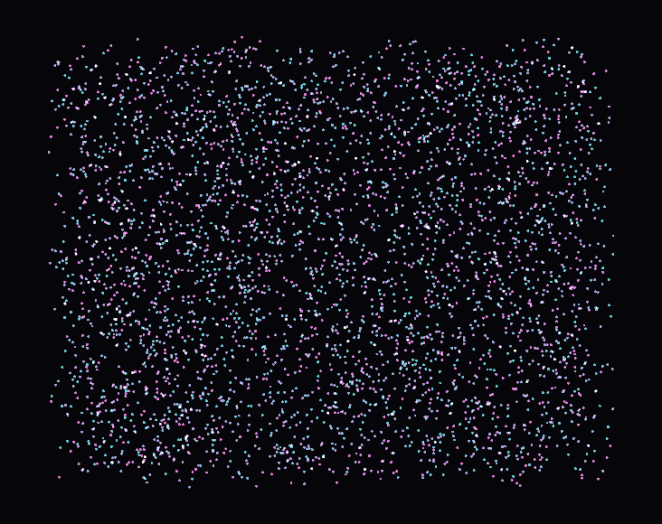

# 🟧 4. The GPU layer

The first layer speaks **shader**. You write GLSL, fill the data with the names the shader declares, and call `draw()`. In this page you learn the naming contract, typed vertices, errors, compute shaders, and the tools for the cases where one `Drawable` is not enough.

| | |
|---|---|
| **Entry point** | `compages::gpu::Drawable` |
| **Header** | `<Compages/GPU/GPU.hpp>` |
| **Code** | `include/Compages/GPU/`, implementation in `src/GPU/` |
| **Not in this layer** | the window, entities, model files |

The commented triangle is in [chapter 3 §1](03-Tutorial.md#-1-a-triangle-named-by-the-shader).



---

## 🔌 1. Create the device

```cpp
#include <Compages/GPU/GPU.hpp>

if (auto ready = compages::gpu::init(glfwGetProcAddress); !ready)
    return fail(ready.error());

// ... frames ...

compages::gpu::shutdown();
```

`init` loads the OpenGL functions. The OpenGL 4.5 core context must already be current.

---

## 🔖 2. The naming contract

```cpp
compages::gpu::Drawable mesh;
COMPAGES_TRY(mesh.load(vertex_src, fragment_src));

mesh["position"] = positions;                                // attribute: one value per vertex
mesh["tint"]     = compages::core::Vector3f{ 1, 0.5f, 0.2f }; // uniform
mesh["image"]    = texture;                                  // sampler: the texture must outlive the drawable
mesh["time"]     = elapsed;                                  // uniform

compages::gpu::clear({ 0.08f, 0.09f, 0.12f });
mesh.draw();
```

`operator[]` does not guess: the shader already classified each name as an attribute, a uniform or a sampler. The same syntax works for the three.

- Attributes given one by one are **stored interleaved** (position, color, position, color…): the layout the GPU reads best.
- Assigning an attribute marks a **dirty range**; `draw()` sends only this range. In `02_DynamicGeometry`, moving the top vertex sends one vertex out of three. `00b_CpuGpuSync` shows the same on a raw `Buffer`, with orange bars for the bytes the GPU does not have yet (there you call `upload()` yourself).
- Uniforms are written at each draw. A texture gets a unit and is bound only for the draw.

---

## 🧬 3. Typed vertices

When your data is already a struct, the field names must match the attribute names:

```cpp
struct Vertex
{
    compages::core::Vector2f position;
    compages::core::Vector3f color;
};

mesh.vertices<Vertex>({
    { { -0.8f, -0.6f }, { 1, 0, 0 } },
    { {  0.8f, -0.6f }, { 0, 1, 0 } },
    { {  0.0f,  0.8f }, { 0, 0, 1 } },
});

mesh.vertex<Vertex>(2u).position.y = 0.5f;   // marked dirty, sent at the next draw
```

A buffer that never changes can be immutable, without CPU mirror (`01c_InterleavedTriangle`):

```cpp
COMPAGES_TRY_ASSIGN(vertices,
    compages::gpu::Buffer<Vertex>::from(corners,
        { .usage = compages::gpu::BufferUsage::Immutable, .cpu_mirror = false }));
mesh.vertices(vertices);
```

The drawable reads this buffer where it is: no copy.

---

## 🚨 4. Errors

| When | Mechanism |
|------|-----------|
| a shader does not compile | the `Status` of `load`, often through `COMPAGES_TRY` |
| unknown name, wrong type, empty draw | a frame message |

```cpp
const std::string err = compages::gpu::takeFrameError();   // "" when nothing happened
```

Only the first message is kept; `frameErrorCount()` says how many came after. `prepare()` at the end of the setup runs these checks before the main loop. `setBreakOnError(true)` stops the debugger on the faulty line. More in [chapter 10](10-Debugging.md).

---

## 🧮 5. Compute

A compute shader does not draw pixels: you give it a grid. The same `Buffer` can be the storage block it writes and the vertices of the next draw, with no copy through the CPU. This is `12_ComputeParticles`:

```cpp
COMPAGES_TRY(step.dispatchItems(count));
compages::gpu::barrier(compages::gpu::Barrier::VertexAttrib);
points.draw();
```

> ⚡ `barrier` is **not** added after a dispatch for you: the GPU may run ahead. A missing barrier gives a race, not a compile error. Combine the flags with `|` (`VertexAttrib`, `Storage`, `Command`, `All`… in `GPU/Core/Enums.hpp`).

- `00c_Compute` is the smallest one: an array of numbers, then `download()` brings the result back to the CPU (orange bars while the CPU copy is late).
- `13_Galaxy`: two ping-pong buffers, eight thousand stars, tiles in work group memory (see below).
- `14_SpiralGalaxy`, inspired by Glumpy: no gravity, ellipses whose tilt depends on the radius; the temperature is a coordinate in a 1D texture (the black-body ramp); additive point sprites. Each frame only the position and the size are written; `draw()` sends what is dirty.

### 🏓 Ping-pong: read one copy, write the other

A simulation step computes the new state from the old one. Each cell (a star, a pixel) reads its neighbours. The GPU runs thousands of cells at the same time, in no order you know. If the step read and wrote **the same** buffer, a cell could read a neighbour that is already new, or half written: the result would change from one run to the next. This is a race, and the GPU gives no error for it.

So the state is kept twice, A and B. One step reads A and writes B; the next one reads B and writes A:

```text
step 1:   A (old) --read--> shader --write--> B (new)
step 2:   B (old) --read--> shader --write--> A (new)
step 3:   A (old) --read--> shader --write--> B (new)
```

Nothing is copied: only the roles change. Between two steps, a `barrier` makes the writes of one step visible to the reads of the next (and to the draw).

For buffers, `gpu::PingPong<T>` holds the two copies. `input()` is the one to read, `output()` the one to write, and `swap()` exchanges them. After `swap()`, `input()` is what was just written: the latest state, which the drawable shows and the next step reads. This is the loop of `13_Galaxy`:

```cpp
// setUp: the first state, in both buffers.
COMPAGES_TRY_ASSIGN(m_stars, compages::gpu::PingPong<Star>::from(std::span<const Star>(stars)));

// Each frame:
m_step.bind("Input", m_stars.input());     // readonly buffer Input in the shader
m_step.bind("Output", m_stars.output());   // writeonly buffer Output
m_step.dispatchItems(COUNT);
compages::gpu::barrier(compages::gpu::Barrier::Storage | compages::gpu::Barrier::VertexAttrib);
m_stars.swap();                            // what was written is now input()
m_points.vertices(m_stars.input());        // draw the latest state, no copy
m_points.draw();
```

For pictures, the idea is the same with two `Texture`, each wired to a `Framebuffer`, and an index that says which one is current (`11a_GameOfLife`, `11b_GrayScott`, `54_SweatAndDecals`). A fragment shader must not sample the texture it draws into, for the same reason:

```cpp
const int next = 1 - m_current;
m_step["previous"] = m_field[m_current];                 // read the current one
compages::gpu::RenderPass into(m_target[next], { .clear_color = false });
m_step.draw(3u);                                         // write the other one
m_current = next;                                        // it becomes current
```

A render pass makes its writes visible to the next pass by itself; a compute dispatch needs the `barrier`.

To see the numbers on the CPU, read the current copy back: `m_stars.input().read()` returns a `std::vector<T>` (`13_Galaxy` writes it to `galaxy.csv`); `buffer.download()` refreshes the CPU copy of a buffer that keeps one (`00c_Compute`). Both make the CPU wait for the GPU: do it once, not every frame. The helper script `examples/10_ScientificAndCompute/13_Galaxy_plot_xy.py` displays the star positions from that CSV with matplotlib.

---

## 🧰 6. When one Drawable is not enough

| Need | Types | Demo |
|------|-------|------|
| one mesh, several shaders | `Buffer<Vertex>`, `Pipeline`, `Program` | `05a_MultiPassMesh` |
| draw into an image | `Framebuffer`, `RenderPass`, `Texture` | `05b_RenderToTexture`, `05c_PostProcess` |
| cellular automaton on an image | two `Texture`, swapped | `11a_GameOfLife`, `11b_GrayScott` |
| compute writes the vertices | `ComputeProgram`, `Buffer`, `barrier` | `12_ComputeParticles`, `13_Galaxy` |
| the CPU never counts the survivors | compute → indirect draw command | `21_IndirectDraw` |
| height field computed on the CPU | dynamic vertices, fixed indices | `10a_HeightMap`, `10b_Terrain3D` |

`05a_MultiPassMesh` is the milestone: one `Buffer<Vertex>`, three programs (lit, normals, wireframe). Each `Pipeline::create<Vertex>(program, state)` checks that the shader can read this struct. An attribute dropped by the linker is accepted; a type mismatch is not. So the layout is declared **on the C++ side**: the shader does not guess it, and you never write `glVertexAttribPointer`.

---

## 🎚 7. Passes and state

- `gpu::clear(color)` clears the current target.
- A `RenderPass` sets the viewport, clears, and chooses the target (framebuffer or window). `01a_ClearScreen` opens two passes, one per half of the window, without shader.
- `drawable.state().depth_test = true` (also blending, culling, primitive) belongs to the drawable. The pipeline is rebuilt only when the state changes. `04_DepthAndTransforms` uses depth test and back-face culling.
- `gpu::forgetRenderState()`: call it after another library (ImGui in the gallery) touched the context, so that the backend stops trusting its cached state.

Driver messages (`KHR_debug`) go to stderr as `[gpu] warning:` and `[gpu] error:`.

---

## 🎫 8. Handles

Driver objects live in pools: an index plus a generation. Destroying twice does nothing. A `Buffer<T>` cannot be copied. The gallery `--check` verifies that closing a demo brings every counter back to zero: destroying your objects is enough, no `tearDown()` to write.

---

## 🧭 9. Gallery path for this layer

Read them in this order; each demo adds one idea:

1. `00b_CpuGpuSync` — CPU copy, pending range.
2. `00c_Compute` — one computation, one read-back.
3. `01b_Triangle` then `01c_InterleavedTriangle` — by name, then by struct.
4. `02_DynamicGeometry` — one dirty vertex.
5. `04_DepthAndTransforms` — indices, depth, matrices.
6. `05a_MultiPassMesh` — one buffer, three readers.
7. `06a_Mandelbrot` — no vertex buffer, only `gl_VertexID`.
8. `11a_GameOfLife` → `12_ComputeParticles` → `13_Galaxy` → `14_SpiralGalaxy` → `16_NeuralNetwork` (three compute passes in a row).

All demos: [chapter 9](09-Examples.md).

Next: [05-World-Layer.md](05-World-Layer.md) — placing things without the GPU.
