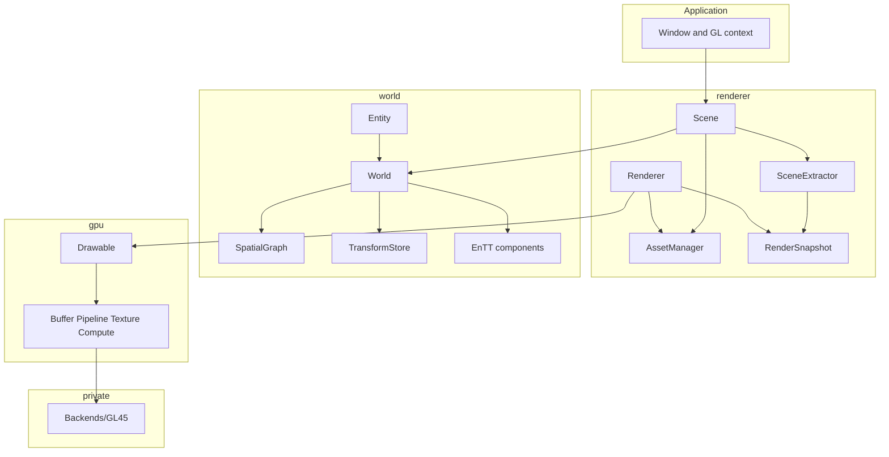

# 🏗 7. Architecture

The *why* of the layers is in [chapter 1](01-Introduction.md#-3-three-layers). This page says *where* the code lives, *who may include whom*, and *what happens* during one frame. Read it before you change Compages itself.

---

## 🧭 1. Overview



`Core/` (vectors, matrices, `Result`, `Frame`, files) is the shared vocabulary, in the `compages::core` namespace. It is not a fourth layer: no simulation and no drawing starts there.

---

## 🚧 2. Who may include whom

| Layer | Entry point | May include | Never includes |
|-------|-------------|-------------|----------------|
| `compages::gpu` | `Drawable` | `Core` | `World`, `Renderer`, any `gl*` in public headers |
| `compages::world` | `World`, `Entity` | `Core` | `GPU`, `Renderer` |
| `compages::renderer` | `Scene` | `World`, `GPU`, `Core` | window code |

```cpp
#include <Compages/Compages.hpp>       // the whole stack
#include <Compages/GPU/GPU.hpp>        // layer 1
#include <Compages/World/World.hpp>    // ids, each, update
#include <Compages/World/Entity.hpp>   // chaining
#include <Compages/Renderer/Scene.hpp> // layer 3
```

The only code that includes glad is `src/GPU/Backends/GL45/`. The `GPU_BACKEND` variable of `Makefile.common` chooses which backend folder is compiled; callers of `gpu::` change nothing.

---

## 📁 3. Folders

```text
include/Compages/          the public interface, installed
  Core/                    vectors, matrices, Result, Frame, AABB, units
  GPU/                     Drawable, Buffer, Compute, Texture, Pipeline...
  World/                   World, Entity, Behavior, Components/, Spatial/ (joints), Controllers/
  Renderer/                Scene, Assets/, Render/ (extraction, snapshot, renderer)
src/
  Core/                    File.cpp
  GPU/                     implementation + Backends/GL45/ (glad is private here)
  World/                   World, Entity, Spatial/, Controllers/
  Renderer/                Scene, Assets/, Render/, Systems/
examples/                  the gallery, one binary; Common/ holds the window and the manifest
tests/                     GPU, World, Renderer
attic/Physics/             ReactPhysics3D adapter, not in the build
external/manifest          the third-party repositories
```

`include/` is the contract; `src/` is not installed.

---

## 🟧 4. GPU layer

An OpenGL program is a shader with named data. `Drawable::operator[]` and `vertices<T>()` fill the CPU mirror; `draw()` sends the dirty ranges, then the draw call.

| Type | Role |
|------|------|
| `Buffer<T>` | CPU mirror, storage buffer, shared between compute and draw |
| `Pipeline`, `Program` | one mesh, several shaders |
| `Texture`, `Framebuffer`, `RenderPass` | targets, post-processing |
| `ComputeProgram`, `barrier` | compute grids |
| `UniformBlock` | uniform blocks shared by several passes |

Handles live in pools (index + generation). Destroying twice is harmless. `Buffer<T>` cannot be copied.

---

## 🟦 5. World layer

1. **Graph**: `SpatialGraph` (parent, first child, sibling) and `TransformStore` (local, world, dirty bit). Propagation from parent to child.
2. **ECS**: EnTT. `Entity` is the chaining handle; `EntityId` is what you store.

`World::update(Frame)` runs all behaviors; then `update()` without argument runs the joints (`KinematicSystem`) and computes the matrices (`TransformSystem`).

`Orbit` and `Fly` are behaviors of `World/Controllers/Controls.hpp`, reading a `ViewFrame`. `FPSController` is a separate class, used through `apply`; it draws nothing.

---

## 🟩 6. Renderer layer

| Job | Classes |
|-----|---------|
| asset catalog | `AssetManager`, glTF / STL / URDF loaders, `CanvasTexture` |
| instancing | `load`, `instantiate`, prefabs |
| drawing a frame | `SceneExtractor` → `RenderSnapshot` → `Renderer` |

```text
Scene::draw(ViewFrame)
  Scene::update
    World::update(frame)
    AnimationSystem
    World::update()
    skinning on SkinInstance
  Scene::render
    SceneExtractor
    Renderer  ->  gpu::
```

`scene.box(...)` returns a `world::Entity`: layer 2 goes on under layer 3.

---

## 🎭 7. Four actors per frame

```text
application    context, input, ViewFrame
world          entities, behaviors, joints, matrices
renderer       drawing, asset ids resolved
gpu            sends the CPU changes to the backend, draws and dispatches
```

- `compages::core::Frame`: time and size. Enough for a headless simulation.
- `compages::world::ViewFrame`: a `Frame` plus input.

---

## 🚪 8. Where to enter the code

| Goal | File | Demo |
|------|------|------|
| triangle | `GPU/Drawable.hpp` | `01b_Triangle` |
| compute | `GPU/Compute.hpp` | `12_ComputeParticles` |
| headless world | `World/World.hpp` | `30_HeadlessWorld` |
| joints | `World/Spatial/Joint.hpp` | `38_RobotArm` |
| scene | `Renderer/Scene.hpp` | `50_ThreeJsLike` |
| extraction | `Renderer/Render/SceneExtractor.hpp` | renderer tests |
| assets | `Renderer/Assets/` | `34_GltfModel` |

---

## 🪟 9. Window and physics

- GLFW exists only in `examples/Common/Window.cpp`. After the ImGui panels of the gallery, `gpu::forgetRenderState()` resets the cached state of the backend.
- `attic/Physics/` is a ReactPhysics3D adapter, out of the build. The plan is to bring it back as `world::` components and a system; the renderer would show the result, never simulate collisions.

---

## 🔨 10. Build

Install and options: [chapter 2](02-Getting-Started.md).

```text
make download-external-libs
make compile-external-libs
make -j"$(nproc)"
make tests -j"$(nproc)"
```

Next: [08-API-Reference.md](08-API-Reference.md).
