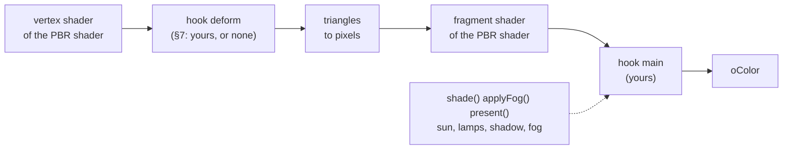
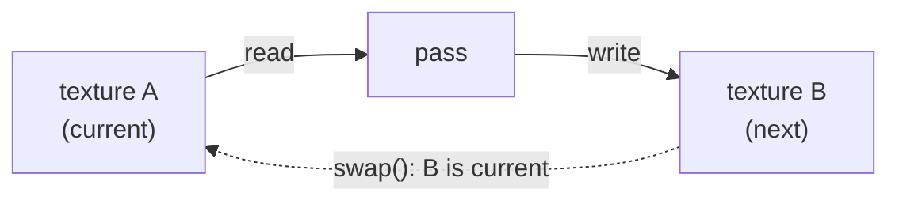

# 🎓 12. Going further: one technique at a time

You can now create and move a scene. This chapter extends the [complete program from chapter 3](03-Tutorial.md#-5-your-own-window-a-complete-program). It starts with ready-made operations, then shows how to create your own geometry and shaders, and finally how to combine several GPU steps.

**Before you start:** run that program, change a colour and explain its frame loop. You need no equations for the first steps. For shader customization (§6–9), also read [the naming contract](04-GPU-Layer.md#-2-the-naming-contract) and be comfortable with basic GLSL.

These are **guided excerpts from real demos**, not nine blocks to paste into one file. Each source link identifies the surrounding implementation. Names such as `m_scene` refer to members of that demo; constants, helper functions and assets remain in its source. Start the named demo, follow the data in the excerpt, and change one value in the original code before adapting it to your own application.

| Step | You want to… | New idea | Demo |
|------|--------------|----------|------|
| 1 | Show numbers as colours or heights | `Field`, `scene.show` | `11a_HeatPlate` |
| 2 | Select an object with the mouse | Picking from the last rendered view | `06l_CanvasPaint` |
| 3 | See through a surface | Opacity and drawing order | `10f_FlowingWater` |
| 4 | Make a texture from calculated pixels | Image format and upload | `10f_FlowingWater` |
| 5 | Build a shape from triangles | Mesh vertices, indices and bounds | `10f_FlowingWater` |
| 6 | Change surface shading | The fragment hook `main` | `10f_FlowingWater` |
| 7 | Move a surface in a shader | The vertex hook `deform` | `10e_Archipelago` |
| 8 | Read field values in your own shader | `Texture::fromField` | `10f_FlowingWater` |
| 9 | Keep a simulation on the GPU | Passes and ping-pong | `10c_SweatAndDecals` |

Follow the first three steps for a data viewer. Continue with §4–7 for custom surfaces; finish with §8–9 for GPU simulations. The [glossary](01-Introduction.md#-2-the-words-you-will-meet) explains the vocabulary.

---

## 🗺 1. Values on a grid: `Field`

📁 `examples/11_Science/11a_HeatPlate.cpp`, `11g_FlowAroundCylinder.cpp` · more in [chapter 6 §7](06-Renderer-Layer.md#show-a-field-heat-maps-and-coloured-reliefs)

Start with data you can inspect: each grid point holds one number, and the Renderer turns the numbers into a picture. The calculation of those numbers remains your code.

### Start in your own program

In `scene.cpp` from chapter 3, add this after creating the cube and before `scene.prepare()`. It uses the field-display pattern from `11a_HeatPlate`, with nine fixed values so you can inspect them:

```cpp
const compages::Grid2D grid{ .columns = 3, .rows = 3,
                             .origin = { -1.0f, -1.0f }, .spacing = 1.0f };
compages::Field<float> temperature(grid, 20.0f);
temperature(1, 1) = 100.0f;
compages::renderer::FieldLook look{
    .colors = compages::renderer::ColorMap::Inferno,
    .low = 20.0f, .high = 100.0f, .relief = 0.0f, .lit = false };
compages::world::Entity plate = scene.show(temperature, look, "Plate");
cube.position(0.0f, 1.0f, 0.0f); // Keep the cube above the field.
scene.camera().position(0.0f, 2.0f, 5.0f).lookAt(0.0f, 0.0f, 0.0f);
```

The result is a flat coloured square on the ground with a hot centre. The colours interpolate across the surface; the field still stores only nine temperatures. If you later change a value, update the existing entity before drawing:

```cpp
temperature(1, 1) = 60.0f;
if (auto shown = scene.show(plate, temperature, look); !shown)
{
    std::cerr << shown.error() << '\n';
    return 1; // Inside run(), which returns an integer.
}
```

The centre changes colour. Set `look.relief = 0.01f` before updating the display to show the same values as height. Neither operation simulates heat: you are choosing how to display the values.

### Follow the demo implementation

A `Grid2D` says where points are: columns, rows, the first point, the step. A `Field<T>` holds one value per point, in one array. A field of a million points is one object, never a million entities.

```cpp
const compages::Grid2D grid{ .columns = POINTS,
                             .rows = POINTS,
                             .origin = { -0.5f * WIDTH, -0.5f * WIDTH },
                             .spacing = spacing };
m_temperature = compages::Field<float>(grid, ROOM);
// ...
m_plate = m_scene.show(m_temperature, m_look, "Plate");          // once
COMPAGES_TRY(m_scene.show(m_plate, m_temperature, m_look));     // each frame, new values
```

| Call | Does |
|------|------|
| `field(i, j)`, `field[k]` | the value of a point |
| `field.sample({ x, z })` | the value at any place, mixed from the four points around (bilinear) |
| `grid.point(k)`, `grid.nearest(p)`, `grid.neighbours8(k)` | from a point to its place, and back; its neighbours |
| `scene.show(Field<float>, FieldLook)` | a heat map, with relief or not |
| `scene.show(Field<Vector2f>, ArrowLook)` | arrows |
| `scene.probe(field, look, pixel)` | the point and the value under the mouse |

`10f` shows its flow as arrows with the same call (Try it → Arrows), and its floating crates read the flow where they are with `sample()`.

`sample()` mixes the four points round a place (bilinear interpolation), and a `CurvilinearGrid` places each point freely, fitted round a shape. [Chapter 14 §0](14-Science-With-Fields.md#-0-fields-in-five-minutes) gives the formulas, and the rest of chapter 14 the physics of the `11_Science` demos.

**Check it:** In `11a_HeatPlate`, change only the colour range. The picture changes, but the temperature values and the simulated heat flow stay the same. Display settings and simulation rules have separate jobs.

---

## 🖱 2. What is under the mouse

📁 `examples/06_Scene/06l_CanvasPaint.cpp`, `examples/10_Complete/10f_FlowingWater.cpp` (`click`)

Picking answers a concrete question: which object was drawn under this mouse pixel? It uses the view from the last render, so wait until a first frame has been drawn.

`scene.pick(pixel)` gives the nearest shape under a pixel and the point it hits, as the last render saw it:

```cpp
if (p_frame.input.mouse_left)
{
    if (auto hit = m_scene.pick(p_frame.input.mouse))
    {
        if (hit->entity == m_canvas.id())
        {
            // hit->point is in world space
        }
    }
}
```

When you want a plane rather than a shape, make the ray yourself from the camera of the last render: two points of the pixel, unprojected.

```cpp
const compages::Vector4f eye = camera.inverse_projection * compages::Vector4f(x, y, p_depth, 1.0f);
const compages::Vector4f world = camera.inverse_view * compages::Vector4f(eye.x / eye.w, eye.y / eye.w, eye.z / eye.w, 1.0f);
```

- The pixel starts at the bottom left (`Input::mouse`), like OpenGL.
- `lastCamera()` is empty before the first render: check `viewport_width`.
- In the gallery the right button turns the camera (`Orbit`), so the left button is free for the demo.

**Check it:** Run `06l_CanvasPaint`, click the surface, then move the camera and click again. The picked world point changes with the view. Mouse pixels and world coordinates are different kinds of position.

---

## 🫥 3. Things you can see through

📁 `examples/10_Complete/10f_FlowingWater.cpp` (`makeJet`) · more in [chapter 6 §1](06-Renderer-Layer.md#looks)

A transparent surface blends its colour with the picture behind it. The Renderer must draw solid shapes first, then transparent ones in distance order.

For an ordinary shape, start with the ready-made look from the Renderer. In the setup of `scene.cpp`, before `prepare()`, add:

```cpp
scene.box("Glass", compages::renderer::seeThrough(
    compages::renderer::color(0.2f, 0.7f, 0.9f), 0.35f))
    .position(0.0f, 0.0f, 1.0f);
```

You should see the original cube through a tinted box placed in front of it. Opacity 1 is solid; 0 is fully transparent.

For a custom shader, the following excerpt shows the same choice at material level. Return to it after §6.

A see-through material gives a second state to `Material::create`. The Renderer uses it for a shape whose opacity is under one: such shapes are drawn after the solid ones, from the farthest, blended, without writing the depth.

```cpp
.state = { .depth_test = true, .cull = compages::gpu::CullMode::None },
.see_through = compages::gpu::RenderState{ .depth_test = true,
                                           .depth_write = false,
                                           .blend = compages::gpu::Blend::alpha(),
                                           .cull = compages::gpu::CullMode::None } }
// ...
renderer.flags = compages::renderer::RenderFlags::NoShadowCaster;
instance->opacity = 0.99f;
```

- `CullMode::None` draws both faces: the far side of the jet shows through the near one.
- Water casts no shadow: `RenderFlags::NoShadowCaster`.
- The shader writes its alpha into `oColor.a`, times `opacity`.

**Check it:** In the water demo, compare the jet with opacity near one and a lower opacity. Look through it at a solid object. Intersecting transparent objects can still reveal the limits of per-object sorting.

---

## 🖼 4. A picture made by the program

📁 `examples/10_Complete/FlowingWater/Pictures.cpp` · more in [chapter 4](04-GPU-Layer.md)

An image can come from a calculation as well as a file. Your code makes the pixel array; a GPU texture stores the image the shader will read.

A texture is an image in GPU memory. You can fill it from bytes you computed: noise, a normal map, concrete. Describe it, write the pixels, build the smaller copies used from afar (**mipmaps**), and give it to the assets of the scene:

```cpp
compages::gpu::TextureDesc desc =
    compages::gpu::TextureDesc::image(std::uint32_t(p_picture.size), std::uint32_t(p_picture.size),
                                      p_srgb ? compages::gpu::PixelFormat::SRGB8A8
                                             : compages::gpu::PixelFormat::RGBA8)
        .wrap(compages::gpu::Wrap::Repeat);
desc.levels = 0u;                       // as many mipmaps as the size allows
compages::renderer::TextureAsset asset;
asset.name = p_name;
COMPAGES_TRY_ASSIGN(asset.texture, compages::gpu::Texture::create(desc));
COMPAGES_TRY(asset.texture.write(std::as_bytes(std::span(p_picture.rgba))));
COMPAGES_TRY(asset.texture.generateMipmaps());
asset.description = desc;
return p_scene.assets().addTexture(p_name, std::move(asset));
```

- **sRGB** for colours painted for the eye (concrete, foam); plain `RGBA8` for numbers (noise, normals). The GPU turns sRGB into linear light when it reads, so the filtering stays right.
- `Wrap::Repeat` and a picture that **tiles** (its right edge meets its left edge): `tiledNoise()` wraps its lattice every `period` cells, so the noise has no seam.
- Rows start from the bottom.

**Check it:** In `FlowingWater/Pictures.cpp`, follow one pixel from its generated RGBA bytes to `Texture::write`. Find which images hold colours and which hold numerical data before changing the format.

---

## 🧱 5. A mesh made by hand

📁 `examples/10_Complete/FlowingWater/Spout.cpp` · more in [chapter 6 §1](06-Renderer-Layer.md#-1-build-a-scene)

A ready-made box hides its triangles. A custom mesh gives you the same ingredients explicitly: points, surface directions, texture coordinates, and the indices that join three corners.

A mesh is a list of corners (**vertices**: position, normal, texture coordinates) and a list of triangles (three indices into the corners). The jet of water of `10f` is a tube along the path of a thrown body, one ring of corners after another:

```cpp
compages::renderer::MeshVertex vertex;
vertex.position = centre + (out * radius);
vertex.normal = out;
vertex.uv = compages::Vector2f(float(k) / float(AROUND), length);   // round, along
mesh.source_vertices.push_back(vertex);
// ...two triangles between ring a and ring b:
p_mesh.source_indices.insert(p_mesh.source_indices.end(),
                             { a + k, b + k, a + k + 1u, a + k + 1u, b + k, b + k + 1u });
// ...at the end
p_mesh.index_count = p_mesh.source_indices.size();
p_mesh.local_bounds = compages::AABB::fromCorners(low, high);
```

```cpp
m_jet_body = m_scene.mesh(flowing::jetMesh(m_jet, LEVEL), "Water jet");
```

- `scene.mesh(mesh, name)` returns an entity, like `box()`. `scene.reshape(entity, mesh)` replaces its mesh later (`10e` does it for its tiles).
- `local_bounds` is the box around the corners: the Renderer skips a mesh outside the view, and `pick()` tests it.
- The corners stay on the CPU in `source_vertices`: `10f` reads them back to find where the scene meets the water (step 1 of [chapter 13 §3](13-Complete-Demos.md#-3-10f_flowingwater-water-that-flows-round-things)).

**Check it:** In `FlowingWater/Spout.cpp`, find the two triangles joining neighbouring rings. Reducing the number of corners around a ring makes the tube more angular; its centre path stays the same.

---

## 🎨 6. Your own look: the hook `main`

📁 `examples/10_Complete/10f_FlowingWater.cpp`, `FlowingWater/Shaders.hpp` · more in [chapter 6 §7](06-Renderer-Layer.md#your-own-material-hooks-of-the-pbr-shader)

A custom fragment shader changes the appearance of a surface. Keep the Renderer’s lights and camera, and replace only the part that computes the final pixel colour.

`color(...)` and `texture(...)` cover the simple cases. For anything else, write the `main()` of the fragment shader yourself, and keep the rest of the PBR shader of the Renderer: its sun, its lamps, its shadow, its fog and its tone curve. The PBR shader leaves a hole called a **hook** for it:

```cpp
compages::renderer::shaders::ShaderPair shaders = compages::renderer::shaders::pbr();
shaders.fragment().hook("main", flowing::SOLID_MAIN);
compages::renderer::Material material;
COMPAGES_TRY_ASSIGN(material,
                    compages::renderer::Material::create(
                        p_name, { .family = compages::renderer::ShaderFamily::PbrMinimal,
                                  .shaders = std::move(shaders),
                                  .state = { .depth_test = true, .cull = compages::gpu::CullMode::Back },
                                  .see_through = std::nullopt }));
material.textures = { { .sampler = "surfaceMap", .texture = p_picture } };
return m_scene.assets().addMaterial(material.name, std::move(material));
```



Your `main()` sees what the PBR shader declares: `vWorldPos`, `vNormal`, `vUv`, `baseColorFactor`, and the functions `shade(base, normal, position)`, `applyFog(colour, position)` and `present(colour)`. It writes `oColor`. Here, a picture projected along the three axes and blended by the normal (**triplanar mapping**): long walls need no texture coordinates.

```glsl
uniform sampler2D surfaceMap;
uniform float tileMetres;
uniform float waterLevel;

void main()
{
    vec3 n = normalize(vNormal);
    vec3 w = pow(abs(n), vec3(4.0));
    w /= (w.x + w.y + w.z);
    vec3 p = vWorldPos / tileMetres;
    vec3 c = texture(surfaceMap, p.zy).rgb * w.x + texture(surfaceMap, p.xz).rgb * w.y
           + texture(surfaceMap, p.xy).rgb * w.z;
    vec3 base = c * baseColorFactor;
    // ... darker and slimy near the water ...
    oColor = vec4(present(applyFog(shade(base, n, vWorldPos), vWorldPos)), opacity);
}
```

Then a shape wears it, and each frame you give its uniforms:

```cpp
m_scene.look(p_entity, p_material);
// each frame
material->program.set("tileMetres", 4.0f);
material->program.set("waterLevel", LEVEL);
```

- `material.textures` binds pictures to the samplers by name: the Renderer does it at each draw (at most five, units 2 to 6).
- One shader text, several materials: the concrete, the painted metal and the stripes of `10f` are three `Material`s of the same `SOLID_MAIN`, each with its own picture.
- Setting a uniform the shader does not use (or with the wrong type) is a **frame error**: `--check` fails. A GLSL compiler drops a uniform it never reads, so a uniform you set must really count in the result.
- A tint per shape: each shape has its own `MaterialInstance` (`base_color_factor`, in linear colours: `srgbToLinear(...)`).

**Check it:** In `FlowingWater/Shaders.hpp`, follow `surfaceMap` from its sampler declaration to the colour calculation. Then find the C++ texture binding with the same name. The two names must match.

---

## 🌊 7. Moving the vertices on the GPU: the hook `deform`

📁 `examples/10_Complete/Archipelago/Shaders.hpp` · more in [chapter 6 §7](06-Renderer-Layer.md#your-own-material-hooks-of-the-pbr-shader)

A vertex shader can move the corners of a mesh each frame. It changes the drawn surface; it does not rewrite the CPU geometry or move a World entity.

The vertex shader of the PBR shader has a hook too. It receives each corner in world space and may move it. The sea of `10e` is a flat grid that the hook lifts into waves:

```cpp
water.vertex()
    .include("archipelago/swells.glsl", swells)
    .hook("deform", SURFACE_WAVES);
```

```glsl
void deform(inout vec4 world, inout vec3 normal)
{
    world = displace(world);   // Gerstner waves, from the table of swells
    normal = gWaveNormal;
}
```

- `include(name, text)` gives GLSL text a name: here the table of swells, written by C++ (`swellsGlsl()`). The boats read the same table on the CPU (`swellHeight()`): they ride the waves that are drawn.
- When the vertex shader replaces `deform`, `Material::create` also makes the program of the sun shadow with it: the shadow follows the waves.

**Check it:** Follow the shared swell table in the archipelago demo: the shader draws waves and CPU code positions boats from the same formula. Shader deformation alone would leave the boats unaware of the waves.

---

## 🚚 8. A field sent to a shader

📁 `examples/10_Complete/10f_FlowingWater.cpp` · more in [chapter 4](04-GPU-Layer.md)

When a shader needs your field, copy its values into a texture. The CPU field and GPU texture are separate resources: editing the field does not automatically refresh the texture.

`show()` draws a field in a way chosen for you. When your own shader needs the values, send the field as a texture. A `Field` numbers its points like the texels of a texture, so the values go as they are:

```cpp
compages::renderer::TextureAsset flow;
flow.name = "Flow map";
COMPAGES_TRY_ASSIGN(flow.texture, compages::gpu::Texture::fromField(m_bake.packed()));
COMPAGES_TRY_ASSIGN(m_flow_map, m_scene.assets().addTexture(flow.name, std::move(flow)));
// later, after a change of the values:
flow->texture.write(std::as_bytes(m_bake.packed().values()));
```

- `float` → R32F, `Vector2f` → RG32F, `Vector4f` → RGBA32F; a `Field<T, Grid3D>` gives a 3D texture (`11f_Volume`).
- The shader reads it at the centre of the texel of a point: `uv = ((p - origin) / spacing + 0.5) / cells`.
- The same `Field` serves the CPU (`sample()`) and the GPU (the texture): the crates float on the water that is drawn.

**Check it:** Find the texture creation and the later `write` in `10f_FlowingWater.cpp`. Explain when a recalculated field must be uploaded, and why CPU sampling needs no upload.

---

## 🖌 9. Drawing into a texture: passes and ping-pong

📁 `examples/10_Complete/10c_SweatAndDecals.cpp` · more in [chapter 4 §5 and §7](04-GPU-Layer.md#-5-compute)

A simulation needs to preserve its previous state. Draw into a second texture, then swap the two roles so the next step reads the latest result.

The GPU layer draws into textures as well as onto the screen. A **pass** chooses where to draw (`RenderPass` on a `Framebuffer`). A simulation reads its state and writes the next one: two textures, read one, write the other, swap (**ping-pong**):

```cpp
for (int i = 0; i < steps; ++i)
{
    m_fluid_pass["previous"] = m_fluid.current();
    {
        compages::gpu::RenderPass const pass(
            m_fluid.next(), { .clear_color = false, .clear_depth = false });
        m_fluid_pass.draw(3u);          // one triangle that covers the texture
    }
    m_fluid.swap();
}
```



- `drawable["name"] = value` sets a uniform or binds a texture by the name of its sampler.
- `draw(3u)` with no vertices: the vertex shader makes the three corners from `gl_VertexID`, and one triangle covers the whole texture. Each pixel is one cell of the simulation.
- `10c` also draws the head **into its own UV map** (`gl_Position = vec4(uv * 2.0 - 1.0, 0.0, 1.0)`): one texel of the texture is then one piece of skin ([chapter 13 §1](13-Complete-Demos.md#-1-10c_sweatanddecals-a-simulation-on-the-skin)).

**Check it:** Trace two iterations on paper: A → B, then B → A. In `10c_SweatAndDecals`, find the pass scope and `swap()`. Swapping the roles copies no pixels.

---

## 📋 Summary

| I want to… | Call | Step |
|------------|------|------|
| keep values on a grid | `Grid2D`, `Field<T>`, `sample`, `scene.show` | 1 |
| know what is under the mouse | `scene.pick`, `lastCamera()` | 2 |
| draw something see-through | `see_through` state, `opacity < 1` | 3 |
| make a texture from bytes | `TextureDesc::image`, `Texture::create`, `write`, `generateMipmaps`, `addTexture` | 4 |
| make a mesh from corners | `MeshAsset`, `scene.mesh`, `scene.reshape` | 5 |
| write my own fragment shader and keep the lights | `shaders::pbr()`, `.hook("main", …)`, `Material::create` | 6 |
| give a uniform each frame | `material->program.set(name, value)` | 6 |
| move vertices on the GPU | `.hook("deform", …)`, `.include(name, text)` | 7 |
| give a field to my shader | `Texture::fromField`, `write(values())` | 8 |
| simulate on the GPU | `RenderPass`, `TexturePingPong`, `draw(3u)` | 9 |

## 🧩 Practice: build a small viewer

Use your `scene.cpp` from chapter 3 as the starting point. Build one small project before studying a complete demo:

1. Create a ground grid and two shapes. Give them different colours and meaningful names.
2. Add one movement rule that uses `frame.elapsed`. Leave the other shape still.
3. Show a scalar field with `scene.show` using the pattern in §1. Start with fixed values; a physics solver is optional.
4. Change the field values over time and update its displayed entity. Keep the colour range fixed so colour changes represent value changes.
5. Add picking from §2 after supplying `frame.input.mouse` and `mouse_left` from your window. Remember that picking uses the previous rendered camera.
6. Check setup and frame errors. Close the program cleanly.

**Done means:** you can explain where the data lives, which call changes the simulation, which call sends data to the GPU, and why one update is enough per frame. The image responds to your changes and the program reports no frame error.

For the next challenge, choose [Three complete demos](13-Complete-Demos.md) to combine rendering techniques, or [Science with fields](14-Science-With-Fields.md) to turn equations into calculations and pictures. Both are optional branches of the learning path.
