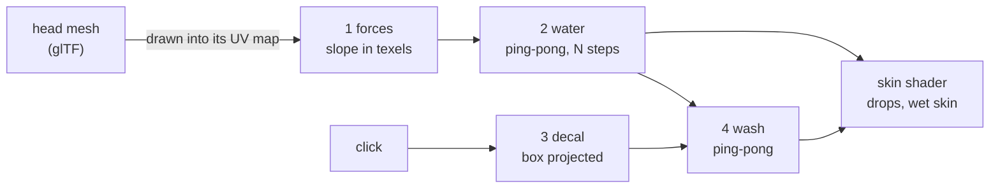
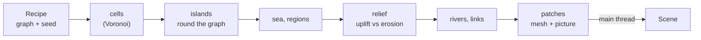
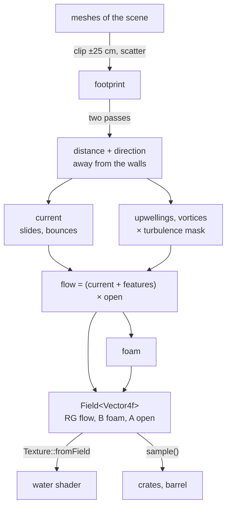

# 🏗 13. Three complete demos, step by step

The last demos of the gallery put the calls of [chapter 12](12-Going-Further.md) together, as a game or a tool would. This chapter rebuilds three of them in the order they were made. Each one adds a new kind of work:

| # | Demo | What it adds | Read first |
|---|------|--------------|------------|
| 1 | `10c_SweatAndDecals` | a simulation **on the GPU**, in the UV map of a mesh: several passes, ping-pong | chapter 12 §1, §8 |
| 2 | `10e_Archipelago` | a whole world **made on the CPU** in a thread: cells, erosion, rivers, levels of detail, a sea | chapter 12 §1, §3, §5, §6 |
| 3 | `10f_FlowingWater` | a technique of a game studio: a **flow map** baked from the scene, read by the GPU and the CPU | chapter 12 §1 to §7 |

Each part follows the code: one step, the file it lives in, the lines that matter, what to try. Open the demo next to the page: `./build/linux-gcc-debug/bin/Compages-examples 10c_SweatAndDecals`.

---

## 🧴 1. 10c_SweatAndDecals: a simulation on the skin


📁 `examples/10_Complete/10c_SweatAndDecals.cpp` (one file)

A head sweats. Drops form in the pores, run down the skin, leave a wet trail, and wash away the stickers (**decals**) you paint on it. Nothing is simulated in 3D: everything happens in textures laid on the skin.



### Step 1 — Load the head and keep its triangles

```cpp
COMPAGES_TRY_ASSIGN(m_root, m_scene.loadFile(head));
m_world.each<compages::renderer::MeshRenderer>(
    [this](compages::world::Entity p_entity,
           compages::renderer::MeshRenderer&) { m_head = p_entity; });
// The UV passes and the raycast need the triangles on the CPU.
compages::renderer::MeshAsset const* mesh = m_scene.assets().mesh(drawn.mesh);
m_vertices = mesh->source_vertices;
m_indices = mesh->source_indices;
```

`loadFile` reads the glTF file (the head of the three.js decals demo, Lee Perry-Smith) and returns the root entity. The mesh is found with `each<MeshRenderer>`. Its corners stay on the CPU: the passes draw them again, and the click finds the skin under the mouse with them.

### Step 2 — The skin: your own `main`

As in chapter 12 §1, the PBR shader keeps its lights and gets a new `main()` (`SKIN_MAIN`): the normal map, the decals, the drops. This demo binds its three extra textures by hand, on units 2, 3 and 4, before the render:

```cpp
material.program.set("normalMap", 2);
material.program.set("decalMap", 3);
material.program.set("fluidMap", 4);
// each frame
m_normal_map.bind(2u);
m_decals.current().bind(3u);
m_fluid.current().bind(4u);
m_scene.render();
```

The decal and water maps change every frame (ping-pong), so they are not fixed in `Material::textures`. The mesh has no tangents: the shader builds a tangent frame from the derivatives of the position and the UV (`bend()`, after C. Schüler).

### Step 3 — Draw the mesh into its own UV map

The key idea of the demo. The vertex shader puts each corner at its texture coordinate instead of its place on the screen:

```glsl
vec4 world = model * vec4(position, 1.0);
vWorldPos = world.xyz;
gl_Position = vec4(uv * 2.0 - 1.0, 0.0, 1.0);
```

Drawn into a 256 x 256 texture, each pixel of this pass is one texel of the skin, and still knows its 3D position. One texel is about a millimetre of skin, the size of a drop. No depth test, both faces: the winding in UV space can be anything.

### Step 4 — The force pass: which way is down, in texels

Gravity along the skin is the part of gravity $\mathbf{g}$ that is not along the normal $\mathbf{n}$:

```math
\mathbf{s} = \mathbf{g} - (\mathbf{g}\cdot\mathbf{n})\,\mathbf{n}
```

The water moves in texels, so the slope must be written in the frame of the UV map. In this pass, $\mathbf{p}_u$ = `dFdx(vWorldPos)` is the piece of skin one texel to the right covers, and $\mathbf{p}_v$ = `dFdy` the one above: the two tangents of the map. We want $(a, b)$ with $\mathbf{s} \approx a\,\mathbf{p}_u + b\,\mathbf{p}_v$, the best fit (least squares):

```math
\begin{pmatrix} \mathbf{p}_u\cdot\mathbf{p}_u & \mathbf{p}_u\cdot\mathbf{p}_v \\ \mathbf{p}_u\cdot\mathbf{p}_v & \mathbf{p}_v\cdot\mathbf{p}_v \end{pmatrix}
\begin{pmatrix} a \\ b \end{pmatrix}
=
\begin{pmatrix} \mathbf{s}\cdot\mathbf{p}_u \\ \mathbf{s}\cdot\mathbf{p}_v \end{pmatrix}
```

A 2 × 2 system, solved by its determinant:

```glsl
vec3 pu = dFdx(vWorldPos);
vec3 pv = dFdy(vWorldPos);
vec3 slope = gravity - dot(gravity, n) * n;
// Solve slope = a pu + b pv: the same move, counted in texels.
float e = dot(pu, pu);
float f = dot(pu, pv);
float g = dot(pv, pv);
float det = e * g - f * f;
flow = vec2(g * dot(slope, pu) - f * dot(slope, pv), e * dot(slope, pv) - f * dot(slope, pu)) / det;
```

It also writes where the skin faces down (drops fall there) and where it sweats (the forehead). The head turns (Pitch, Roll): the field is made again each frame.

### Step 5 — The water pass (ping-pong)

A texel holds at most one drop, and where the drop sits inside the texel: drops glide, they do not jump. Pores fill small beads. A bead heavier than a threshold runs down the force field. When it crosses the border of its texel, it goes to that neighbour (diagonals too) and leaves a thin film behind, the wet trail. It stops when it has left most of its water, at a threshold that changes from texel to texel (rough skin).

Each texel computes what its eight neighbours send to it, from their own state only. The water that moves is counted once on each side, so none is created on the way. The loop is chapter 12 §8: read `current()`, write `next()`, `swap()`, several steps per frame so that a drop moves at most one texel per step.

### Step 6 — Decals projected on the skin

A left click finds the skin under the mouse (a ray against the triangles kept in step 1). A box is placed in front of it, turned at random, as `DecalGeometry` of three.js does. The UV pass draws the skin again, and keeps only the texels inside the box:

```glsl
vec3 d = vWorldPos - center;
vec3 box = vec3(dot(d, right) / dot(right, right),
                dot(d, up) / dot(up, up),
                dot(d, forward) / dot(forward, forward));
if (any(greaterThan(abs(box), vec3(1.0))) ||
    dot(normalize(vNormal), -normalize(forward)) < 0.2)
{
    discard;
}
vec4 color = texture(picture, box.xy * 0.5 + 0.5);
```

The picture is blended into the decal map (1024 x 1024).

### Step 7 — The wash pass

Where a drop runs, the paint is read from upstream (`uv - flow * dt`): it is carried down in streaks. Wherever there is water, the paint fades (Washing in Try it). Another ping-pong, on the decal map.

### Step 8 — The drops, drawn round

The skin shader looks at the 5 x 5 texels around each pixel. Each drop is a small round cap at its place, its radius the cube root of its water $V$ (a volume grows as the cube of a length), and its height a paraboloid:

```math
r = 1.2\,V^{1/3}, \qquad z(\mathbf{d}) = 0.45\,r\left(1 - \frac{|\mathbf{d}|^2}{r^2}\right)
```

 Caps of nearby drops add up, so drops that touch merge. A drop is darker, a sharp mirror of the sun and of a window of light above the viewer, with the Fresnel rim of water (2 %).

### The frame, in order

```cpp
m_scene.update(p_frame);     // the head turns
computeForces();             // pass 1
simulate(p_frame.elapsed);   // pass 2, several steps
wash(p_frame.elapsed);       // pass 4 (pass 3 on a click)
m_scene.render();            // the skin reads the maps
```

Try it: left click paints a decal or drops water, Pitch and Roll tilt the head and the drops change their way. Water stops at the seams of the UV map: it cannot cross from one island of the map to the next. That is the limit of the idea.

---

## 🏝 2. 10e_Archipelago: a world made from a graph


📁 `examples/10_Complete/10e_Archipelago.cpp` and `examples/10_Complete/Archipelago/`, one file per part

A new take on Chréage, the map of knowledge of I. Aberkane's thesis ("Mind Ergonomy for the Knowledge Economy", 2016, chapter 11): web pages become places on islands. An island is a theme, a region is a topic, a link is a place on the bank of a river. The contents come from [IslandedBrowser](https://github.com/Lecrapouille/IslandedBrowser): `organize.py` groups bookmarks of Firefox, and `IslandedBrowser -d DIR --layout` writes the place of every node in a force directed layout (springs between similar pages). The demo reads `archipelago/bookmarks-layout.json` of Compages-data, or the file given by `COMPAGES_ARCHIPELAGO`; without it, a few pages of Wikipedia built in.

The map is 16 km wide. Every size is written with its unit (`toMetres(1.4_km)`), so a mistake of a factor 1000 does not compile.

| File | Part |
|------|------|
| `Knowledge` | reads the layout |
| `Placement` | fits the graph to the map |
| `Cells`, `Land`, `Shores`, `Relief`, `Geology`, `Strands`, `Rivers`, `Outlines` | the land, on the CPU, in stages |
| `Painting` | its picture |
| `Sea`, `Swells`, `Shaders.hpp` | the sea (hooks `deform` and `main`) |
| `FineTiles` | finer tiles near the camera |
| `Wildlife`, `Pins`, `Signs`, `Highlight`, `Panels`, `Browser` | what lives on the map, and the interface |

### Step 1 — A recipe, a thread, a progress bar

Making the land takes seconds. `setUp()` must not wait: it starts the work in a thread and returns. `Job<T>` (`Archipelago/Job.hpp`) is a `std::jthread` and a `std::future`:

```cpp
m_report = std::make_shared<Report>();
m_loading.start([recipe = std::move(recipe), report = m_report]()
                { return makeMap(recipe, *report); });
```

The thread writes how far it is into a `Report` under a mutex. The gallery asks `Example::progress()` each frame and shows a bar; `--check` waits for 1 before it counts frames. When the job is ready, `draw()` takes the result and gives it to the GPU (`finishLoading`). Only the main thread touches the GPU and the `Scene`.

```cpp
Land makeLand(Recipe const& p_recipe, Progress const& p_progress)
{
    making.land.sites = scatterSites(p_recipe.seed);
    shapeIslands(making);
    floodSea(making);
    divideRegions(making);
    raiseRelief(making);
    traceRivers(making);
    placeLinks(making);
    findPeaks(making);
    traceOutlines(making);
    return std::move(making.land);
}
```



The same seed gives the same map: Try it → Seed, Erosion steps, Generate.

### Step 2 — Cells: a Voronoi diagram on a `Grid2D`

As the thesis asks, after A. Patel's polygon maps, the map is made of **cells**: the places nearest to each of 96 x 96 points (a **Voronoi diagram**). There is one point (the **site**) per square of a grid, moved by up to 0.3 square:

```cpp
inline const compages::Grid2D CELL_GRID{
    .columns = CELLS,
    .rows = CELLS,
    .origin = compages::Vector2f((-0.5f * MAP) + (0.5f * CELL_SIZE),
                                 (-0.5f * MAP) + (0.5f * CELL_SIZE)),
    .spacing = CELL_SIZE
};
```

So the nearest site of a point is always among the 3 x 3 squares around it, and the neighbours of a cell are `CELL_GRID.neighbours8(c)`. Each value of a cell is a `Field` on this grid: `sites` (`Field<Vector2f>`), `elevations`, `islands_of`, `regions_of`, `parts_of`. No graph library, no million entities.

### Step 3 — Islands around the graph

The layout puts the islands far apart and their links close together. Each island gets a disc whose area is its share of the links, where the layout put it; the discs are pushed apart until a strait separates them. The land is the union of round shapes on the graph (discs on the nodes, capsules along the edges island → region → link), on coordinates bent by noise for the coasts. Each land cell belongs to the region of the nearest link of its island, so related links stay side by side. Water closed in by land is filled.

### Step 4 — Relief: uplift against erosion

The land is not drawn by hand. It grows by a simple geological model on the graph of the cells (Cordonnier et al. 2016). The plate rises under the islands (about 1 mm a year, more inland, 1.8 times more on the borders between regions, which become ridges), and the rivers cut it down by the **stream power law**:

`dh/dt = U - K A^½ S`

It cuts faster where a river drains more land (A) and where it is steeper (S). One step is 40 000 years, solved exactly from the sea upward (Braun and Willett 2013): a cell $i$ needs only the new height of the cell $r$ it drains to, at a distance $L$:

```math
h_i^{t+\Delta t} = \frac{h_i^{t} + U\,\Delta t + F\,h_r^{t+\Delta t}}{1 + F}, \qquad F = \frac{K\,\Delta t\,\sqrt{A_i}}{L}
```

No step is too long for it (it is implicit), which is why 40 000 years at once work. Pits are filled first (**priority flood**, Barnes et al. 2014: a lake overflows at its lowest pass), and the slopes creep.

```cpp
uplift[c] = UPLIFT * massif * (0.25f + (0.75f * heart)) * (1.0f + (RIDGE * ridge[c]));
// ...
p_making.drainage = erode(land.sites, p_making.ground, uplift, outlet,
                          p_making.recipe.erosion_steps, progress);
```

`erode()` returns the **drainage**: for each cell, the cell its water goes to, the order from the sea upward, and the area it drains. The next steps read it.

### Step 5 — Rivers, regions, links

The thesis maps contents "as loci along a strand": a river is a strand of places. Here an island is structured by its main river, the largest basin the erosion made. A region is a basin between ridges, drained by its tributary, which runs from its highest cell down to a river or the sea. A link is a cell of the region near the tributary, in the order of the layout along it, marked by a pin of the colour of the island.

Only these rivers are drawn: a smooth Catmull-Rom spline through their cells (the thesis tried Bézier, Catmull-Rom and B-splines), meanders of about eleven widths, a width that grows with the square root of the area drained. They dig their valley (a smooth V) and their bed into the mesh. The edges of the cells are faint inside a region, firmer around a link, bold between regions.

### Step 6 — From cells to a mesh and a picture

A `Patch` is a square of the map, ready for the GPU: its heights are a `Field<float>` (one per corner of its quads), its picture is the painted map. The ground at any point comes from one function, `Land::heightAt(x, z)` (the cells blended smoothly, a little roughness). A patch becomes a mesh by hand (chapter 12 §3) and a texture (§2).

### Step 7 — Levels of detail

One mesh for 16 km at 2 m would be far too heavy. The map is cut into 8 x 8 tiles of 2 km. From afar, one coarse mesh (a quad every 31 m) and one picture (16 m a pixel). Near the camera, `FineTiles` asks two threads for finer tiles (8 m, 2 m a pixel), which take the place of the coarse ones. A **skirt** (a strip hanging down along the edges) hides the cracks between a fine tile and a coarse one. At most twelve fine tiles live at once. Since the heights come from one function, a coarse and a fine tile agree.

Near the camera, the ground shader adds real pictures of grass, sand and rock (ambientCG, CC0), read at two scales and divided by their mean colour, so the colours of the map stay: sand on the beaches, rock on the steep slopes, grass elsewhere.

### Step 8 — The sea: one table of swells for the GPU and the CPU

Near the camera, a grid of 160 x 160 quads follows the camera. The hook `deform` (chapter 12 §5) lifts it with **Gerstner waves** (GPU Gems 1, chapter 1): a point of the water goes round a small circle, so the crests are sharp and the troughs wide. For swells of direction $\mathbf{d}_k$, wave number $k_k = 2\pi/\lambda_k$ and amplitude $A_k$:

```math
\phi_k = k_k\,(\mathbf{d}_k\cdot\mathbf{x}) - \omega_k\,t, \qquad
\mathbf{x}' = \mathbf{x} + \sum_k Q\,A_k\,\mathbf{d}_k \cos\phi_k, \qquad
y' = \sum_k A_k \sin\phi_k, \qquad \omega_k^2 = g\,k_k
```

with $Q = 0.75$ the sharpness of the crests (below 1, a crest never loops). Ten swells are blown by one wind, each with the speed of deep water waves (`omega² = g k`: a swell of 233 m has a period of 12 s). Waves come in groups: the height of each swell follows a noise that drifts at half the speed of the waves.

```cpp
inline constexpr std::array SWELLS = { Swell{ 0.80f, 0.60f, 233.0f, 0.062f },
                                       Swell{ 0.92f, 0.39f, 151.0f, 0.055f },
                                       // ... eight more
                                     };
[[nodiscard]] std::string swellsGlsl();   // the same table, as GLSL
[[nodiscard]] float swellHeight(float p_x, float p_z, float p_depth, float p_time);
```

The table lives once in C++. `swellsGlsl()` writes it as GLSL, given to the shaders by `include("archipelago/swells.glsl", …)`. `swellHeight()` computes the same sum on the CPU, so the boats ride the waves that are drawn. The surface is see-through: the sea bed shows in the shallows, foam on the steep crests and in the surf. Farther away, the ground shader makes the waves in its normals only, and the two fade into each other.

### Step 9 — Life and interface

Boats sail round the islands where the water is deep enough, gulls circle in flocks along the coasts, fish jump in the lagoons. Boats and fish are drawn at least as large as a part of their distance to the camera, like the icons of a map. The names are written on signs over their places (`Signs`, with `ImGui::GetWindowDrawList()` over the picture), and `Panels` opens the windows of IslandedBrowser through `Example::overlay()`. The keys are in [chapter 9](09-Examples.md#-12-10--complete-everything-together).

---

## 🌊 3. 10f_FlowingWater: water that flows round things


📁 `examples/10_Complete/10f_FlowingWater.cpp` and `examples/10_Complete/FlowingWater/`: `Pictures` (the textures), `FlowBake` (the flow map), `Spout` (the jet of the pipe), `Shaders.hpp`

A settling pool of concrete under sodium lamps. The water flows round the pillars, turns in vortices, spreads out of upwellings, and carries crates and a barrel. A pipe spits water into it. The technique is the water of Portal 2: A. Grimes, "Making and Using Non-Standard Textures" (GDC 2011), and A. Vlachos, "Water Flow in Portal 2" (SIGGRAPH 2010). The surface is one flat square: everything moves in its textures.

References: Grimes, GDC 2011 ([PDF](https://cdn.fastly.steamstatic.com/apps/valve/2011/gdc_2011_grimes_nonstandard_textures.pdf)); Vlachos, SIGGRAPH 2010 ([PDF](http://www.valvesoftware.com/publications/2010/siggraph2010_vlachos_waterflow.pdf), the address the GDC talk gives); all of [Valve's publications](https://www.valvesoftware.com/fr/publications). The demo rebuilds the technique with its own code, pictures and scene; more credits in [chapter 11](11-Credits.md).



### Step 1 — The scene and its pictures

Every picture is made by the program and tiles (chapter 12 §2): concrete cast in panels with the holes of the form ties, green painted metal with rust, yellow and black stripes, and three pictures for the water: a **noise**, small **ripples** (a normal map) and grimy **foam** (the colour map, its opacity in alpha). The solid things share one triplanar shader (chapter 12 §1), darker and slimy near the waterline.

### Step 2 — Where the scene meets the water

The paper made its flow maps in Houdini. `FlowBake` makes the same steps on a `Grid2D` of 12.5 cm over the water (193 x 113 points). First, the **footprint**: the triangles of every solid entity are clipped to a slab of ±25 cm round the level of the water; points are scattered over what is left and dropped onto the grid.

```cpp
void FlowBake::scatter(Vector3f const& p_a, Vector3f const& p_b, Vector3f const& p_c, float p_level)
{
    // ... a triangle wholly above or below the slab is skipped
    const int n = std::clamp(int(std::ceil(edge / (0.5f * m_grid.spacing))), 1, 600);
    for (int i = 0; i <= n; ++i)
    {
        for (int j = 0; i + j <= n; ++j)
        {
            const Vector3f p = p_a + ((p_b - p_a) * s) + ((p_c - p_a) * t);
            if (std::abs(p.y - p_level) > SLAB) { continue; }
            // ... the nearest point of the grid is solid, and remembers p
        }
    }
}
```

The corners come from `MeshAsset::source_vertices`, placed by `entity.worldMatrix()` (call `World::update()` first). The catwalk above the water does not count; its legs do.

### Step 3 — The distance to the walls

Then every point of the water learns the nearest scattered point: a pass from the bottom left, a pass back from the top right, twice. Each point keeps the nearest point its neighbours know (**dead reckoning**). Since it keeps the point and not only the distance, the direction away from the wall comes for free:

```cpp
const Vector2f out = m_grid.point(k) - m_nearest[k];
m_distance[k] = length(out);
m_away[k] = out * (1.0f / m_distance[k]);
```

### Step 4 — The current

The slow motion of the pool, painted by an artist in the paper: here a direction plus a **circulation** round the pool. Near a wall, the part of the current going into the wall is taken away (it slides along) and some is thrown back (the paper projects the normals of the props onto the water):

```cpp
const float into = compages::vector::dot(v, n);
if (into < 0.0f)
{
    v -= n * (into * std::exp(-d / (1.5f * p_recipe.edge_width)));
    v += n * (p_recipe.deflection * -into * std::exp(-d / p_recipe.edge_width));
}
```

A light blur smooths the bends.

### Step 5 — Upwellings and vortices

Water forced up spreads out (an **upwelling**); a **vortex** turns. The paper copies metaballs on random points and takes the move each one causes. The same shape is one formula, zero at the centre and at the rim:

```cpp
const float x = r / feature.radius;
const Vector2f out = delta * (1.0f / r);
const Vector2f push = feature.vortex ? (Vector2f(-out.y, out.x) * feature.spin) : out;
const Vector2f added = push * (feature.strength * bump(x));      // bump = x (1 - x²)², scaled to 1
```

With $x = r / R$ and $\hat{\mathbf{r}}$ the direction from the centre:

```math
\text{bump}(x) = \frac{x\,(1 - x^2)^2}{0.2862}, \qquad
\mathbf{v}_{\text{up}} = S\,\text{bump}(x)\,\hat{\mathbf{r}}, \qquad
\mathbf{v}_{\text{vortex}} = \pm S\,\text{bump}(x)\,(\hat{\mathbf{y}} \times \hat{\mathbf{r}})
```

(0.2862 is the top of $x(1-x^2)^2$, at $x = 1/\sqrt5$.) The vortex is the cross product of the spreading with the up vector. The upwellings are much larger than the vortices: the interesting motion is where they meet. They count where a **turbulence mask** lets them (painted in the paper, a slow noise here). A left click on the water adds one; the jet of the pipe adds one where it falls.

### Step 6 — Foam, and the texture

The water slows near the walls. Foam gathers there and where the water is slow; the upwellings push it away. Everything goes into one `Field<Vector4f>` (chapter 12 §7):

| Channel | Holds |
|---------|-------|
| R, G | the flow, in metres per second |
| B | how much foam gathers |
| A | open water (0 against a wall) |

The paper stored a 256 x 256 DXT5 with `rg = flow * 0.5 + 0.5`; a float texture keeps the real speeds. Try it → "Flow map" shows it in the colours of the paper.

### Step 7 — The shader: two phases and a noise

A picture moved along the flow for a time `t` is read at `p - flow * t`. It can only be moved so far before it is stretched beyond recognition, so the time goes from −cycle/2 to +cycle/2 and starts again. Try it → "1. One phase": the whole surface jumps at once (the **pop**).

A noise offsets the phase of each pixel, so they do not all start again at once. Try it → "2. Phase offset by noise": the edges between pixels that started again and the others **crawl** over the surface (in red).

The cure: read the picture twice, half a cycle apart, and blend them by the same phase. Each layer starts again while its weight is zero. Try it → "3. Two phases blended". With $T$ the cycle, $\nu(\mathbf{p})$ the noise and $\mathbf{f}$ the flow:

```math
\varphi_0 = \operatorname{fract}\!\left(\frac{t}{T} + \nu\right), \quad
\varphi_1 = \operatorname{fract}\!\left(\varphi_0 + \tfrac12\right), \quad
w = |2\varphi_0 - 1|
```

```math
C(\mathbf{p}) = (1 - w)\;\text{tex}\big(\mathbf{p} - \mathbf{f}\,(\varphi_0 - \tfrac12)\,T\big) + w\;\text{tex}\big(\mathbf{p} - \mathbf{f}\,(\varphi_1 - \tfrac12)\,T\big)
```

When layer 0 jumps ($\varphi_0$ goes from 1 to 0), $w = 1$: it is invisible.

```glsl
float offset = noise.r;
float t = time / cycle + offset;
float phase0 = fract(t);
float phase1 = fract(t + 0.5);
float blend = abs(2.0 * phase0 - 1.0);       // 1 when layer 0 starts again
vec2 shift0 = flow * ((phase0 - 0.5) * cycle);
vec2 shift1 = flow * ((phase1 - 0.5) * cycle);
vec3 r = mix(ripple(p, shift0), ripple(p, shift1), blend);
```

### Step 8 — Ripples first, then the foam

The ripples flow first. Then they bend the reading of the foam: the foam rides the ripples instead of gliding under them (the fix of the paper when the foam looked like it moved below the water). The foam mask of the flow map, broken by a coarse noise, says where the colour map shows. The water itself: a dark body, the sky at grazing angles (Fresnel), the glints of the sun and of each lamp.

### Step 9 — The CPU reads the same field

The crates and the barrel move with `Field::sample()` where they are, the bilinear value the GPU reads too. They turn with half the **curl** of the flow (the spin of a small body in a fluid), measured by central differences on the field:

```math
\omega = \frac{\partial f_z}{\partial x} - \frac{\partial f_x}{\partial z}, \qquad \dot\theta = \tfrac12\,\omega
```
 The walls push them back by the distance and the direction of step 3. They also send their places to the shader, which turns the water round them: the flow reacts to the game, like the emancipation grids of the paper.

### Step 10 — The pipe

A drain pipe comes up through the deck and over the edge. Its jet is a tube along the path of a thrown body (chapter 12 §3), see-through (§4), its picture scrolling down; a crown of spray where it falls scrolls up and breathes. In the water shader, rings run out from the impact and the water is white there. In the flow map, the impact is an upwelling: the water it brings spreads out and carries the crates away. Try it → Pipe running.

---

## 🧭 Next

- Add your own step: a second pipe, a painted turbulence mask on a `CanvasTexture` ([chapter 6 §5](06-Renderer-Layer.md#-5-paint-on-a-texture-canvastexture)), a sparse 3D field when [the roadmap](../ROADMAP.md) has it.
- The gallery, its options and its keys: [chapter 9](09-Examples.md).
