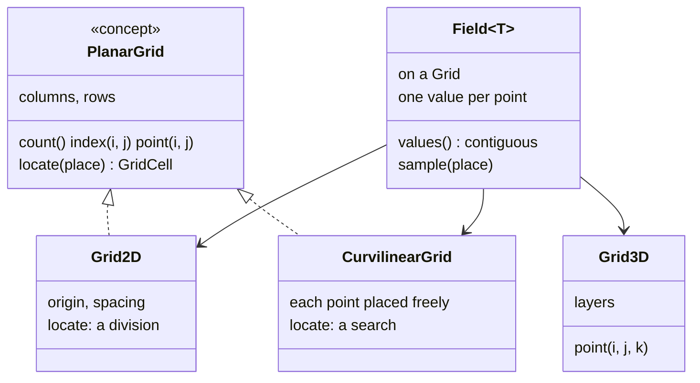
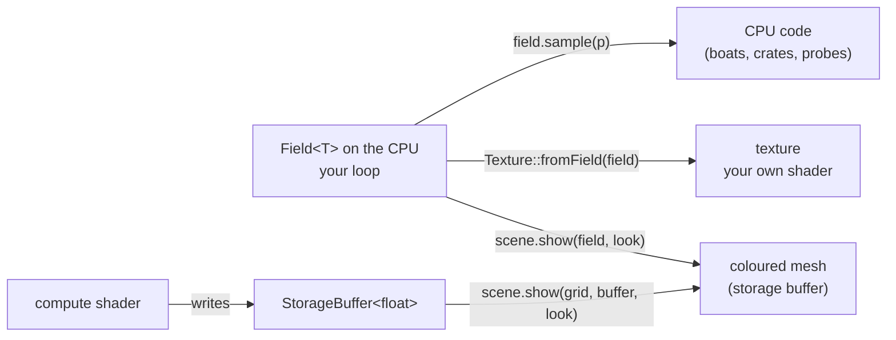
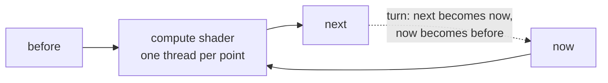
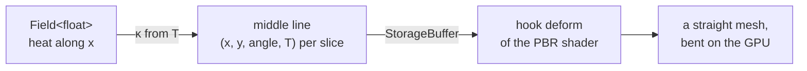

# 🔬 14. Science with fields, step by step

The demos of chapter 11 of the gallery (`11a` to `11h`) compute physics on a grid and show it. This chapter explains each one: the equation, how it becomes a loop on a grid, and the Compages calls that hold and show the numbers. Read it in order: each section uses the ones before.

What you will learn:

| § | Demo | The physics | The Compages idea |
|---|------|-------------|-------------------|
| 0 | — | — | grids, fields, bilinear sampling, where the numbers go |
| 1 | `11a_HeatPlate` | heat equation | a `Field<float>` updated on the CPU, `scene.show()` |
| 2 | `11b_RippleTank` | wave equation | the same on the GPU: a compute shader, three buffers |
| 3 | `11c_FieldProbe` | a ray meets a relief | `scene.probe()` |
| 4 | `11d_BimetalBeam` | heat + thermal bending | a CPU model bends a mesh on the GPU (hook `deform`) |
| 5 | `11e_Smoke` | incompressible fluid (Stable Fluids) | five compute kernels, ping-pong |
| 6 | `11f_Volume` | light through warm air | `Field<float, Grid3D>`, a 3D texture, an isosurface |
| 7 | `11g_FlowAroundCylinder` | ideal flow round a column | vectors, streamlines, a grid fitted round a shape |
| 8 | `11h_Thermometers` | following values in time | `Chart` |

You need chapter 3 §3 (a `Scene`) and, for §2 and §5, the idea of a compute shader ([chapter 4 §5](04-GPU-Layer.md#-5-compute)).

---

## 🧮 0. Fields in five minutes

### A grid says where the points are

A `Grid2D` is a regular grid of the ground plane: $n_c$ columns, $n_r$ rows, a first point $\mathbf{o}$ and a step $h$. Point $(i, j)$ is at

```math
\mathbf{p}_{ij} = \mathbf{o} + h\,(i,\ j), \qquad 0 \le i < n_c,\quad 0 \le j < n_r
```

and its number (its **index**) is $k = j\,n_c + i$: row after row. In a 3D scene the plane is the ground seen from above, so a `Vector2f` is $(x, z)$.

### A field holds one value per point

A `Field<T, Grid>` is one array of $n_c\,n_r$ values of type `T` (a `float`, a `Vector2f`...), in the order of the indices. That order is also the order of the texels of a texture, so the array goes to the GPU as it is.



### Between the points: bilinear sampling

`field.sample(place)` asks the grid for the cell of the place (`grid.locate(place)` → `GridCell{ i, j, s, t }`): the cell between points $(i, j)$ and $(i+1, j+1)$, and how far across it, $s$ and $t$ from 0 to 1. Then it mixes the four corners:

```math
f(\mathbf{p}) = (1-s)(1-t)\,f_{i,j} + s\,(1-t)\,f_{i+1,j} + (1-s)\,t\,f_{i,j+1} + s\,t\,f_{i+1,j+1}
```

On a `Grid2D`, $s$ and $t$ are the fractional parts of $(\mathbf{p} - \mathbf{o}) / h$. Outside the grid, the value of the nearest edge.

### Where the numbers go



- Small, or read by the CPU: compute on the CPU, show with `scene.show(field, look)` (§1).
- Large, every frame: compute on the GPU and never read it back (§2, §5).

---

## 🔥 1. 11a_HeatPlate: the heat equation

📁 `examples/11_Science/11a_HeatPlate.cpp`

Heat spreads from warm places to cold ones. The temperature $T$ follows the **heat equation**, with $\alpha$ the diffusivity of the metal (m²/s):

```math
\frac{\partial T}{\partial t} = \alpha\,\nabla^2 T = \alpha\left(\frac{\partial^2 T}{\partial x^2} + \frac{\partial^2 T}{\partial z^2}\right)
```

On a grid of step $h$, the **Laplacian** $\nabla^2 T$ is the sum of the four neighbours minus four times the point (the five-point stencil):

```math
\nabla^2 T_{ij} \approx \frac{T_{i-1,j} + T_{i+1,j} + T_{i,j-1} + T_{i,j+1} - 4\,T_{ij}}{h^2}
```

One small step of time $\Delta t$ forward (explicit Euler):

```math
T_{ij}^{n+1} = T_{ij}^{n} + r\left(T_{i-1,j} + T_{i+1,j} + T_{i,j-1} + T_{i,j+1} - 4\,T_{ij}\right)^{n}, \qquad r = \frac{\alpha\,\Delta t}{h^2}
```

It stays stable only while $r \le \tfrac14$: a longer frame is cut into several steps. The code keeps $r \le 0.2$:

```cpp
const float limit = 0.2f * h2 / DIFFUSIVITY;
const int steps = std::max(1, int(std::ceil(p_seconds / limit)));
const float rate = DIFFUSIVITY * (p_seconds / float(steps)) / h2;
// ...
m_next(i, j) = edge ? ROOM
               : heated ? HEATER
               : t + (rate * (m_temperature(i - 1, j) + m_temperature(i + 1, j) +
                              m_temperature(i, j - 1) + m_temperature(i, j + 1) - (4.0f * t)));
```

- Two fields, `m_temperature` and `m_next`: read one, write the other, `std::swap`. Writing in place would mix old and new values.
- The edges stay at room temperature (a **boundary condition**); the heaters are held hot.
- `scene.show(m_plate, m_temperature, m_look)` each frame sends the new values; the mesh never changes.

Try it: the colour map, the relief (the temperature as a height), the speed of time.

---

## 🌊 2. 11b_RippleTank: the wave equation on the GPU

📁 `examples/11_Science/11b_RippleTank.cpp`

A water surface of height $u$ follows the **wave equation**, with $c$ the speed of the waves:

```math
\frac{\partial^2 u}{\partial t^2} = c^2\,\nabla^2 u
```

A second derivative in time needs two past states. The **leapfrog** scheme keeps three: before, now, next.

```math
u^{n+1}_{ij} = \Big(2\,u^{n}_{ij} - u^{n-1}_{ij} + C^2\,\big(u_{i-1,j} + u_{i+1,j} + u_{i,j-1} + u_{i,j+1} - 4\,u_{ij}\big)^{n}\Big)\,d
```

with $C^2 = (c\,\Delta t / h)^2$, stable under $\tfrac12$ (here 0.3), and $d$ a damping just under 1. Each pixel of a compute shader computes one point:

```glsl
float height = (2.0 * now[k] - before[k] + courant2 * laplacian) * damping;
```



- The three buffers turn each step: no copy.
- `scene.show(grid, buffer, look)` draws the buffer of *now* as it is. The CPU never reads a height.
- After a dispatch, `gpu::barrier(...)` is the caller's job ([chapter 4](04-GPU-Layer.md#-5-compute)).

---

## 🏝 3. 11c_FieldProbe: what is under the mouse

📁 `examples/11_Science/11c_FieldProbe.cpp` · `Fields/HeightField.hpp`

The ray of a pixel is $\mathbf{r}(t) = \mathbf{o} + t\,\mathbf{d}$. It meets the relief where it goes below the ground:

```math
g(t) = r_y(t) - H\big(r_x(t),\ r_z(t)\big) \le 0
```

with $H$ the height drawn (the value times the relief of the look, `sample()` between points). `intersectHeight` walks along the ray by half a grid step until $g \le 0$, then halves the last step 8 times (**bisection**), so the point is found to $h/512$.

```cpp
if (const auto found = m_scene.probe(m_altitude, m_look, p_frame.input.mouse))
{
    // found->point: where; found->value: the altitude there
}
```

---

## 🔩 4. 11d_BimetalBeam: heat that bends a strip

📁 `examples/11_Science/11d_BimetalBeam.cpp`

A strip of brass on steel, held at one end, heated at the other. Two models chained:

**Heat along the strip** (1D), with the air cooling it at a rate $\beta$:

```math
\frac{\partial T}{\partial t} = \alpha\,\frac{\partial^2 T}{\partial x^2} - \beta\,(T - T_{\text{air}})
```

**Bending.** Brass grows more than steel when warm ($\alpha_b = 19 \times 10^{-6}$, $\alpha_s = 12 \times 10^{-6}$ per degree). For two layers of the same thickness and stiffness, Timoshenko's formula gives the **curvature** of a slice of thickness $h$:

```math
\kappa = \frac{3}{2}\,\frac{(\alpha_b - \alpha_s)\,(T - T_{\text{air}})}{h}
```

The middle line then follows from the clamp: each slice of length $\Delta x$ turns by $\kappa\,\Delta x$.

```math
\theta_{i} = \theta_{i+1} + \kappa_i\,\Delta x, \qquad \mathbf{p}_{i} = \mathbf{p}_{i+1} - \Delta x\,(\cos\theta_i,\ \sin\theta_i)
```



The CPU writes the middle line into a storage buffer; the hook `deform` (chapter 12 §5) moves each corner of a straight mesh onto it.

---

## 💨 5. 11e_Smoke: an incompressible fluid

📁 `examples/11_Science/11e_Smoke.cpp`

Air is a fluid that is not squeezed. Its speed $\mathbf{u}$ follows the Euler equations: it is carried by itself, pushed by the pressure $p$ and by forces $\mathbf{f}$ (here the lift of hot smoke), and no air is created or lost (**divergence free**):

```math
\frac{\partial \mathbf{u}}{\partial t} + (\mathbf{u}\cdot\nabla)\,\mathbf{u} = -\nabla p + \mathbf{f}, \qquad \nabla\cdot\mathbf{u} = 0
```

J. Stam's **Stable Fluids** (SIGGRAPH 1999) splits one step into simple parts, each a compute shader (lengths in grid cells, $h = 1$):

1. **Advect** (move along itself), looking back: the speed at $\mathbf{x}$ is the one that was at $\mathbf{x} - \Delta t\,\mathbf{u}(\mathbf{x})$; add the lift $\Delta t\,(w,\ b\,s)$ (wind $w$, buoyancy $b$, smoke $s$).
2. **Divergence** of the result: $\nabla\cdot\mathbf{u}_{ij} \approx \tfrac12\left(u^x_{i+1,j} - u^x_{i-1,j} + u^y_{i,j+1} - u^y_{i,j-1}\right)$.
3. **Pressure**: solve $\nabla^2 p = \nabla\cdot\mathbf{u}$ by Jacobi steps, $p_{ij} \leftarrow \tfrac14\left(p_{i-1,j} + p_{i+1,j} + p_{i,j-1} + p_{i,j+1} - (\nabla\cdot\mathbf{u})_{ij}\right)$.
4. **Project**: $\mathbf{u} \leftarrow \mathbf{u} - \nabla p$. Now $\nabla\cdot\mathbf{u} \approx 0$.
5. **Advect the smoke** along $\mathbf{u}$ the same way.


The five kernels come from one GLSL text: `ShaderSource::define("STEP", n)` chooses the part ([chapter 4](04-GPU-Layer.md#shaders-made-of-pieces-shadersource)). Looking *back* (step 1) is what makes it stable at any $\Delta t$.

---

## 🌡 6. 11f_Volume: seeing through warm air

📁 `examples/11_Science/11f_Volume.cpp` · `Fields/Isosurface.hpp`, `Fields/Slice.hpp`

The temperature of a room is a `Field<float, Grid3D>`. `scene.show(volume, look)` sends it as a 3D texture and draws a box. For each pixel, the shader walks the ray through the box in $N$ steps of length $\Delta l$. Each step glows with the colour $c_i$ of its value and hides what is behind (**emission and absorption**):

```math
\alpha_i = 1 - e^{-k\,t_i\,\Delta l}, \qquad C = \sum_{i} c_i\,\alpha_i \prod_{j<i} (1 - \alpha_j)
```

with $t_i$ the value placed in the range (0 to 1), and $k = 3 / |\text{box}|$: at the top of the range, $e^{-3} \approx 5\,\%$ of the light crosses the box.

Two other ways to look at a volume:

- `compages::slice(volume, Axis::Y, layer)`: one layer as a 2D field, for `scene.show()`.
- `compages::isosurface(volume, level)`: the surface where the value equals a level (here the air at 30°), by **marching tetrahedra**. Each cube of 8 points is cut into 6 tetrahedra; on each edge whose ends are on both sides of the level, the surface crosses at

```math
\mathbf{p} = \mathbf{a} + \frac{\ell - f_a}{f_b - f_a}\,(\mathbf{b} - \mathbf{a})
```

Tetrahedra have no ambiguous cases (unlike the cubes of marching cubes). `renderer::meshOf(surface)` makes a mesh of it.

---

## 🌀 7. 11g_FlowAroundCylinder: ideal flow and a grid fitted round the column

📁 `examples/11_Science/11g_FlowAroundCylinder.cpp`

### The flow

A uniform wind $U$ round a column of radius $R$ that turns (circulation $\Gamma$). In polar coordinates $(r, \theta)$ round the column, the **ideal flow** (no friction) is a uniform flow plus a doublet plus a vortex:

```math
u_r = U\left(1 - \frac{R^2}{r^2}\right)\cos\theta, \qquad
u_\theta = -U\left(1 + \frac{R^2}{r^2}\right)\sin\theta + \frac{\Gamma}{2\pi r}
```

The pressure follows from Bernoulli (faster is lower), as a coefficient:

```math
C_p = 1 - \frac{|\mathbf{u}|^2}{U^2}
```

With a turn, the wind is faster on one side: the pressure is lower there and the column is pushed sideways (the **Magnus effect**; the force per metre is $\rho\,U\,\Gamma$, Kutta-Joukowski).

### Streamlines

`compages::streamline(field, start, step, steps)` follows the field with the midpoint method (Runge-Kutta 2), $\hat{\mathbf{v}} = \mathbf{v} / |\mathbf{v}|$:

```math
\mathbf{x}_{n+1} = \mathbf{x}_n + \Delta s\;\hat{\mathbf{v}}\!\left(\mathbf{x}_n + \tfrac{\Delta s}{2}\,\hat{\mathbf{v}}(\mathbf{x}_n)\right)
```

### A grid fitted round the column

On a regular `Grid2D`, the round column is a staircase of square cells: the colours step along its wall. A **body-fitted** grid follows the shape: here an **O-grid**, $i$ round the column and $j$ away from it. Point $(i, j)$ lies on the straight line from the wall $\mathbf{w}_i$ to the edge of the channel $\mathbf{e}_i$ (equal steps along the edge, so a point falls on each corner), with steps that grow away from the wall:

```math
\mathbf{p}_{ij} = \mathbf{w}_i + \big(\mathbf{e}_i - \mathbf{w}_i\big)\,\frac{e^{b\,u} - 1}{e^{b} - 1}, \qquad u = \frac{j}{n_r - 1},\quad b = 3
```

```cpp
compages::CurvilinearGrid ogrid;
COMPAGES_TRY_ASSIGN(ogrid, compages::CurvilinearGrid::create(AROUND + 1, OUT, fitted));
m_fitted_pressure = compages::Field<float, compages::CurvilinearGrid>(ogrid, 0.0f);
m_fitted_floor = m_scene.show(m_fitted_pressure, m_pressure_look, "Pressure, fitted grid");
```

The ring closes on itself: its first column is repeated as its last one. Same calls as on a `Grid2D` (`field(i, j)`, `sample()`, `streamline()`, `show()`); only `locate()` differs. Its points are not regular, so finding the cell of a place is a **search**: the cells are sorted into buckets once; then, in the few cells of the bucket, the inverse of the bilinear map of a cell

```math
\mathbf{p}(s, t) = \mathbf{a} + (\mathbf{b} - \mathbf{a})\,s + (\mathbf{c} - \mathbf{a})\,t + (\mathbf{a} - \mathbf{b} - \mathbf{c} + \mathbf{d})\,s\,t
```

is found by Newton's method (a 2 × 2 system per step). A place is in the cell when $0 \le s, t \le 1$.

Try it: Grid (regular or fitted), Grid lines, the speed, the turn.

---

## 📈 8. 11h_Thermometers: values over time

📁 `examples/11_Science/11h_Thermometers.cpp` · `Renderer/Visualization/Chart.hpp`

Two thermometers read a heated plate (as in §1) with `field.sample(spot)`, and a `Chart` draws their curves on a board. With `ChartScale::FollowValues`, the axis takes **round numbers** round the values shown. The step of the grid is a quarter of the range, rounded to the nearest of $1, 2, 5$ or $10$ times a power of ten:

```math
\text{step} = m \cdot 10^{n}, \qquad n = \left\lfloor \log_{10} \tfrac{v_{\max} - v_{\min}}{4} \right\rfloor,\quad m \in \{1, 2, 5, 10\}
```

Then the bottom and the top go out to multiples of the step (one step more where a curve would touch the frame).

```cpp
COMPAGES_TRY(m_chart.create(m_scene,
                            { .width = 1024u, .height = 512u, .seconds = 120.0f,
                              .low = 0.0f, .high = 100.0f,
                              .scale = compages::renderer::ChartScale::FollowValues },
                            "Thermometers"));
// each frame
m_chart.add(m_curves[k], m_time, m_temperature.sample(m_spots[k]));
COMPAGES_TRY(m_chart.draw());
```

The board shows the picture as it is, like a screen: a hook `main` that only reads the picture, so the sun does not light it.

---

## 📋 Summary

| Equation | Discrete form | Where |
|----------|---------------|-------|
| $\partial_t T = \alpha \nabla^2 T$ | explicit Euler, five-point Laplacian, $\alpha \Delta t / h^2 \le \tfrac14$ | §1, §4 |
| $\partial_t^2 u = c^2 \nabla^2 u$ | leapfrog, three buffers, $(c \Delta t / h)^2 \le \tfrac12$ | §2 |
| $\nabla\cdot\mathbf{u} = 0$ | advect back, Jacobi on $\nabla^2 p = \nabla\cdot\mathbf{u}$, $\mathbf{u} - \nabla p$ | §5 |
| light through a medium | $\alpha_i = 1 - e^{-k t_i \Delta l}$, front to back | §6 |
| ideal flow | uniform + doublet + vortex | §7 |

Next: [13. Three complete demos](13-Complete-Demos.md) uses fields in a game-like scene (`10f_FlowingWater`), or [6. The Renderer layer](06-Renderer-Layer.md#show-a-field-heat-maps-and-coloured-reliefs) for every option of `show()`.
