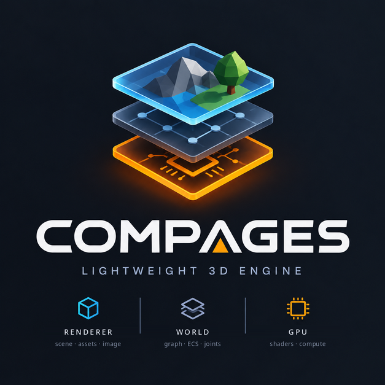

# 📚 Compages documentation

Start here if you want to learn Compages. By the end of the basic path, you will be able to build and run a program, create and move objects, draw a scene, and read errors when something goes wrong.

You do not need to know 3D or OpenGL. To write the programs, you need basic C++: variables, functions, structs, and a loop. The code also uses lambdas (functions written inside another function) and templates such as `Field<float>` (a field whose values are floating-point numbers). You can explore the gallery before learning these C++ details.

Choose your path by what you want to do. Each path is a list to read in order; the reference chapters (4–11) are there when you need a fact.



## 🚶 Path 1: use Compages

Make a program that shows a 3D scene: install, a first window, objects, light, a camera, models, controls. You see a result from the second step.

| Step | Read and do | You are ready to continue when… |
|------|-------------|---------------------------------|
| 1 | [Introduction](01-Introduction.md) | you can explain the difference between a world and its picture |
| 2 | [Getting started](02-Getting-Started.md), open `06a_FirstScene` | you see the cube and can move the gallery camera |
| 3 | [Your first programs](03-Tutorial.md) | you can change a speed, a colour and a position and predict the result |
| 4 | [The Renderer layer](06-Renderer-Layer.md): scene, looks, camera, lights, files | you can load a model and light it |
| 5 | [The World layer](05-World-Layer.md): entities, routines, joints | you can make things move without the GPU |
| 6 | [Going further](12-Going-Further.md) §1–5, then [the small viewer](12-Going-Further.md#-practice-build-a-small-viewer) | your program creates, updates, draws and closes without an error |

## 🎨 Path 2: make effects and simulations

Change how things look and compute on the GPU: your own shaders, values on a grid, passes, ping-pong, water, fog, light. Read path 1 up to step 3 first.

| Step | Read | What you get |
|------|------|--------------|
| 1 | [Going further](12-Going-Further.md) §6–9 | your own look (hooks), moving vertices, a field sent to a shader, passes |
| 2 | [Techniques, one page each](techniques/README.md) | one effect per page: the idea, the lines that switch it on, the GLSL, the cost |
| 3 | [The GPU layer](04-GPU-Layer.md) | shaders, buffers, compute, several passes, without the Renderer |
| 4 | [Science with fields](14-Science-With-Fields.md) | heat, waves, fluids, volumes: an equation, its loop on a grid, its picture |
| 5 | [Three complete demos](13-Complete-Demos.md) | three case studies, from their inputs to their final picture |

## 🔧 Path 3: understand and extend the engine

How Compages works inside: who includes whom, one frame from start to end, the lifetime of GPU objects, the ECS, the snapshot, profiling and tests.

| Step | Read | What you get |
|------|------|--------------|
| 1 | [Introduction §3](01-Introduction.md) and the three layer chapters (4, 5, 6) | what each layer leaves out, and why |
| 2 | [Architecture](07-Architecture.md) | folders, includes, the frame, the entry points |
| 3 | [Debugging](10-Debugging.md) | errors, driver messages, apitrace, RenderDoc, CI without a screen |
| 4 | [AGENTS.md](../AGENTS.md) | the conventions and the rules that are easy to break |

Keep the gallery open beside the text. For each example: run it, read the explanation, change one value, predict what will happen, then rebuild and compare. You do not need to understand every file of a large demo at once.

## 🧭 Quick paths

- *"I just want to see something."* → [2. Getting started](02-Getting-Started.md), then `./build/linux-gcc-debug/bin/Compages-examples`
- *"I have a shader and numbers."* → [3. Tutorial §1](03-Tutorial.md#-1-a-triangle-named-by-the-shader), then [4. GPU](04-GPU-Layer.md)
- *"I simulate things, no window needed."* → [3. Tutorial §2](03-Tutorial.md#-2-a-world-without-a-screen), then [5. World](05-World-Layer.md)
- *"I want to build a 3D scene."* → [3. Tutorial §3](03-Tutorial.md#-3-a-picture-of-the-world), then [6. Renderer](06-Renderer-Layer.md)
- *"I want one effect: bloom, a cartoon look, flowing water."* → [Techniques](techniques/README.md)
- *"I compute physics on a grid."* → [14. Science with fields](14-Science-With-Fields.md)
- *"My window is black."* → [10. Debugging](10-Debugging.md)
- *"I want to change Compages itself."* → [7. Architecture](07-Architecture.md), and [AGENTS.md](../AGENTS.md) for the conventions

## 📚 All chapters

**Tutorials** teach in order. **Techniques** and **case studies** explain one thing each. **Reference** chapters are for looking up a fact.

| # | Chapter | Kind | Contents |
|---|---------|------|----------|
| 1 | [Introduction](01-Introduction.md) | tutorial | 🌱 3D words, the three layers and why they are separate |
| 2 | [Getting started](02-Getting-Started.md) | tutorial | 🚀 Install, build, gallery, headless CI, system install |
| 3 | [Your first programs](03-Tutorial.md) | tutorial | 🎓 Guided examples, terminal programs and a complete window application |
| 12 | [Going further](12-Going-Further.md) | tutorial | 🎓 Fields and interaction first, then meshes, shaders and GPU passes |
| — | [Techniques](techniques/README.md) | technique | 🎨 One effect per page: cel shading, bloom, flow mapping… |
| 13 | [Three complete demos](13-Complete-Demos.md) | case study | 🏗 Sweat, an archipelago and flowing water, rebuilt step by step |
| 14 | [Science with fields](14-Science-With-Fields.md) | case study | 🔬 Heat, waves, fluids, volumes, ideal flow: equations and grids |
| 4 | [The GPU layer](04-GPU-Layer.md) | reference | 🟧 Drawable, buffers, compute, several passes |
| 5 | [The World layer](05-World-Layer.md) | reference | 🟦 Scene graph, ECS, routines, joints |
| 6 | [The Renderer layer](06-Renderer-Layer.md) | reference | 🟩 Scene, assets, frame, live textures |
| 7 | [Architecture](07-Architecture.md) | reference | 🏗 Folders, includes, one frame |
| 8 | [API reference](08-API-Reference.md) | reference | 📖 The calls of the three layers |
| 9 | [Examples](09-Examples.md) | reference | 🖼 The gallery and its keys |
| 10 | [Debugging](10-Debugging.md) | reference | 🐞 Errors, driver messages, apitrace, RenderDoc |
| 11 | [Credits](11-Credits.md) | reference | 🙏 Inspirations, third parties |

## 📷 Images

The screenshots live in the [Compages-data](https://github.com/Lecrapouille/Compages-data) repository, in `doc/examples/`, one per demo; the pages link to them there. They are written by:

```sh
./build/linux-gcc-debug/bin/Compages-examples --check --shots external/Compages-data/doc/examples
```

## 🌍 A note on the language

This documentation is written in simple English, with short sentences and common words, so that readers whose first language is not English (French readers in particular) can follow it easily.
