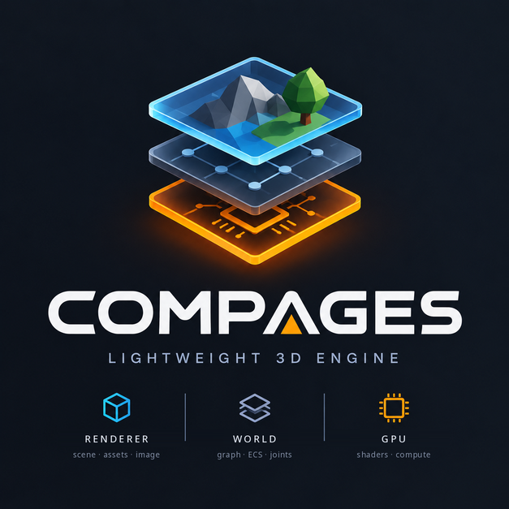

# 📚 Compages documentation

Start here if you want to learn Compages. By the end of the basic path, you will be able to build and run a program, create and move objects, draw a scene, and read errors when something goes wrong.

You do not need to know 3D or OpenGL. To write the programs, you need basic C++: variables, functions, structs, and a loop. The code also uses lambdas (functions written inside another function) and templates such as `Field<float>` (a field whose values are floating-point numbers). You can explore the gallery before learning these C++ details.

**The chapter numbers are stable file names, not a single reading order.** Learn with 1 → 2 → 3, choose a layer, then continue with 12. Use 7–11 when you need a reference. Chapters 13 and 14 are optional applications of what you learned.

## 🪜 Your learning path

| Stage | Read and do | You are ready to continue when… |
|-------|-------------|---------------------------------|
| 1. Understand | [Introduction](01-Introduction.md) | You can explain the difference between a world and its picture |
| 2. Run | [Getting started](02-Getting-Started.md), open `06a_FirstScene` | You see the cube and can move the gallery camera |
| 3. Change | [Your first programs](03-Tutorial.md), run the terminal example and the complete window program | You can change a speed, a colour and a position and predict the result |
| 4. Choose | [Renderer](06-Renderer-Layer.md) for a scene, [World](05-World-Layer.md) for a simulation, or [GPU](04-GPU-Layer.md) for shaders | You can explain which part of your application belongs in each layer |
| 5. Extend | [Going further](12-Going-Further.md), one technique at a time | You can add interaction or display data in your own program |
| 6. Build | The small project at the end of [chapter 12](12-Going-Further.md#-practice-build-a-small-viewer) | Your program creates, updates, draws and closes without an error |
| 7. Explore | [Complete demos](13-Complete-Demos.md) or [Science with fields](14-Science-With-Fields.md) | You can follow the data from its calculation to its picture |

Keep the gallery open beside the text. For each example: run it, read the explanation, change one value, predict what will happen, then rebuild and compare. You do not need to understand every file of a large demo at once.



## 🎓 Learn

| # | Chapter | You will learn | Reading guide |
|---|---------|----------------|------|
| 1 | [Introduction](01-Introduction.md) | 3D words (shader, buffer, entity, component…), the three layers and why they are separate | ideas first |
| 2 | [Getting started](02-Getting-Started.md) | Install, build, run the gallery, run without a screen | build time varies |
| 3 | [Your first programs](03-Tutorial.md) | Guided layer examples, terminal programs and a complete window application | run and edit |
| 12 | [Going further](12-Going-Further.md) | Fields, picking and opacity, then textures, meshes, shaders and passes | choose one technique |
| 13 | [Three complete demos](13-Complete-Demos.md) | `10c_SweatAndDecals`, `10e_Archipelago` and `10f_FlowingWater` rebuilt step by step | choose one demo |
| 14 | [Science with fields](14-Science-With-Fields.md) | The `11_Science` demos: each equation (heat, waves, fluids, light through a volume, ideal flow), its loop on a grid, its calls | start with heat |

## 🧱 The three layers

| # | Chapter | Read it when… |
|---|---------|---------------|
| 4 | [The GPU layer](04-GPU-Layer.md) | you have shaders and arrays: draw, compute, several passes |
| 5 | [The World layer](05-World-Layer.md) | you have things that move: entities, ECS, joints, routines, no screen |
| 6 | [The Renderer layer](06-Renderer-Layer.md) | you want a picture of the world: scene, camera, lights, files, painted textures |

## 📖 Reference

| # | Chapter | Contents |
|---|---------|----------|
| 7 | [Architecture](07-Architecture.md) | Folders, who includes whom, one frame from start to end |
| 8 | [API reference](08-API-Reference.md) | The calls of the three layers on one page |
| 9 | [Examples](09-Examples.md) | The gallery: every demo, its idea, its keys |
| 10 | [Debugging](10-Debugging.md) | Error messages, driver messages, apitrace, RenderDoc, CI without a screen |
| 11 | [Credits](11-Credits.md) | Technical lessons, inspirations, third-party libraries |

## 🧭 Quick paths

- *"I just want to see something."* → [2. Getting started](02-Getting-Started.md), then `./build/linux-gcc-debug/bin/Compages-examples`
- *"I have a shader and numbers."* → [3. Tutorial §1](03-Tutorial.md#-1-a-triangle-named-by-the-shader), then [4. GPU](04-GPU-Layer.md)
- *"I simulate things, no window needed."* → [3. Tutorial §2](03-Tutorial.md#-2-a-world-without-a-screen), then [5. World](05-World-Layer.md)
- *"I want to build a 3D scene."* → [3. Tutorial §3](03-Tutorial.md#-3-a-picture-of-the-world), then [6. Renderer](06-Renderer-Layer.md)
- *"I know the basics; how do the big demos work?"* → [12. Going further](12-Going-Further.md), then [13. Three complete demos](13-Complete-Demos.md)
- *"I compute physics on a grid."* → [14. Science with fields](14-Science-With-Fields.md)
- *"My window is black."* → [10. Debugging](10-Debugging.md)
- *"I want to change Compages itself."* → [7. Architecture](07-Architecture.md), and [AGENTS.md](../AGENTS.md) for the conventions

## 📚 All chapters

| # | Chapter | Contents |
|---|---------|----------|
| | [Reading guide](README.md) | 🧭 Reading order and quick paths |
| 1 | [Introduction](01-Introduction.md) | 🌱 3D words, the three layers and why they are separate |
| 2 | [Getting started](02-Getting-Started.md) | 🚀 Install, build, gallery, headless CI, system install |
| 3 | [Your first programs](03-Tutorial.md) | 🎓 Guided examples, terminal programs and a complete window application |
| 4 | [The GPU layer](04-GPU-Layer.md) | 🟧 Drawable, buffers, compute, several passes |
| 5 | [The World layer](05-World-Layer.md) | 🟦 Scene graph, ECS, routines, joints |
| 6 | [The Renderer layer](06-Renderer-Layer.md) | 🟩 Scene, assets, frame, live textures |
| 7 | [Architecture](07-Architecture.md) | 🏗 Folders, includes, one frame |
| 8 | [API reference](08-API-Reference.md) | 📖 The calls of the three layers |
| 9 | [Examples](09-Examples.md) | 🖼 The gallery and its keys |
| 10 | [Debugging](10-Debugging.md) | 🐞 Errors, driver messages, apitrace, RenderDoc |
| 11 | [Credits](11-Credits.md) | 🙏 Inspirations, third parties |
| 12 | [Going further](12-Going-Further.md) | 🎓 Fields and interaction first, then meshes, shaders and GPU passes |
| 13 | [Three complete demos](13-Complete-Demos.md) | 🏗 Sweat, an archipelago and flowing water, rebuilt step by step |
| 14 | [Science with fields](14-Science-With-Fields.md) | 🔬 Heat, waves, fluids, volumes, ideal flow: equations and grids |


## 📷 Images

The screenshots live in the [Compages-data](https://github.com/Lecrapouille/Compages-data) repository, in `doc/examples/`, one per demo; the pages link to them there. They are written by:

```sh
./build/linux-gcc-debug/bin/Compages-examples --check --shots external/Compages-data/doc/examples
```

## 🌍 A note on the language

This documentation is written in simple English, with short sentences and common words, so that readers whose first language is not English (French readers in particular) can follow it easily.
