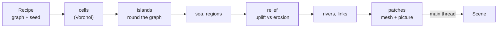

# 🏝 10e_Archipelago: a world made from a graph

[⏫ Case studies](README.md)


📁 `examples/10_Complete/10e_Archipelago.cpp` and `examples/10_Complete/Archipelago/`, one file per part

A new take on Chréage, the map of knowledge of I. Aberkane's thesis ("Mind Ergonomy for the Knowledge Economy", 2016, chapter 11): web pages become places on islands. An island is a theme, a region is a topic, a link is a place on the bank of a river. The contents come from [IslandedBrowser](https://github.com/Lecrapouille/IslandedBrowser): `organize.py` groups bookmarks of Firefox, and `IslandedBrowser -d DIR --layout` writes the place of every node in a force directed layout (springs between similar pages). The demo reads `archipelago/bookmarks-layout.json` of Compages-data, or the file given by `COMPAGES_ARCHIPELAGO`; without it, a few pages of Wikipedia built in.

The map is 16 km wide. Every size is written with its unit (`toMetres(1.4_km)`), so a mistake of a factor 1000 does not compile.

| File | Part |
|------|------|
| `Knowledge` | reads the layout |
| `Placement` | fits the graph to the map |
| `Cells`, `Land`, `Shores`, `Relief`, `Geology`, `Strands`, `Rivers`, `Outlines` | the land, on the CPU, in stages |
| `Painting` | its picture |
| `Sea`, `Swells`, `Shaders.hpp` | the sea (hooks `deform` and `main`) |
| `FineTiles` | finer tiles near the camera |
| `Wildlife`, `Pins`, `Signs`, `Highlight`, `Panels`, `Browser` | what lives on the map, and the interface |

**First observation:** land generation happens on the CPU; displaying its result happens on the GPU. The background thread produces data. The main thread turns that data into meshes and textures while its graphics context is current.

## Step 1 — A recipe, a thread, a progress bar

Making the land takes seconds. `setUp()` must not wait: it starts the work in a thread and returns. `Job<T>` (`Archipelago/Job.hpp`) is a `std::jthread` and a `std::future`:

```cpp
m_report = std::make_shared<Report>();
m_loading.start([recipe = std::move(recipe), report = m_report]()
                { return makeMap(recipe, *report); });
```

The thread writes how far it is into a `Report` under a mutex. The gallery asks `Example::progress()` each frame and shows a bar; `--check` waits for 1 before it counts frames. When the job is ready, `draw()` takes the result and gives it to the GPU (`finishLoading`). Only the main thread touches the GPU and the `Scene`.

```cpp
Land makeLand(Recipe const& p_recipe, Progress const& p_progress)
{
    making.land.sites = scatterSites(p_recipe.seed);
    shapeIslands(making);
    floodSea(making);
    divideRegions(making);
    raiseRelief(making);
    traceRivers(making);
    placeLinks(making);
    findPeaks(making);
    traceOutlines(making);
    return std::move(making.land);
}
```



The same seed gives the same map: Try it → Seed, Erosion steps, Generate.

## Step 2 — Cells: a Voronoi diagram on a `Grid2D`

As the thesis asks, after A. Patel's polygon maps, the map is made of **cells**: the places nearest to each of 96 x 96 points (a **Voronoi diagram**). There is one point (the **site**) per square of a grid, moved by up to 0.3 square:

```cpp
inline const compages::Grid2D CELL_GRID{
    .columns = CELLS,
    .rows = CELLS,
    .origin = compages::Vector2f((-0.5f * MAP) + (0.5f * CELL_SIZE),
                                 (-0.5f * MAP) + (0.5f * CELL_SIZE)),
    .spacing = CELL_SIZE
};
```

So the nearest site of a point is always among the 3 x 3 squares around it, and the neighbours of a cell are `CELL_GRID.neighbours8(c)`. Each value of a cell is a `Field` on this grid: `sites` (`Field<Vector2f>`), `elevations`, `islands_of`, `regions_of`, `parts_of`. No graph library, no million entities.

## Step 3 — Islands around the graph

The layout puts the islands far apart and their links close together. Each island gets a disc whose area is its share of the links, where the layout put it; the discs are pushed apart until a strait separates them. The land is the union of round shapes on the graph (discs on the nodes, capsules along the edges island → region → link), on coordinates bent by noise for the coasts. Each land cell belongs to the region of the nearest link of its island, so related links stay side by side. Water closed in by land is filled.

## Step 4 — Relief: uplift against erosion

The land is not drawn by hand. It grows by a simple geological model on the graph of the cells (Cordonnier et al. 2016). The plate rises under the islands (about 1 mm a year, more inland, 1.8 times more on the borders between regions, which become ridges), and the rivers cut it down by the **stream power law**:

`dh/dt = U - K A^½ S`

It cuts faster where a river drains more land (A) and where it is steeper (S). One step is 40 000 years, solved exactly from the sea upward (Braun and Willett 2013): a cell $i$ needs only the new height of the cell $r$ it drains to, at a distance $L$:

```math
h_i^{t+\Delta t} = \frac{h_i^{t} + U\,\Delta t + F\,h_r^{t+\Delta t}}{1 + F}, \qquad F = \frac{K\,\Delta t\,\sqrt{A_i}}{L}
```

No step is too long for it (it is implicit), which is why 40 000 years at once work. Pits are filled first (**priority flood**, Barnes et al. 2014: a lake overflows at its lowest pass), and the slopes creep.

```cpp
uplift[c] = UPLIFT * massif * (0.25f + (0.75f * heart)) * (1.0f + (RIDGE * ridge[c]));
// ...
p_making.drainage = erode(land.sites, p_making.ground, uplift, outlet,
                          p_making.recipe.erosion_steps, progress);
```

`erode()` returns the **drainage**: for each cell, the cell its water goes to, the order from the sea upward, and the area it drains. The next steps read it.

## Step 5 — Rivers, regions, links

The thesis maps contents "as loci along a strand": a river is a strand of places. Here an island is structured by its main river, the largest basin the erosion made. A region is a basin between ridges, drained by its tributary, which runs from its highest cell down to a river or the sea. A link is a cell of the region near the tributary, in the order of the layout along it, marked by a pin of the colour of the island.

Only these rivers are drawn: a smooth Catmull-Rom spline through their cells (the thesis tried Bézier, Catmull-Rom and B-splines), meanders of about eleven widths, a width that grows with the square root of the area drained. They dig their valley (a smooth V) and their bed into the mesh. The edges of the cells are faint inside a region, firmer around a link, bold between regions.

## Step 6 — From cells to a mesh and a picture

A `Patch` is a square of the map, ready for the GPU: its heights are a `Field<float>` (one per corner of its quads), its picture is the painted map. The ground at any point comes from one function, `Land::heightAt(x, z)` (the cells blended smoothly, a little roughness). A patch becomes a mesh by hand (chapter 12 §5) and a texture (§4).

## Step 7 — Levels of detail

One mesh for 16 km at 2 m would be far too heavy. The map is cut into 8 x 8 tiles of 2 km. From afar, one coarse mesh (a quad every 31 m) and one picture (16 m a pixel). Near the camera, `FineTiles` asks two threads for finer tiles (8 m, 2 m a pixel), which take the place of the coarse ones. A **skirt** (a strip hanging down along the edges) hides the cracks between a fine tile and a coarse one. At most twelve fine tiles live at once. Since the heights come from one function, a coarse and a fine tile agree.

Near the camera, the ground shader adds real pictures of grass, sand and rock (ambientCG, CC0), read at two scales and divided by their mean colour, so the colours of the map stay: sand on the beaches, rock on the steep slopes, grass elsewhere.

## Step 8 — The sea: one table of swells for the GPU and the CPU

Near the camera, a grid of 160 x 160 quads follows the camera. The hook `deform` ([write a material](../guides/write-a-material.md#4-deform-to-move-the-vertices)) lifts it with **Gerstner waves** (GPU Gems 1, chapter 1): a point of the water goes round a small circle, so the crests are sharp and the troughs wide. For swells of direction $\mathbf{d}_k$, wave number $k_k = 2\pi/\lambda_k$ and amplitude $A_k$:

```math
\phi_k = k_k\,(\mathbf{d}_k\cdot\mathbf{x}) - \omega_k\,t, \qquad
\mathbf{x}' = \mathbf{x} + \sum_k Q\,A_k\,\mathbf{d}_k \cos\phi_k, \qquad
y' = \sum_k A_k \sin\phi_k, \qquad \omega_k^2 = g\,k_k
```

with $Q = 0.75$ the sharpness of the crests (below 1, a crest never loops). Ten swells are blown by one wind, each with the speed of deep water waves (`omega² = g k`: a swell of 233 m has a period of 12 s). Waves come in groups: the height of each swell follows a noise that drifts at half the speed of the waves.

```cpp
inline constexpr std::array SWELLS = { Swell{ 0.80f, 0.60f, 233.0f, 0.062f },
                                       Swell{ 0.92f, 0.39f, 151.0f, 0.055f },
                                       // ... eight more
                                     };
[[nodiscard]] std::string swellsGlsl();   // the same table, as GLSL
[[nodiscard]] float swellHeight(float p_x, float p_z, float p_depth, float p_time);
```

The table lives once in C++. `swellsGlsl()` writes it as GLSL, given to the shaders by `include("archipelago/swells.glsl", …)`. `swellHeight()` computes the same sum on the CPU, so the boats ride the waves that are drawn. The surface is see-through: the sea bed shows in the shallows, foam on the steep crests and in the surf. Farther away, the ground shader makes the waves in its normals only, and the two fade into each other.

## Step 9 — Life and interface

Boats sail round the islands where the water is deep enough, gulls circle in flocks along the coasts, fish jump in the lagoons. Boats and fish are drawn at least as large as a part of their distance to the camera, like the icons of a map. The names are written on signs over their places (`Signs`, with `ImGui::GetWindowDrawList()` over the picture), and `Panels` opens the windows of IslandedBrowser through `Example::overlay()`. The keys are in [chapter 9](../reference/gallery.md#-13-10--complete-everything-together).

## 🔗 See also

[Make pictures and meshes](../guides/make-pictures-and-meshes.md) · [Write a material: `deform`](../guides/write-a-material.md#4-deform-to-move-the-vertices) · [Move the camera: fly to a place](../guides/move-the-camera.md#-fly-to-a-place) · [Text on the picture](../guides/text-on-the-picture.md)
