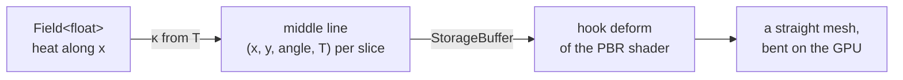

# 🔩 11d_BimetalBeam: heat that bends a strip

[⏫ Case studies](README.md)


📁 `examples/11_Science/11d_BimetalBeam.cpp`

A strip of brass on steel, held at one end, heated at the other. Two models chained:

**Heat along the strip** (1D), with the air cooling it at a rate $\beta$:

```math
\frac{\partial T}{\partial t} = \alpha\,\frac{\partial^2 T}{\partial x^2} - \beta\,(T - T_{\text{air}})
```

**Bending.** Brass grows more than steel when warm ($\alpha_b = 19 \times 10^{-6}$, $\alpha_s = 12 \times 10^{-6}$ per degree). For two layers of the same thickness and stiffness, Timoshenko's formula gives the **curvature** of a slice of thickness $h$:

```math
\kappa = \frac{3}{2}\,\frac{(\alpha_b - \alpha_s)\,(T - T_{\text{air}})}{h}
```

The middle line then follows from the clamp: each slice of length $\Delta x$ turns by $\kappa\,\Delta x$.

```math
\theta_{i} = \theta_{i+1} + \kappa_i\,\Delta x, \qquad \mathbf{p}_{i} = \mathbf{p}_{i+1} - \Delta x\,(\cos\theta_i,\ \sin\theta_i)
```



The CPU writes the middle line into a storage buffer; the hook `deform` ([write a material](../guides/write-a-material.md#4-deform-to-move-the-vertices)) moves each corner of a straight mesh onto it.

## 🚧 Limits

Timoshenko's formula holds for two layers of the same thickness and stiffness, and small bends. The heat model is one-dimensional: the strip is the same temperature across its width.

## 🔗 See also

[Write a material: `deform`](../guides/write-a-material.md#4-deform-to-move-the-vertices) · [The heat plate](heat-plate.md)
