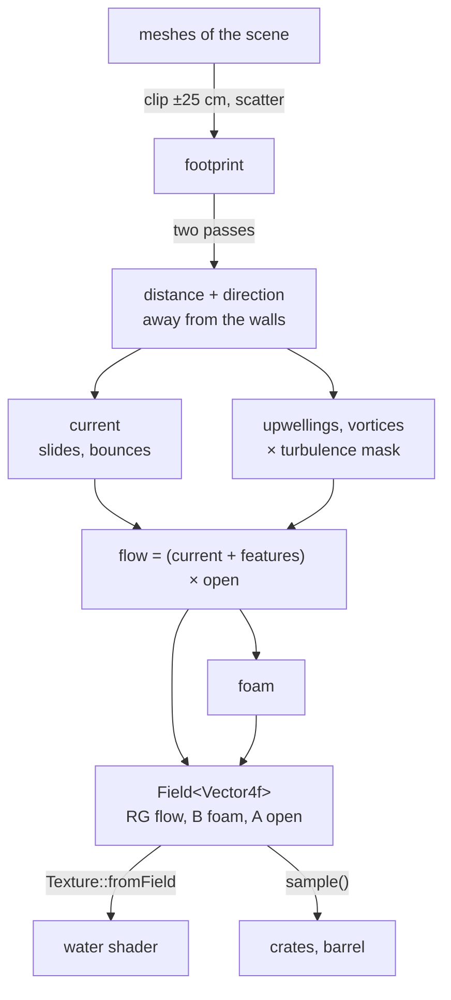

# 10f_FlowingWater: water that flows round things

[Case studies](README.md)


📁 `examples/10_Complete/10f_FlowingWater.cpp` and `examples/10_Complete/FlowingWater/`: `Pictures` (the textures), `FlowBake` (the flow map), `Spout` (the jet of the pipe), `Shaders.hpp`

A settling pool of concrete under sodium lamps. The water flows round the pillars, turns in vortices, spreads out of upwellings, and carries crates and a barrel. A pipe spits water into it. The technique is the water of Portal 2: A. Grimes, "Making and Using Non-Standard Textures" (GDC 2011), and A. Vlachos, "Water Flow in Portal 2" (SIGGRAPH 2010). The surface is one flat square: everything moves in its textures.

References: Grimes, GDC 2011 ([PDF](https://cdn.fastly.steamstatic.com/apps/valve/2011/gdc_2011_grimes_nonstandard_textures.pdf)); Vlachos, SIGGRAPH 2010 ([PDF](http://www.valvesoftware.com/publications/2010/siggraph2010_vlachos_waterflow.pdf), the address the GDC talk gives); all of [Valve's publications](https://www.valvesoftware.com/fr/publications). The demo rebuilds the technique with its own code, pictures and scene; more credits in [the credits](../reference/credits.md).



A flow map stores the direction and speed of water at each point. The shader uses it to move the visible texture; the CPU uses the same field to move floating crates. This is a shared description of movement, not a full fluid solver.

## Step 1 — The scene and its pictures

Every picture is made by the program and tiles ([make pictures and meshes](../guides/make-pictures-and-meshes.md)): concrete cast in panels with the holes of the form ties, green painted metal with rust, yellow and black stripes, and three pictures for the water: a **noise**, small **ripples** (a normal map) and grimy **foam** (the colour map, its opacity in alpha). The solid things share one triplanar shader (chapter 12 §6), darker and slimy near the waterline.

## Step 2 — Where the scene meets the water

The paper made its flow maps in Houdini. `FlowBake` makes the same steps on a `Grid2D` of 12.5 cm over the water (193 x 113 points). First, the **footprint**: the triangles of every solid entity are clipped to a slab of ±25 cm round the level of the water; points are scattered over what is left and dropped onto the grid.

```cpp
void FlowBake::scatter(Vector3f const& p_a, Vector3f const& p_b, Vector3f const& p_c, float p_level)
{
    // ... a triangle wholly above or below the slab is skipped
    const int n = std::clamp(int(std::ceil(edge / (0.5f * m_grid.spacing))), 1, 600);
    for (int i = 0; i <= n; ++i)
    {
        for (int j = 0; i + j <= n; ++j)
        {
            const Vector3f p = p_a + ((p_b - p_a) * s) + ((p_c - p_a) * t);
            if (std::abs(p.y - p_level) > SLAB) { continue; }
            // ... the nearest point of the grid is solid, and remembers p
        }
    }
}
```

The corners come from `MeshAsset::source_vertices`, placed by `entity.worldMatrix()` (call `World::update()` first). The catwalk above the water does not count; its legs do.

## Step 3 — The distance to the walls

Then every point of the water learns the nearest scattered point: a pass from the bottom left, a pass back from the top right, twice. Each point keeps the nearest point its neighbours know (**dead reckoning**). Since it keeps the point and not only the distance, the direction away from the wall comes for free:

```cpp
const Vector2f out = m_grid.point(k) - m_nearest[k];
m_distance[k] = length(out);
m_away[k] = out * (1.0f / m_distance[k]);
```

## Step 4 — The current

The slow motion of the pool, painted by an artist in the paper: here a direction plus a **circulation** round the pool. Near a wall, the part of the current going into the wall is taken away (it slides along) and some is thrown back (the paper projects the normals of the props onto the water):

```cpp
const float into = compages::vector::dot(v, n);
if (into < 0.0f)
{
    v -= n * (into * std::exp(-d / (1.5f * p_recipe.edge_width)));
    v += n * (p_recipe.deflection * -into * std::exp(-d / p_recipe.edge_width));
}
```

A light blur smooths the bends.

## Step 5 — Upwellings and vortices

Water forced up spreads out (an **upwelling**); a **vortex** turns. The paper copies metaballs on random points and takes the move each one causes. The same shape is one formula, zero at the centre and at the rim:

```cpp
const float x = r / feature.radius;
const Vector2f out = delta * (1.0f / r);
const Vector2f push = feature.vortex ? (Vector2f(-out.y, out.x) * feature.spin) : out;
const Vector2f added = push * (feature.strength * bump(x));      // bump = x (1 - x²)², scaled to 1
```

With $x = r / R$ and $\hat{\mathbf{r}}$ the direction from the centre:

```math
\text{bump}(x) = \frac{x\,(1 - x^2)^2}{0.2862}, \qquad
\mathbf{v}_{\text{up}} = S\,\text{bump}(x)\,\hat{\mathbf{r}}, \qquad
\mathbf{v}_{\text{vortex}} = \pm S\,\text{bump}(x)\,(\hat{\mathbf{y}} \times \hat{\mathbf{r}})
```

(0.2862 is the top of $x(1-x^2)^2$, at $x = 1/\sqrt5$.) The vortex is the cross product of the spreading with the up vector. The upwellings are much larger than the vortices: the interesting motion is where they meet. They count where a **turbulence mask** lets them (painted in the paper, a slow noise here). A left click on the water adds one; the jet of the pipe adds one where it falls.

## Step 6 — Foam, and the texture

The water slows near the walls. Foam gathers there and where the water is slow; the upwellings push it away. Everything goes into one `Field<Vector4f>` ([show a field](../guides/show-a-field.md#the-values-in-your-own-shader)):

| Channel | Holds |
|---------|-------|
| R, G | the flow, in metres per second |
| B | how much foam gathers |
| A | open water (0 against a wall) |

The paper stored a 256 x 256 DXT5 with `rg = flow * 0.5 + 0.5`; a float texture keeps the real speeds. Try it → "Flow map" shows it in the colours of the paper.

## Step 7 — The shader: two phases and a noise

A picture moved along the flow for a time `t` is read at `p - flow * t`. It can only be moved so far before it is stretched beyond recognition, so the time goes from −cycle/2 to +cycle/2 and starts again. Try it → "1. One phase": the whole surface jumps at once (the **pop**).

A noise offsets the phase of each pixel, so they do not all start again at once. Try it → "2. Phase offset by noise": the edges between pixels that started again and the others **crawl** over the surface (in red).

The cure: read the picture twice, half a cycle apart, and blend them by the same phase. Each layer starts again while its weight is zero. Try it → "3. Two phases blended". With $T$ the cycle, $\nu(\mathbf{p})$ the noise and $\mathbf{f}$ the flow:

```math
\varphi_0 = \operatorname{fract}\!\left(\frac{t}{T} + \nu\right), \quad
\varphi_1 = \operatorname{fract}\!\left(\varphi_0 + \tfrac12\right), \quad
w = |2\varphi_0 - 1|
```

```math
C(\mathbf{p}) = (1 - w)\;\text{tex}\big(\mathbf{p} - \mathbf{f}\,(\varphi_0 - \tfrac12)\,T\big) + w\;\text{tex}\big(\mathbf{p} - \mathbf{f}\,(\varphi_1 - \tfrac12)\,T\big)
```

When layer 0 jumps ($\varphi_0$ goes from 1 to 0), $w = 1$: it is invisible.

```glsl
float offset = noise.r;
float t = time / cycle + offset;
float phase0 = fract(t);
float phase1 = fract(t + 0.5);
float blend = abs(2.0 * phase0 - 1.0);       // 1 when layer 0 starts again
vec2 shift0 = flow * ((phase0 - 0.5) * cycle);
vec2 shift1 = flow * ((phase1 - 0.5) * cycle);
vec3 r = mix(ripple(p, shift0), ripple(p, shift1), blend);
```

## Step 8 — Ripples first, then the foam

The ripples flow first. Then they bend the reading of the foam: the foam rides the ripples instead of gliding under them (the fix of the paper when the foam looked like it moved below the water). The foam mask of the flow map, broken by a coarse noise, says where the colour map shows. The water itself: a dark body, the sky at grazing angles (Fresnel), the glints of the sun and of each lamp.

## Step 9 — The CPU reads the same field

The crates and the barrel move with `Field::sample()` where they are, the bilinear value the GPU reads too. They turn with half the **curl** of the flow (the spin of a small body in a fluid), measured by central differences on the field:

```math
\omega = \frac{\partial f_z}{\partial x} - \frac{\partial f_x}{\partial z}, \qquad \dot\theta = \tfrac12\,\omega
```
 The walls push them back by the distance and the direction of step 3. They also send their places to the shader, which turns the water round them: the flow reacts to the game, like the emancipation grids of the paper.

## Step 10 — The pipe

A drain pipe comes up through the deck and over the edge. Its jet is a tube along the path of a thrown body ([make pictures and meshes](../guides/make-pictures-and-meshes.md)), see-through ([see-through things](../guides/see-through-things.md)), its picture scrolling down; a crown of spray where it falls scrolls up and breathes. In the water shader, rings run out from the impact and the water is white there. In the flow map, the impact is an upwelling: the water it brings spreads out and carries the crates away. Try it → Pipe running.

## What Compages does for you

The meshes of the scene on the CPU (`source_vertices`) for the bake, the `Field` and its `Grid2D`, the texture made from it in one call (`Texture::fromField`), the PBR shader whose `main` the water replaces, bilinear sampling on the CPU equal to the GPU's, see-through drawing for the jet. The bake, the shaders and the floating physics are the demo's.

## See also

[Flow mapping](../techniques/flow-mapping.md) (the shader trick alone) · [Show a field: the values in your own shader](../guides/show-a-field.md#the-values-in-your-own-shader) · [See-through things](../guides/see-through-things.md)
