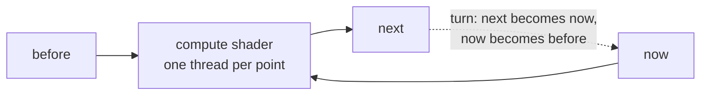

# 🌊 11b_RippleTank: the wave equation on the GPU

[⏫ Case studies](README.md)


📁 `examples/11_Science/11b_RippleTank.cpp`

A water surface of height $u$ follows the **wave equation**, with $c$ the speed of the waves:

```math
\frac{\partial^2 u}{\partial t^2} = c^2\,\nabla^2 u
```

**Picture the effect:** a local bump pushes the surrounding water, so the disturbance travels outward. Heat diffusion smooths a hot spot; a wave carries a disturbance across the grid. These are different update rules even though both store one number per grid point.

A second derivative in time needs two past states. The **leapfrog** scheme keeps three: before, now, next.

```math
u^{n+1}_{ij} = \Big(2\,u^{n}_{ij} - u^{n-1}_{ij} + C^2\,\big(u_{i-1,j} + u_{i+1,j} + u_{i,j-1} + u_{i,j+1} - 4\,u_{ij}\big)^{n}\Big)\,d
```

with $C^2 = (c\,\Delta t / h)^2$, stable under $\tfrac12$ (here 0.3), and $d$ a damping just under 1. Each pixel of a compute shader computes one point:

```glsl
float height = (2.0 * now[k] - before[k] + courant2 * laplacian) * damping;
```



- The three buffers turn each step: no copy.
- `scene.show(grid, buffer, look)` draws the buffer of *now* as it is. The CPU never reads a height.
- After a dispatch, `gpu::barrier(...)` is the caller's job ([compute on the GPU](../guides/compute-on-the-gpu.md)).

## 🚧 Limits

- Stable only while $C^2 = (c\,\Delta t / h)^2 \le \tfrac12$: faster waves or a finer grid need smaller steps of time.
- The damping $d$ stands for every loss at once; it is not the physics of a real liquid.

## 🔗 See also

[Compute on the GPU](../guides/compute-on-the-gpu.md) · [The heat plate](heat-plate.md) (the same grid, a different equation)
