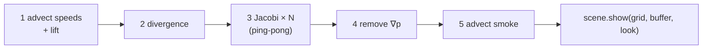

# 💨 11e_Smoke: an incompressible fluid

[⏫ Case studies](README.md)


📁 `examples/11_Science/11e_Smoke.cpp`

Air is a fluid that is not squeezed. Its speed $\mathbf{u}$ follows the Euler equations: it is carried by itself, pushed by the pressure $p$ and by forces $\mathbf{f}$ (here the lift of hot smoke), and no air is created or lost (**divergence free**):

```math
\frac{\partial \mathbf{u}}{\partial t} + (\mathbf{u}\cdot\nabla)\,\mathbf{u} = -\nabla p + \mathbf{f}, \qquad \nabla\cdot\mathbf{u} = 0
```

J. Stam's **Stable Fluids** (SIGGRAPH 1999) splits one step into simple parts, each a compute shader (lengths in grid cells, $h = 1$):

1. **Advect** (move along itself), looking back: the speed at $\mathbf{x}$ is the one that was at $\mathbf{x} - \Delta t\,\mathbf{u}(\mathbf{x})$; add the lift $\Delta t\,(w,\ b\,s)$ (wind $w$, buoyancy $b$, smoke $s$).
2. **Divergence** of the result: $\nabla\cdot\mathbf{u}_{ij} \approx \tfrac12\left(u^x_{i+1,j} - u^x_{i-1,j} + u^y_{i,j+1} - u^y_{i,j-1}\right)$.
3. **Pressure**: solve $\nabla^2 p = \nabla\cdot\mathbf{u}$ by Jacobi steps, $p_{ij} \leftarrow \tfrac14\left(p_{i-1,j} + p_{i+1,j} + p_{i,j-1} + p_{i,j+1} - (\nabla\cdot\mathbf{u})_{ij}\right)$.
4. **Project**: $\mathbf{u} \leftarrow \mathbf{u} - \nabla p$. Now $\nabla\cdot\mathbf{u} \approx 0$.
5. **Advect the smoke** along $\mathbf{u}$ the same way.



The five kernels come from one GLSL text: `ShaderSource::define("STEP", n)` chooses the part ([shaders made of pieces](../guides/draw-in-several-passes.md#-shaders-made-of-pieces-shadersource)). Looking *back* (step 1) is what makes it stable at any $\Delta t$.

## 🚧 Limits

- A fixed number of Jacobi steps leaves a little divergence: the smoke loses or gains a little volume. More steps cost more.
- Looking back blurs the field a little at each step (numerical diffusion): fine whirls fade faster than in real air.
- Two dimensions only.

## 🔗 See also

[Compute on the GPU](../guides/compute-on-the-gpu.md) · [Draw in several passes: shaders made of pieces](../guides/draw-in-several-passes.md#-shaders-made-of-pieces-shadersource)
