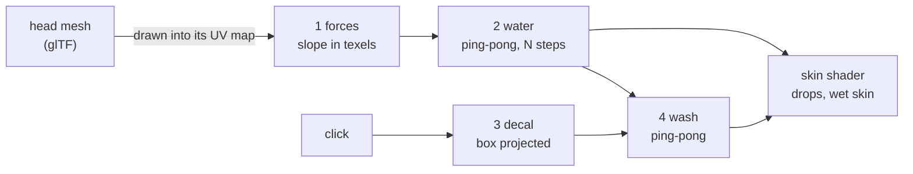

# 🧴 10c_SweatAndDecals: a simulation on the skin

[⏫ Case studies](README.md)


📁 `examples/10_Complete/10c_SweatAndDecals.cpp` (one file)

A head sweats. Drops form in the pores, run down the skin, leave a wet trail, and wash away the stickers (**decals**) you paint on it. Nothing is simulated in 3D: everything happens in textures laid on the skin.



**First observation:** a flat sticker follows a curved head because the simulation stores values in the head's texture coordinates. Keep that distinction in mind: the object is 3D, while the evolving state is a 2D image.

## Step 1 — Load the head and keep its triangles

```cpp
COMPAGES_TRY_ASSIGN(m_root, m_scene.loadFile(head));
m_world.each<compages::renderer::MeshRenderer>(
    [this](compages::world::Entity p_entity,
           compages::renderer::MeshRenderer&) { m_head = p_entity; });
// The UV passes and the raycast need the triangles on the CPU.
compages::renderer::MeshAsset const* mesh = m_scene.assets().mesh(drawn.mesh);
m_vertices = mesh->source_vertices;
m_indices = mesh->source_indices;
```

`loadFile` reads the glTF file (the head of the three.js decals demo, Lee Perry-Smith) and returns the root entity. The mesh is found with `each<MeshRenderer>`. Its corners stay on the CPU: the passes draw them again, and the click finds the skin under the mouse with them.

## Step 2 — The skin: your own `main`

As in [write a material](../guides/write-a-material.md), the PBR shader keeps its lights and gets a new `main()` (`SKIN_MAIN`): the normal map, the decals, the drops. This demo binds its three extra textures by hand, on units 2, 3 and 4, before the render:

```cpp
material.program.set("normalMap", 2);
material.program.set("decalMap", 3);
material.program.set("fluidMap", 4);
// each frame
m_normal_map.bind(2u);
m_decals.current().bind(3u);
m_fluid.current().bind(4u);
m_scene.render();
```

The decal and water maps change every frame (ping-pong), so they are not fixed in `Material::textures`. The mesh has no tangents: the shader builds a tangent frame from the derivatives of the position and the UV (`bend()`, after C. Schüler).

## Step 3 — Draw the mesh into its own UV map

The key idea of the demo. The vertex shader puts each corner at its texture coordinate instead of its place on the screen:

```glsl
vec4 world = model * vec4(position, 1.0);
vWorldPos = world.xyz;
gl_Position = vec4(uv * 2.0 - 1.0, 0.0, 1.0);
```

Drawn into a 256 x 256 texture, each pixel of this pass is one texel of the skin, and still knows its 3D position. One texel is about a millimetre of skin, the size of a drop. No depth test, both faces: the winding in UV space can be anything.

## Step 4 — The force pass: which way is down, in texels

Gravity along the skin is the part of gravity $\mathbf{g}$ that is not along the normal $\mathbf{n}$:

```math
\mathbf{s} = \mathbf{g} - (\mathbf{g}\cdot\mathbf{n})\,\mathbf{n}
```

The water moves in texels, so the slope must be written in the frame of the UV map. In this pass, $\mathbf{p}_u$ = `dFdx(vWorldPos)` is the piece of skin one texel to the right covers, and $\mathbf{p}_v$ = `dFdy` the one above: the two tangents of the map. We want $(a, b)$ with $\mathbf{s} \approx a\,\mathbf{p}_u + b\,\mathbf{p}_v$, the best fit (least squares):

```math
\begin{pmatrix} \mathbf{p}_u\cdot\mathbf{p}_u & \mathbf{p}_u\cdot\mathbf{p}_v \\ \mathbf{p}_u\cdot\mathbf{p}_v & \mathbf{p}_v\cdot\mathbf{p}_v \end{pmatrix}
\begin{pmatrix} a \\ b \end{pmatrix}
=
\begin{pmatrix} \mathbf{s}\cdot\mathbf{p}_u \\ \mathbf{s}\cdot\mathbf{p}_v \end{pmatrix}
```

A 2 × 2 system, solved by its determinant:

```glsl
vec3 pu = dFdx(vWorldPos);
vec3 pv = dFdy(vWorldPos);
vec3 slope = gravity - dot(gravity, n) * n;
// Solve slope = a pu + b pv: the same move, counted in texels.
float e = dot(pu, pu);
float f = dot(pu, pv);
float g = dot(pv, pv);
float det = e * g - f * f;
flow = vec2(g * dot(slope, pu) - f * dot(slope, pv), e * dot(slope, pv) - f * dot(slope, pu)) / det;
```

It also writes where the skin faces down (drops fall there) and where it sweats (the forehead). The head turns (Pitch, Roll): the field is made again each frame.

## Step 5 — The water pass (ping-pong)

A texel holds at most one drop, and where the drop sits inside the texel: drops glide, they do not jump. Pores fill small beads. A bead heavier than a threshold runs down the force field. When it crosses the border of its texel, it goes to that neighbour (diagonals too) and leaves a thin film behind, the wet trail. It stops when it has left most of its water, at a threshold that changes from texel to texel (rough skin).

Each texel computes what its eight neighbours send to it, from their own state only. The water that moves is counted once on each side, so none is created on the way. The loop is the ping-pong of [compute on the GPU](../guides/compute-on-the-gpu.md#-ping-pong-read-one-copy-write-the-other): read `current()`, write `next()`, `swap()`, several steps per frame so that a drop moves at most one texel per step.

## Step 6 — Decals projected on the skin

A left click finds the skin under the mouse (a ray against the triangles kept in step 1). A box is placed in front of it, turned at random, as `DecalGeometry` of three.js does. The UV pass draws the skin again, and keeps only the texels inside the box:

```glsl
vec3 d = vWorldPos - center;
vec3 box = vec3(dot(d, right) / dot(right, right),
                dot(d, up) / dot(up, up),
                dot(d, forward) / dot(forward, forward));
if (any(greaterThan(abs(box), vec3(1.0))) ||
    dot(normalize(vNormal), -normalize(forward)) < 0.2)
{
    discard;
}
vec4 color = texture(picture, box.xy * 0.5 + 0.5);
```

The picture is blended into the decal map (1024 x 1024).

## Step 7 — The wash pass

Where a drop runs, the paint is read from upstream (`uv - flow * dt`): it is carried down in streaks. Wherever there is water, the paint fades (Washing in Try it). Another ping-pong, on the decal map.

## Step 8 — The drops, drawn round

The skin shader looks at the 5 x 5 texels around each pixel. Each drop is a small round cap at its place, its radius the cube root of its water $V$ (a volume grows as the cube of a length), and its height a paraboloid:

```math
r = 1.2\,V^{1/3}, \qquad z(\mathbf{d}) = 0.45\,r\left(1 - \frac{|\mathbf{d}|^2}{r^2}\right)
```

 Caps of nearby drops add up, so drops that touch merge. A drop is darker, a sharp mirror of the sun and of a window of light above the viewer, with the Fresnel rim of water (2 %).

## The frame, in order

```cpp
m_scene.update(p_frame);     // the head turns
computeForces();             // pass 1
simulate(p_frame.elapsed);   // pass 2, several steps
wash(p_frame.elapsed);       // pass 4 (pass 3 on a click)
m_scene.render();            // the skin reads the maps
```

Try it: left click paints a decal or drops water, Pitch and Roll tilt the head and the drops change their way. Water stops at the seams of the UV map: it cannot cross from one island of the map to the next. That is the limit of the idea.

## 🧩 What Compages does for you

Loading the head and keeping its triangles (`loadFile`, `MeshAsset::source_vertices`), the lit shader with its own `main`, the passes and their framebuffers (`RenderPass`, `TexturePingPong`). The water rules, the decal projection and the skin shading are the demo's.

## 🔗 See also

[Draw in several passes](../guides/draw-in-several-passes.md) · [Compute on the GPU: ping-pong](../guides/compute-on-the-gpu.md#-ping-pong-read-one-copy-write-the-other) · [Write a material](../guides/write-a-material.md)
