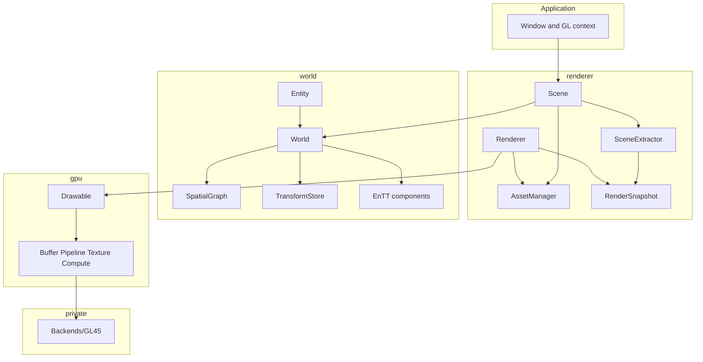

# 🏗 Architecture

[⏫ Concepts](README.md)

A change in one layer should not force every application to depend on the others. The include boundaries below preserve that separation. [Three layers](three-layers.md) explains the application design; the [code map](../reference/code-map.md) lists folders and headers for contributors.

## 🧭 Overview



`Core/` (vectors, matrices, `Result`, `Frame`, files) is the shared vocabulary, in the `compages` namespace; it is not a fourth layer. `Fields/` (grids and fields) is plain data, also in `compages`, usable by every layer ([fields and grids](fields-and-grids.md)).

## 🚧 Who may include whom

| Part | Entry point | May include | Never includes |
|------|-------------|-------------|----------------|
| `Fields` (in `compages`) | `Field<T>` | `Core` | `GPU`, `World`, `Renderer` |
| `compages::gpu` | `Drawable` | `Core`, `Fields` | `World`, `Renderer`, any `gl*` in a public header |
| `compages::world` | `World`, `Entity` | `Core`, `Fields` | `GPU`, `Renderer` |
| `compages::renderer` | `Scene` | `World`, `GPU`, `Fields`, `Core` | window code |

Public header entry points are listed in the [code map](../reference/code-map.md#-public-headers).

Only `src/GPU/Backends/GL45/` includes glad. A world component never holds a GPU pointer, only asset ids; the Renderer draws from a `RenderSnapshot`, never from the World. The library never calls GLFW: GLFW lives in `examples/Common/Window.cpp`.

## 🎭 Four actors per frame

```text
application    context, input, ViewFrame
world          entities, routines, joints, matrices
renderer       extraction, drawing, asset ids resolved
gpu            sends the CPU changes to the backend, draws and dispatches
```

[One frame](one-frame.md) gives the order in detail.

## 📦 Public contracts and private helpers

`include/Compages/` is the installed contract. Implementations in `src/` can change without exposing backend details to applications. A helper used by one implementation stays beside that file. This keeps private dependencies out of public headers.

Only `Scene` uses PIMPL. Its implementation brings together assets, extraction and drawing, while its public header keeps those details private. The smaller classes expose their own focused interfaces. This avoids an allocation and an extra indirection for every small object.

## 🎮 The backend boundary

The GL45 implementation requires OpenGL 4.5, including Direct State Access for object setup. Its compute paths also use storage buffers and dispatches. Keeping these calls behind the GPU interface lets World code compile without a graphics context.

Only `GL45` exists today. A different backend must implement resource creation, drawing, compute and synchronization while preserving the public contracts. Isolating driver calls makes that work possible; it does not supply the replacement. `GPU_BACKEND` selects the implementation folder at build time.

A platform without the required context cannot run this backend's drawing code. World-only applications remain usable because the include boundary keeps them independent of that driver requirement.
