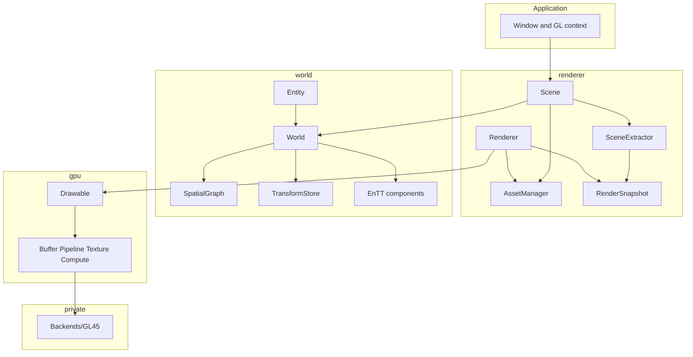

# Architecture

[Concepts](README.md)

The *why* of the layers is in [three layers](three-layers.md). This page says *where* the code lives, *who may include whom*, and *where to enter* when you want to change Compages itself. To use Compages in an application, the tutorials and the guides are enough.

## Overview



`Core/` (vectors, matrices, `Result`, `Frame`, files) is the shared vocabulary, in the `compages` namespace; it is not a fourth layer. `Fields/` (grids and fields) is plain data, also in `compages`, usable by every layer ([fields and grids](fields-and-grids.md)).

## Who may include whom

| Part | Entry point | May include | Never includes |
|------|-------------|-------------|----------------|
| `Fields` (in `compages`) | `Field<T>` | `Core` | `GPU`, `World`, `Renderer` |
| `compages::gpu` | `Drawable` | `Core`, `Fields` | `World`, `Renderer`, any `gl*` in a public header |
| `compages::world` | `World`, `Entity` | `Core`, `Fields` | `GPU`, `Renderer` |
| `compages::renderer` | `Scene` | `World`, `GPU`, `Fields`, `Core` | window code |

```cpp
#include <Compages/Compages.hpp>              // the whole stack
#include <Compages/GPU/GPU.hpp>               // the GPU layer
#include <Compages/Fields/Field.hpp>          // Grid2D, Field<T>
#include <Compages/World/World.hpp>           // ids, each, update
#include <Compages/World/Entity.hpp>          // chaining
#include <Compages/Renderer/Scene/Scene.hpp>  // the Renderer
```

Only `src/GPU/Backends/GL45/` includes glad. A world component never holds a GPU pointer, only asset ids; the Renderer draws from a `RenderSnapshot`, never from the World. The library never calls GLFW: GLFW lives in `examples/Common/Window.cpp`.

## Folders

```text
include/Compages/          the public interface, installed
  Core/                    vectors, matrices, Result, Frame, AABB, units
  Fields/                  Grid2D, CurvilinearGrid, Grid3D, Field<T, Grid>, intersect, isosurface, streamline
  GPU/                     Drawable, Buffer, Compute, Texture, Pipeline, ShaderSource, Statistics
  World/                   World, Entity, EntityId, Routine
    Components/            Camera, Light, SkinInstance, PoseDriver
    Spatial/               SpatialGraph, TransformStore, TransformSystem
    Kinematics/            Joint, JointHandle, KinematicSystem
    Import/                URDF: read the file, build the chain
    Controllers/           Orbit, Fly, FPS, input
  Renderer/
    Scene/                 Scene (the façade), Looks, Environment, RenderSettings
    Assets/                AssetManager, meshes, materials, textures, skins, prefabs
    Import/                glTF, STL, URDF visuals, prefab instantiation
    Procedural/            primitives, shader library (pieces and hooks), CanvasTexture
    Visualization/         FieldLook, ColorMap, Chart: fields drawn by Scene::show()
    Animation/             clips, Animator, AnimationSystem
    Render/                extraction, snapshot, Renderer, shadows, fog, clusters, RenderTarget, picking
    Components/            MeshRenderer, PrefabInstance, ScreenEffects
    Serialization/         saving a scene to JSON
src/                       the same folders, plus GPU/Backends/GL45/ and the private helpers of a folder
examples/                  the gallery, one binary; Common/ holds the window and the manifest
tests/                     Core, Fields, GPU, World, Renderer (GoogleTest)
external/external.mk       the third-party repositories, locked in external/versions.lock
```

`include/` is the contract; `src/` is not installed. Classes stay small; only `Scene` uses PIMPL (`Scene::Impl` in `Scene.cpp`). A helper used by one `.cpp` lives next to it in `src/`.

## Four actors per frame

```text
application    context, input, ViewFrame
world          entities, routines, joints, matrices
renderer       extraction, drawing, asset ids resolved
gpu            sends the CPU changes to the backend, draws and dispatches
```

[One frame](one-frame.md) gives the order in detail.

## Where to enter the code

| Goal | File | Demo |
|------|------|------|
| triangle | `GPU/Drawable.hpp` | `01c_Triangle` |
| compute | `GPU/ComputeProgram.hpp` | `05d_ComputeParticles` |
| ping-pong | `GPU/PingPong.hpp` | `05f_Galaxy`, `05b_GameOfLife` |
| headless world | `World/World.hpp` | `07a_HeadlessWorld` |
| joints | `World/Kinematics/Joint.hpp` | `13a_Workshop`, `08d_RobotArm` |
| scene | `Renderer/Scene/Scene.hpp` | `13a_Workshop` |
| shader hooks | `Renderer/Procedural/ShaderLib.hpp` | `13c_PaintedArm`, `06o_CelShading` |
| extraction | `Renderer/Render/SceneExtractor.hpp` | the renderer tests |
| assets | `Renderer/Assets/`, `Renderer/Import/` | `08a_GltfModel` |
| physics engine | `World/Components/PoseDriver.hpp` | `07e_ExternalPhysics` |

The conventions for contributors (style, naming, commits, the rules easy to break) are in [AGENTS.md](../../AGENTS.md).

## After OpenGL 4.5

- **4.3** brought compute shaders and storage buffers: particles, n-body, indirect draws.
- **4.5** brought Direct State Access: the backend sets objects up without binding them first.
- **macOS** stops at OpenGL 4.1: it cannot give the context the GL45 backend needs. World-only code builds there.
- **The web** would need a WebGPU backend for compute; WebGL 2 has no compute shaders. The `Backends/` folder is ready for another backend; the `GPU_BACKEND` variable of the `Makefile` chooses which folder is compiled. Only `GL45` exists today.
