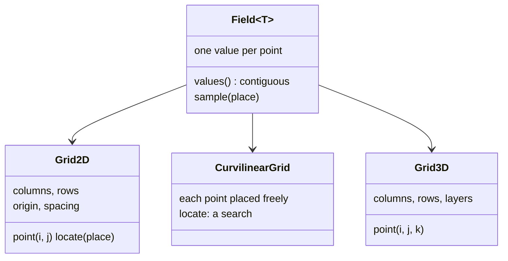
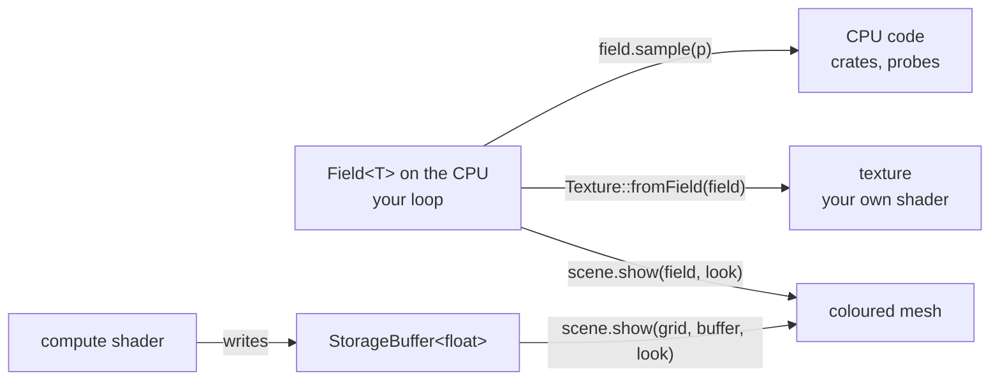

# Fields and grids

[Concepts](README.md)


Most scientific data is a value at each point of a space: the temperature of a plate, the height of an island, the speed of the wind, the density of smoke in a room. An engine made for games offers entities and meshes. A million temperatures as a million entities is absurd; as a mesh, it mixes the data with the way it is drawn, and the solver must know about triangles.

## Where, what, and how it looks, kept apart

| Thing | Type | Holds |
|-------|------|-------|
| **Where** the points are | a grid: `Grid2D`, `Grid3D`, `CurvilinearGrid` | sizes, origin, spacing (or each point placed freely) |
| **What** is there | `Field<T, Grid>` | one value of type `T` per point, in one contiguous array |
| **How** it is shown | a look: `FieldLook`, `ArrowLook` | a colour map, a range, a relief |

Grids and fields are in `include/Compages/Fields/`, in the `compages` namespace, and include only `Core/`. They need no World, no GPU and no screen: a unit test or a solver uses them as plain C++.

### A grid says where the points are

A `Grid2D` is a regular grid of the ground: $n_c$ columns, $n_r$ rows, a first point $\mathbf{o}$ and a step $h$. Point $(i, j)$ is at

```math
\mathbf{p}_{ij} = \mathbf{o} + h\,(i,\ j), \qquad 0 \le i < n_c,\quad 0 \le j < n_r
```

and its number (its **index**) is $k = j\,n_c + i$: row after row. In a 3D scene the grid is the ground seen from above, so a `Vector2f` of the grid is $(x, z)$. A grid with a size of zero or less holds no point: `count()` is 0 and `valid()` is false.

### A field holds one value per point

A `Field<T, Grid>` is one array of values in the order of the indices. That order is also the order of the texels of a texture, so the array goes to the GPU as it is (`gpu::Texture::fromField(field)`), with no reordering.



A point and a cell are not the same: 3 × 3 points make 2 × 2 cells between them. Keep it in mind when you compare the size of an array, the triangles drawn and the coordinates of a shader.

### Between the points: bilinear sampling

`field.sample(place)` finds the cell of the place (`grid.locate(place)` gives the cell $(i, j)$ and how far across it, $s$ and $t$ from 0 to 1), then mixes its four corners:

```math
f(\mathbf{p}) = (1-s)(1-t)\,f_{i,j} + s\,(1-t)\,f_{i+1,j} + (1-s)\,t\,f_{i,j+1} + s\,t\,f_{i+1,j+1}
```

Halfway between 20 and 40 on an edge, it gives 30. Outside the grid, it gives the value of the nearest edge. The GPU samples a texture the same way, so the CPU and the GPU read the same value at the same place: the crates of `10f_FlowingWater` float on the flow the water shader draws.

### Where the numbers go



- **Small, or read by the CPU**: compute on the CPU, show with `scene.show(field, look)`; send the new values each frame with `scene.show(entity, field, look)` ([values on a grid](../tutorials/05-values-on-a-grid.md)).
- **Large, every frame**: compute on the GPU into a storage buffer and show the buffer; nothing comes back to the CPU ([the ripple tank](../case-studies/ripple-tank.md)).

`scene.show()` sends the values to the GPU as a buffer, and the shader turns them into colours and heights: a new range or new values never rebuild the mesh.

## What Compages does not do with fields

Compages holds and shows fields; **it does not solve equations**. Creating a `Field` makes nothing spread. The heat, the waves and the fluids of the `11_Science` demos are a few loops each, in the demos; the [case studies](../case-studies/README.md) explain them. A finite-element solver, adaptive grids, units on values: not in Compages.

## See also

- [Show a field](../guides/show-a-field.md): colour maps, relief, volumes, arrows, a value under the mouse, curves over time.
- [Reference: fields](../reference/api.md#6-fields).
