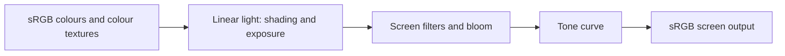

# 🎨 Light and screen colour

[⏫ Concepts](README.md)

Two lamps should give more light than one. Adding the numbers from a colour picker directly does not model that addition. A screen colour and a light intensity use different numerical spaces.

## 💡 Add light in linear space

Colours given to a Scene, including looks, lights, ambient and fog, use sRGB. The Renderer converts them to linear light before shading. In that space, twice the intensity means twice the light contribution.

Colour textures use sRGB decoding too. Textures containing numbers, such as normals or simulation state, must remain linear data. Treating them as sRGB changes the stored meaning. glTF colour factors are already linear, so the loader follows that format's rules.

## 🎞 Fit bright light onto a screen

Light values can exceed 1; the screen cannot display them directly. Exposure multiplies the linear result before a tone curve brings it into a displayable range. Increasing exposure changes the whole picture, rather than adding another light source.

`ToneMapping::Aces` is the default curve. `Reinhard` compresses brightness more gently. `None` clamps bright values and can erase differences above white. These are choices about presentation, not changes to the World or its light entities.

## ✨ Effects need the light before it is clipped

With `ScreenEffects`, the Renderer draws into an RGBA16F target. A bright bulb can retain a value above 1, which [bloom](../techniques/bloom.md) uses to form its halo. Filters read linear values before the final tone curve and sRGB conversion.

Backgrounds, unlit looks and helpers often specify a desired screen colour. Built-in shaders preserve that intent through the `screen()` helper when effects are enabled. Labels are drawn after the final picture pass.

## 📏 What this costs and leaves out

Conversion and tone mapping are shader arithmetic. Screen effects also need floating-point targets and extra passes. A tone curve does not compute bounced light, and a skybox alone does not illuminate objects. Ambient and direct lights still determine the Scene's shading.

## 🔗 See also

[Light the scene](../guides/light-the-scene.md) sets the controls. [Screen effects](../guides/screen-effects.md) attaches filters to a view. [Shader library](../reference/shaders.md) lists presentation helpers and interfaces.
