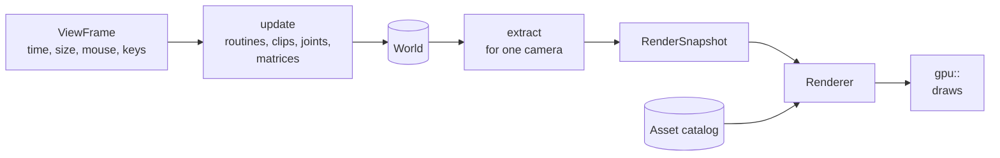

# One frame

[Concepts](README.md)


`scene.draw(frame)` is one line in your loop. Behind it, things happen in an order that matters: a routine that moves a joint must run before the matrices are computed, the matrices before anything is drawn, and nothing may change the world while it is drawn. When the order is wrong, an object lags one frame behind its parent, or moves twice as fast as it should.

## Update once, then draw from a copy

```text
Scene::draw(ViewFrame)
  update(frame)
    World::step(frame)        routines: fixedUpdate, update, timers, messages
    AnimationSystem::sample   clips -> local transforms
    World::update()           joints -> local transforms, then world matrices
    World::endStep()          lateUpdate, matrices of what it moved
    AnimationSystem::pose     skeletons -> SkinInstance
  render(active camera)
    SceneExtractor            World -> RenderSnapshot (what this camera sees)
    Renderer                  snapshot + catalog -> gpu:: calls
```

`draw(frame)` is `update(frame)` followed by `render()`. The two halves can be called apart: [the hot plate](../tutorials/05-values-on-a-grid.md) runs its own work between them, and [the robot eye](../tutorials/07-what-the-robot-sees.md) calls `render()` three times after one `update()`.

### One update per step of time

Calling `world.update(frame)` as well as `scene.draw(frame)` runs the routines twice: everything moves twice as fast.

### The snapshot

Before drawing, the `SceneExtractor` copies from the World what one camera needs: the camera, the lights, the placement and the asset ids of each visible mesh. The `Renderer` then draws from this `RenderSnapshot` and the catalog of assets, and never reads the World. Three things follow:

- **Culling** happens during the extraction: what the camera cannot see is not copied, so not drawn. `09b_ManyCubes` (1,728 cubes) shows the number of draw calls change as the camera turns.
- **Sorting**: the draws are ordered by material, then by mesh, to change shaders as rarely as possible. See-through objects come after the solid ones, from the farthest to the nearest.
- **Tests**: the renderer tests build snapshots by hand, with no World at all.



## Several views of one world

Update once, then render for each view:

```cpp
compages::renderer::Scene map(world, scene.assets());   // same world, same catalog
compages::world::EntityId top = map.camera().id();

scene.update(frame);
scene.render();          // the active camera
map.render(top);         // a minimap
```

A camera whose viewport covers part of the target clears and draws only that part (`06j_SplitViews`). `scene.render(camera, target)` draws into a `RenderTarget` instead of the window. A camera with `sees_helpers = false` leaves out the grids, axes, debug lines and the meshes marked `RenderFlags::Helper`.

## Two kinds of time

| Type | Holds | For |
|------|-------|-----|
| `compages::Frame` | `elapsed`, `total`, `width`, `height` | a headless step: `world.update(frame)` |
| `compages::world::ViewFrame` | a `Frame` plus keyboard and mouse | routines that read input (`Orbit`), `Scene::draw` |

In your own loop you fill `elapsed` and `total` yourself ([a first scene](../tutorials/04-a-scene.md#the-same-scene-in-your-own-window)). `fixedUpdate` of a routine runs at a constant step whatever the frame rate: the place for physics.

## The price of the snapshot

- The snapshot is a copy of what is drawn, every frame and every view. It is the price of a World that may change during drawing (another thread, a physics engine) without harm.
- Animation clips belong to the Renderer (they live in the asset catalog), so a headless World has no clip until a Scene loads one.

## See also

- [Three layers](three-layers.md): why the World does not draw.
- [Several views](../guides/several-views.md), [Screen effects](../guides/screen-effects.md): what happens after the draws.
- [Measure a frame](../guides/measure-a-frame.md): the CPU and GPU time of each part.
