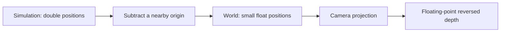

# 📐 Precision and scale

[⏫ Concepts](README.md)

A rocket near the Moon may shake even when its simulation is stable. Two distant surfaces may flicker even when neither moves. These failures come from different numbers: world coordinates and the depth buffer.



## 📍 World coordinates lose small differences

A `float` has 24 bits of significand precision. Around 3.8 × 10⁸ metres, neighbouring floats are 32 metres apart. A rocket moving one metre cannot be represented there. Changing the drawing unit moves the same precision problem to another numerical scale.

Keep the simulation's large positions in double precision. Subtract an origin near the camera before converting positions to the floats used by the World. The rocket stays near zero. The Moon keeps a large coordinate, where a few metres may occupy less than a pixel.

This floating origin changes the coordinates used for drawing. It does not change the simulation's physical positions. Picking results and camera targets use the World coordinates too; convert them back through the same origin when the simulation needs them.

## 🎯 Depth loses distant separation

Several fragments can cover the same pixel. The depth buffer decides which surface is nearest. A perspective projection stores a function of distance, rather than distance itself.

With a distant far plane, conventional depth behaves approximately as:

```math
z_{usual}(d) \approx 1 - \frac{n}{d}
```

Here `n` is the near distance and `d` is the distance along the camera axis. Many depth values describe the region near the camera. Far away, distinct surfaces can round to the same stored value. The visible result is z-fighting: patches of one surface replace the other as the view changes.

Reversing the mapping gives approximately:

```math
z_{reversed}(d) \approx \frac{n}{d}
```

Near becomes 1 and far becomes 0. Floating-point numbers have denser absolute spacing near zero. That spacing compensates for the perspective mapping and improves relative depth precision over a wide range.

The benefit requires a floating-point depth target, such as `Depth32F`, and a projection and depth test that agree. Reversing an integer depth buffer alone gives no precision gain. The GL45 backend also uses zero-to-one clip depth for reversed passes.

## 🔄 One convention for a drawing pass

The Renderer supplies `CameraFrame::reversed_projection` for drawing. It keeps the usual `projection` for CPU operations such as culling and picking. A pass with `reversed_depth = true` clears to far and mirrors depth comparisons, so nearer surfaces still win.

A GPU overlay that tests against the Scene's depth must use that same projection and pass convention. Mixing the two can make distant fragments hide nearby ones. A floating origin cannot repair that mismatch, and reversed depth cannot repair large world coordinates.

## 📏 What this costs and leaves out

A floating origin requires the application to convert positions at its boundary with the World. Reversed depth requires consistent targets, projections and comparisons. Neither provides collision detection or extra geometric detail. Surfaces closer than the available precision can still conflict.

## 🔗 See also

[Very large scenes](../guides/very-large-scenes.md) gives the integration steps. [One frame](one-frame.md) explains which camera data reaches drawing. The implementation uses [CameraFrame](../../include/Compages/Renderer/Render/CameraFrame.hpp) and [RenderPass](../../include/Compages/GPU/RenderPass.hpp).
