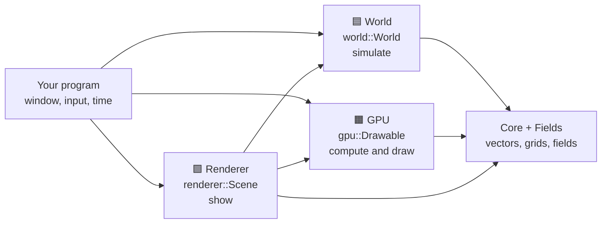

# 🧱 Three layers

[⏫ Concepts](README.md)


## 🎯 The problem: two jobs that get mixed

A 3D program does two different jobs:

```text
          ┌──────────────────────────┐       ┌──────────────────────────┐
          │  SIMULATE                │       │  SHOW                    │
 time ───►│  where are things?       │──────►│  what does the camera    │───► picture
          │  how do they move?       │       │  see? draw it on the GPU │
          └──────────────────────────┘       └──────────────────────────┘
           runs without a screen               needs a graphics context
```

**Simulating** is numbers in memory: a robot arm turns its joints, heat spreads on a plate, particles fall. A unit test, a planner or a server needs it, without any window. **Showing** is a camera that looks at the world and a graphics card that draws triangles into a picture, many times a second.

Most engines mix the two. The position of an object lives in the same class as its mesh; moving a robot needs an OpenGL context; a test of the motion needs a window, or a fake one. The robot workshop of the [tutorials](../tutorials/README.md) shows what happens when they are kept apart: the arm moves in a `World` that knows nothing of pictures, and three different cameras draw it in the same frame without changing it.

## 💡 The idea: three layers, each usable alone

Compages is three layers, plus two shared folders of plain data:



| You have… | Layer | Entry point | It leaves to the others |
|-----------|-------|-------------|-------------------------|
| GLSL and arrays of numbers | 🟧 **GPU** | `compages::gpu::Drawable` | entities, model files, the window |
| things that move, tests included | 🟦 **World** | `compages::world::World` | draw calls, the mesh catalog |
| a world you want to see | 🟩 **Renderer** | `compages::renderer::Scene` | the simulation itself: it stays in the `World` |

**World and GPU do not know each other; the Renderer uses both.** A particle simulation on the GPU needs no scene graph: the GPU layer alone. A robot planner needs no window: the World alone. A game or a simulator with a view needs all three, with types that stay separate.

`Core/` (vectors, matrices, `Result`, `Frame`) and `Fields/` (grids and the values on them) are in the `compages` namespace and include nothing else. Every layer uses them: a field is computed headless, sent to the GPU, or shown by a Scene, and it is the same object.

### 🟧 The GPU layer: the shader is the interface

The shader declares `in vec2 position;`; the C++ writes `drawable["position"] = …`. **The name is the contract**: no attribute numbers, no `glBindBuffer`, no `GLenum` in a public header. The OpenGL 4.5 code is hidden in one folder and could be replaced. The idea comes from [Glumpy](https://glumpy.github.io/), in Python; Compages adds typed vertex layouts on the C++ side, so one buffer can feed several shaders (the picture, the shadow, the outline). Details: [the GPU layer](the-gpu-layer.md).

### 🟦 The World: it exists without a picture

One `World` holds a **scene graph** (parents and children, with chained calls like [Three.js](https://threejs.org/)) and an **ECS** ([EnTT](https://github.com/skypjack/entt)) for your own data. Cameras, lights, joints and routines are simulation data: a camera is a place and a lens, not a draw call. Running headless is not an option added later: it is this layer used alone. Details: [the World](the-world.md).

### 🟩 The Renderer: it shows, it does not own

`renderer::Scene` is the one place to call `box`, `camera`, `sun`, `loadFile`, `show`, `draw`. Behind it:

1. **A catalog** (`AssetManager`): meshes, textures, materials, clips. A world component holds an asset id, never a GPU pointer.
2. **Render components** (`MeshRenderer`, `Animator`) attached to world entities.
3. **A snapshot**: before drawing, the Renderer copies what it needs from the World into a `RenderSnapshot`, then draws from that copy. It never reads the World while drawing.

Several Scenes can share one World and one catalog (a split screen, a minimap, the camera of a robot). Details: [one frame](one-frame.md).

## 💰 What it costs

- **Two names for one thing.** A box in a Scene is a world entity plus a `MeshRenderer` component. `scene.box()` hides it, but a reader of the code sees both.
- **One copy per frame.** The snapshot copies the placements of what is drawn. For tens of thousands of objects this costs more than reading the world in place; the gain is that the World can change during drawing, from another thread or another engine, without harm.
- **The window is yours.** Compages never opens one (`gpu::init` receives a ready context). Your program, or the gallery, does it; the [first scene](../tutorials/02-first-scene.md) shows the twenty lines.

## 🗃 Where does my data live?

A simple API must not force one memory layout. Choose the place by the number of things and by who computes them:

| Your data | Put it in | Why | Example |
|-----------|-----------|-----|---------|
| A few objects with their own logic (a door, a robot arm, a camera) | a **`Routine`** on the entity | start, update, timers, messages; one object, one virtual call: fine for tens or hundreds | `00b_RobotArm`, `07b_Routines` |
| Many things with the same data (robots, agents, bullets) | **components** + `world.each<A, B>(…)` | your structs packed together, one loop over all | `07a_HeadlessWorld` |
| Values on a grid (heat, height, wind) | a **`Field`** | one object for a million points, never a million entities | `00c_HotTable`, `11a_HeatPlate` |
| Vertices the CPU changes from time to time | a **`Drawable`** (`setVertices`, `editVertex`) or a `Dynamic` buffer | a CPU copy; `draw()` sends only what changed | `02b_DynamicGeometry` |
| A movement that is a formula of the time (orbits, waves) | the **vertex shader**, with a time uniform | sent once; only the time is written per frame | `05e_SpiralGalaxy` |
| Millions of things whose next state depends on the last (particles, cells, stars) | a **`StorageBuffer`** or a `PingPong` + a compute shader | stays on the GPU; drawn from there without a copy | `05f_Galaxy`, `05b_GameOfLife` |

## 🚪 What stays outside

- **The window** (GLFW, SDL, Qt): your program.
- **Physics**: Compages has none and will not get one. Your engine (MuJoCo, Bullet, Jolt, your own) computes the poses and writes them into entities marked `PoseDriver::External`; the Renderer shows them ([plug in a physics engine](../guides/plug-a-physics-engine.md)).
- **Sound**, an editor, an asset store, a production pipeline for a big game.

Compages aims first at **scientific simulations** (fields, cellular automata, n-body, curves), then at **robots and games** that reuse the same objects in space. *Compages* means an assembly: parts that lock together into one whole.

## 🔗 See also

- [Architecture](architecture.md): who includes whom, the folders, the backend.
- [One frame](one-frame.md): the order of the work inside `draw()`.
- [A first scene](../tutorials/02-first-scene.md): the `World` and the `Scene` in a program of your own.
