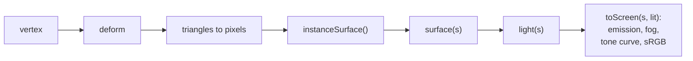

# 🎨 Write a material

[⏫ Guides](README.md)

Give a shape a look no built-in look has (stripes, triplanar concrete, hot metal, waves), and keep what the Renderer gives: the sun and its shadow, the lamps, the fog, the tone curve.


## 🪝 Four hooks of the PBR shader

`shaders::pbr()` returns the two stages of the Renderer's lit shader, as text you can change. Four named functions, its **hooks**, can be replaced:

| Hook | Stage | What you write | Default |
|------|-------|----------------|---------|
| `deform` | vertex | `void deform(inout vec4 world, inout vec3 normal)`: move a corner and turn its normal, in world space | changes nothing |
| `surface` | fragment | `void surface(inout Surface s)`: change `albedo`, `normal`, `metallic`, `roughness`, `emission`, `opacity`; may `discard` | changes nothing |
| `light` | fragment | `vec3 light(Surface s)`: the light on the surface, linear, before emission, fog and tone curve | `sceneLight(s)`: sun, sky, lamps, shadows |
| `main` | fragment | the whole `void main()`, which writes `oColor` | the four steps below |



A name the shader does not declare is an error that lists the known ones (`'pbr.vert' has no hook 'deforme' (known: deform)`), not a silence.

## 🎨 1. Start with surface

It receives what the material instance gives (its colour and picture, its normal map, metal and roughness) and changes what it wants; the light stays right without effort. The workshop paints stripes ([tutorial 5](../tutorials/06-a-look-of-your-own.md)); `11d_BimetalBeam` paints hot metal that glows:

```glsl
void surface(inout Surface s)
{
    s.albedo = mix(STEEL, BRASS, metal.brass);
    float glow = smoothstep(350.0, 800.0, metal.heat);
    s.emission = 0.6 * glow * mix(RED, ORANGE, glow);   // light of its own, after the lamps
}
```

`metal` is a struct of the material itself, `struct MetalV2F { float heat; float brass; }`: its `deform` hook writes it for each corner, and `surface` reads it for each pixel. It sits next to the `v2f` of the PBR shader, never inside it ([shaders reference](../reference/shaders.md)).

`10f_FlowingWater` projects a picture along the three axes and blends by the normal (**triplanar mapping**), so long walls need no texture coordinates:

```glsl
uniform sampler2D surfaceMap;
uniform float tileMetres;

void surface(inout Surface s)
{
    vec3 w = pow(abs(s.normal), vec3(4.0));
    w /= (w.x + w.y + w.z);
    vec3 p = v2f.worldPos / tileMetres;
    vec3 c = texture(surfaceMap, p.zy).rgb * w.x + texture(surfaceMap, p.xz).rgb * w.y
           + texture(surfaceMap, p.xy).rgb * w.z;
    s.albedo = c * baseColorFactor;
}
```

The hook sees what the PBR shader declares: `v2f.worldPos`, `v2f.normal`, `v2f.uv`, `baseColorFactor`, `baseColorMap`, `opacity`, `cameraPos`.

## 💡 2. Then light, for another model of light

The surface stays; only the way light falls on it changes. The [cel shading technique](../techniques/cel-shading.md) cuts the sun into flat tones this way. `light` reads `lightDir`, `lightColor`, `ambient`, `cameraPos`, `v2f.worldPos` and may call `sunVisibility(…)`, `pointLightsContribution(…)`, `shade(…)`, `shadePbr(…)` or `sceneLight(s)` (to change the light of the scene, not replace it).

## 🎨 3. main, for what is not a lit surface

A picture shown as it is, a debug view, several lightings mixed (the water of `10f`). Your `main()` may call `instanceSurface()`, `surface(s)`, `light(s)` and `toScreen(s, lit)`, and every piece of the library: `shade(base, n, worldPos)`, `shadePbr(albedo, n, worldPos, metallic, roughness)` (the model of glTF), `bumpNormal(…)` (a normal map without tangents), `applyFog(colour, worldPos)`, `present(linear)`. Your own shaders can include the same pieces by name (`<compages/shade.glsl>`, `<compages/fog.glsl>`…, listed in `ShaderLib.hpp`).

## 🧬 4. deform, to move the vertices

The sea of `10e_Archipelago` is a flat grid that the hook lifts into Gerstner waves:

```cpp
water.vertex()
    .include("archipelago/swells.glsl", swells)   // GLSL written from the C++ table of swells
    .hook("deform", SURFACE_WAVES);
```

```glsl
void deform(inout vec4 world, inout vec3 normal)
{
    world = displace(world);
    normal = gWaveNormal;
}
```

`include(name, text)` gives a piece of GLSL a name: here the table of swells, written by C++. The boats read the same table on the CPU: they ride the waves that are drawn. A material whose `deform` is replaced draws its own shadow of the sun, so the shadow follows the waves (not the shadow of a lamp: that pass has no hooks).

## 🧩 Make the material, give it, feed it

```cpp
compages::renderer::shaders::ShaderPair shaders = compages::renderer::shaders::pbr();
shaders.fragment().hook("surface", SOLID_SURFACE);
COMPAGES_TRY_ASSIGN(m_concrete,
    scene.assets().createMaterial("Concrete",
        { .family = compages::renderer::ShaderFamily::PbrMinimal,
          .shaders = std::move(shaders),
          .state = { .depth_test = true, .cull = compages::gpu::CullMode::Back },
          .see_through = std::nullopt,
          .textures = { { .sampler = "surfaceMap", .texture = picture } } }));
scene.look(wall, m_concrete);                               // keeps the colour of the wall
// each frame, its uniforms:
scene.assets().material(m_concrete)->program.set("tileMetres", 4.0f);
```

- `createMaterial` compiles, makes the pipelines and registers the material; the compiler's error, with the line, comes back in its `Result`.
- `.textures` binds pictures to samplers by name, at each draw (units 2 to 6: five at most). `.buffers` gives storage buffers by block name: `11d_BimetalBeam` bends its strip on a middle line its CPU model writes each frame.
- One shader text, several materials: the concrete, the painted metal and the stripes of `10f` are three materials of the same `SOLID_SURFACE`, each with its picture.
- Each shape keeps its own colour (`MaterialInstance::base_color_factor`, linear: `srgbToLinear(…)`).
- The Renderer sets the uniforms of the family (lights, fog, shadows) only when the shader reads them.
- `.see_through` is how the shape is drawn when its opacity is under one ([see-through things](see-through-things.md)).

## 🧯 Common problems

- A uniform you set is "unknown". The GLSL compiler drops a uniform that does not count in the result. Setting it is a frame error, and `--check` fails. Use it, or do not set it.
- The clusters of lamps break. Bindings 9, 10 and 11 of the lit shaders hold the clustered lamps: keep them free in your hooks.

## 🔗 See also

[◀ A look of your own](../tutorials/06-a-look-of-your-own.md) · [Cel shading](../techniques/cel-shading.md) · [Flow mapping](../techniques/flow-mapping.md) · [Draw in several passes](draw-in-several-passes.md) (shaders made of pieces, hot reload)
