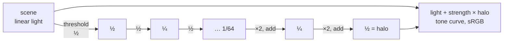

# 💡 Bloom

[◀ Cel shading](cel-shading.md) · [⏫ Techniques](README.md) · [Next: Flow mapping ▶](flow-mapping.md)


| Demo | Layer | Your C++ | Your GLSL | Passes added |
|------|-------|----------|-----------|--------------|
| `12b_Bloom` | 🟩 Renderer | 1 statement | none | up to 12 small passes + 1 |

## 🎯 The problem

A screen cannot show light brighter than its white. A bulb, the sun on chrome or a neon tube are many times brighter than that, but on the screen they become the same flat white as a sheet of paper. Our eyes and cameras know these lights another way: their light **spills round them** in a soft halo. That halo is the bloom. Without it, a lamp at night looks like a white disc stuck on the picture.

## 💡 The idea

1. Draw the scene in **linear light**, in a picture of floating-point numbers (RGBA16F), where 1 is the white of the screen and a bulb can be 7.
2. Keep only the light **above a threshold** (1 by default): the paper is dropped, the bulb stays.
3. Make that picture **half as large**, again and again (down to 1/64 of the size). Each level is more blurred than the one before.
4. Go back up: enlarge each level and **add it** to the larger one. Level 0 now holds a halo of every size: tight near the bulb, wide far from it.
5. Add the halo to the picture, times a **strength**, then apply the tone curve that brings everything back between 0 and 1.

Blurring a small picture is cheap: one pixel of the 1/64 level covers 64 × 64 pixels of the screen. This is why bloom uses a chain of smaller pictures and not one large blur.



## 🧩 In Compages

Bloom is a part of `ScreenEffects`, a component you put **on a camera** ([chapter 6, screen effects](../06-Renderer-Layer.md#screen-effects-filters-and-bloom)). The Renderer makes the pictures, the passes and the framebuffers, and resizes them with the window. From [12b_Bloom.cpp](../../examples/12_Effects/12b_Bloom.cpp):

```cpp
m_camera.set(compages::renderer::ScreenEffects{
    .filters = {}, .bloom = { .enabled = true, .threshold = 1.0f, .strength = 0.6f } });
```

That is all the effect needs. The rest of the demo makes something bright enough to bloom: an **unlit** sphere is drawn at its colour with no shading, so a bulb of colour 1 stays very bright in linear light.

```cpp
compages::world::Entity lamp = m_scene.lamp("Lamp", c, 2.5f, 7.0f);
m_scene.sphere("Bulb", compages::renderer::unlit(c.x, c.y, c.z)).parent(lamp).scale(0.3f);
```

The settings can change at any frame. The demo edits the component in place:

```cpp
compages::renderer::Bloom& bloom = m_camera.get<compages::renderer::ScreenEffects>().bloom;
ImGui::SliderFloat("Threshold", &bloom.threshold, 0.0f, 4.0f, "%.2f");
```

Each camera chooses: in a split view ([chapter 6, several views](../06-Renderer-Layer.md#several-views-of-one-world)), one view can bloom and the other not.

## 🔍 The shader

You write no GLSL for the bloom. These are the passes of the Renderer, in [src/Renderer/Render/ScreenPost.cpp](../../src/Renderer/Render/ScreenPost.cpp).

**Down**: the mean of four pixels, and, on the first level only, the light above the threshold. The colour is scaled, not cut, so that it keeps its hue:

```glsl
vec3 c = 0.25 * (texture(source, vUv + t * vec2(-0.5, -0.5)).rgb + texture(source, vUv + t * vec2(0.5, -0.5)).rgb +
                 texture(source, vUv + t * vec2(-0.5, 0.5)).rgb + texture(source, vUv + t * vec2(0.5, 0.5)).rgb);
float bright = max(c.r, max(c.g, c.b));
oColor = vec4(c * (max(bright - threshold, 0.0) / max(bright, 1e-4)), 1.0);
```

**Up**: a 3 × 3 "tent" (weights 1-2-1 in each direction, divided by 16), added to the larger level (the pass blends; it does not clear):

```glsl
vec3 c = 4.0 * texture(source, vUv).rgb;
c += 2.0 * (texture(source, vUv + vec2(t.x, 0.0)).rgb + texture(source, vUv - vec2(t.x, 0.0)).rgb +
            texture(source, vUv + vec2(0.0, t.y)).rgb + texture(source, vUv - vec2(0.0, t.y)).rgb);
c += texture(source, vUv + t).rgb + texture(source, vUv - t).rgb + texture(source, vUv + vec2(t.x, -t.y)).rgb +
     texture(source, vUv + vec2(-t.x, t.y)).rgb;
oColor = vec4(c / 16.0, 1.0);
```

**Present**: the light, plus its halo, then the tone curve and the sRGB colours of the screen:

```glsl
vec3 c = texture(screenColor, vUv).rgb + bloomStrength * texture(bloomMap, vUv).rgb;
oColor = vec4(toSrgb(toneCurve(max(c, 0.0))), 1.0);
```

## 📏 Cost

At 1920 × 1080:

| What | How much |
|------|----------|
| Levels | 6 (it stops before a side is smaller than 16 pixels) |
| Passes | 6 down + 5 up + 1 present; each draws one triangle over its picture |
| Memory | the linear picture: 16.6 MB (RGBA16F, shared with the filters); the levels: about 1/3 of it, 5.5 MB |
| Pixels read | the down passes read about 1.3 times the screen; the up passes are small |

## 🚧 Limits

- The threshold is hard: light just above it blooms, light just under it does not. Some engines use a soft "knee" round the threshold.
- The halo has one shape, round. Real lenses add streaks and ghosts (lens flares); they are not in Compages.
- Bloom needs light above 1. A scene drawn with a low exposure, or lit only by a dim sun, has nothing to bloom: lower the threshold, or raise the light.

## 🧪 Try it

- **Bloom** off: the bulbs become flat discs with sharp edges.
- **Threshold** to 0: all the light spills, the lit floor glows, the picture looks foggy.
- **Threshold** to 3: only the core of the bulbs blooms.
- **Strength** to 2: the halo is wider than the bulb itself.

## 📁 Source

- [examples/12_Effects/12b_Bloom.cpp](../../examples/12_Effects/12b_Bloom.cpp): the scene and the one statement
- [include/Compages/Renderer/Components/ScreenEffects.hpp](../../include/Compages/Renderer/Components/ScreenEffects.hpp): `ScreenEffects`, `Bloom`, `ScreenFilter`
- [src/Renderer/Render/ScreenPost.cpp](../../src/Renderer/Render/ScreenPost.cpp): the passes

---

[◀ Cel shading](cel-shading.md) · [⏫ Techniques](README.md) · [Next: Flow mapping ▶](flow-mapping.md)
