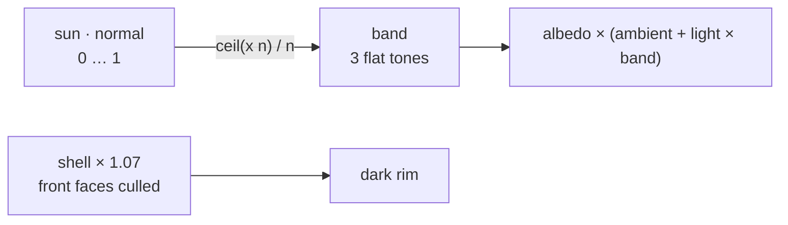

# Cel shading and outlines

[Techniques](README.md) · [Next: Bloom](bloom.md)


| Demo | Layer | Your C++ | Your GLSL | Draws |
|------|-------|----------|-----------|-------|
| `06o_CelShading` | 🟩 Renderer | 4 lines for the tones, 6 for the outline | 12 lines | 2 per shape (shape + outline) |

## The problem

Real light changes smoothly across a sphere: from bright to dark through every grey. A cartoon does not. It paints a few **flat tones** (lit, half lit, in shadow) and draws a **black line** round each shape. You want this look without writing a whole new lighting shader: the colours, the shadows of the sun and the fog of the Scene must stay.

## The idea

### The tones

The light of the sun on a surface is a number from 0 (the sun is behind) to 1 (the sun faces it). Cel shading cuts this number into a few steps before it is used:

```math
\text{band} = \frac{\lceil \text{sun} \times n \rceil}{n}
```

With $n = 3$ tones, every value from 0.01 to 0.33 becomes 0.33, every value from 0.34 to 0.66 becomes 0.66, and so on. The glint of the sun (the small white spot) is cut the same way: it is either on or off.

### The outline

Each shape gets a second copy of itself, a little larger (7 % here), in one dark colour. This copy, the **shell**, is drawn **inside out**: the GPU removes its faces that look at the camera (front-face culling) and keeps its back faces. The shape covers the middle of the shell; only a thin dark rim shows round its edge.



## In Compages

The PBR shader of the Renderer has **hooks**: named functions you may replace with your own text ([write a material](../guides/write-a-material.md)). The hook `light` receives the surface (its colour, its normal) and returns the light it sends back. Replace it, and every other part of the shader (the surface, the shadows, the fog, the tone curve) stays.

**The tones**: take the PBR shader, replace its `light`, make a material, give it to a shape. From [06o_CelShading.cpp](../../examples/06_Scene/06o_CelShading.cpp):

```cpp
compages::renderer::shaders::ShaderPair cel = compages::renderer::shaders::pbr();
cel.fragment().hook("light", BANDS);
COMPAGES_TRY_ASSIGN(m_cel,
                    m_scene.assets().createMaterial("Cel",
                                                    { .family = compages::renderer::ShaderFamily::PbrMinimal,
                                                      .shaders = std::move(cel),
                                                      .state = solid,
                                                      .see_through = std::nullopt }));
// ...
m_scene.look(shape, m_cel);   // the shape keeps its own colour
```

**The outline**: a material whose `main` writes one dark colour and culls the front faces, then a shell as a child of each shape, so it follows it:

```cpp
compages::renderer::shaders::ShaderPair ink = compages::renderer::shaders::pbr();
ink.fragment().hook("main", INK);
// ... createMaterial("Outline", { ..., .state = { .depth_test = true, .cull = compages::gpu::CullMode::Front } })

compages::world::Entity shell = m_scene.shape(p_shape, "Outline").parent(shape).scale(1.07f);
m_scene.look(shell, m_outline);
shell.get<compages::renderer::MeshRenderer>().flags = compages::renderer::RenderFlags::NoShadowCaster;
```

The shell casts no shadow: otherwise the shadow of each shape would grow by 7 %.

**The number of tones** is a uniform of the material, set each frame:

```cpp
m_scene.assets().material(m_cel)->program.set("tones", float(m_tones));
```

## The shader

The whole hook `light`. `lightDir`, `lightColor`, `ambient`, `cameraPos`, `vWorldPos` and `sunVisibility()` (the shadow of the sun) are given by the PBR shader:

```glsl
uniform float tones;

vec3 light(Surface s)
{
    vec3 toSun = normalize(-lightDir);
    vec3 toEye = normalize(cameraPos - vWorldPos);
    float sun = max(dot(s.normal, toSun), 0.0) * sunVisibility(s.normal, toSun, vWorldPos);
    float band = ceil(sun * tones) / tones;
    float glint = pow(max(dot(s.normal, normalize(toSun + toEye)), 0.0), 80.0);
    return s.albedo * (ambient + lightColor * band) + lightColor * step(0.5, glint) * step(0.0, sun - 0.01);
}
```

The glint uses the **half vector** `toSun + toEye` (Blinn-Phong). `step(0.5, glint)` turns the soft spot into a hard one; `step(0.0, sun - 0.01)` removes it on the side in shadow.

The ink is three lines:

```glsl
void main()
{
    oColor = vec4(0.03, 0.03, 0.05, 1.0);
}
```

## Cost

| What | How much |
|------|----------|
| Passes | none added: the tones replace the light of the PBR shader |
| Draws | twice the shapes (each shell is one more draw) |
| Textures | none |
| Per pixel | less work than the PBR light it replaces |

## Limits

- The shell grows by the same factor everywhere: on a long thin shape the line is thicker at the ends. A shell pushed **along the normals** (hook `deform`, [write a material](../guides/write-a-material.md#4-deform-to-move-the-vertices)) keeps the same width everywhere.
- Lines appear only round the outside of a shape, not at its inner folds. A **screen filter** that looks for jumps in the depth draws those too: `12a_ScreenFilters` does it.
- Only the sun is cut into tones. The lamps of the Scene are left out of this hook; add them in the same loop to cut their light too.

## Try it

- **Cartoon** off: the same shapes with the light of the Scene. Compare the shadow side of the red sphere.
- **Tones** from 2 to 6: at 6 the bands become hard to see, and the look comes back close to the smooth light.
- In the code, change `1.07f` to `1.2f`: the line becomes a thick halo; at `1.01f` it almost disappears.

## Source

- [examples/06_Scene/06o_CelShading.cpp](../../examples/06_Scene/06o_CelShading.cpp): the two GLSL texts and the materials
- [include/Compages/Renderer/Procedural/ShaderLib.hpp](../../include/Compages/Renderer/Procedural/ShaderLib.hpp): `shaders::pbr()` and its hooks

---

[Techniques](README.md) · [Next: Bloom](bloom.md)
