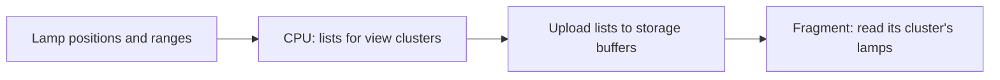

# 🏮 Clustered lighting

[◀ Shadow mapping](shadow-mapping.md) · [⏫ Techniques](README.md) · [Next: Volumetric fog ▶](volumetric-fog.md)


| Demo | Layer | Your C++ | Your GLSL | Passes added |
|------|-------|----------|-----------|--------------|
| `06m_ManyLights` | 🟩 Renderer | 1 creation statement per lamp | none | no extra scene draw |

## 🎯 The problem

Two hundred lamps can light a room, but most are too far away to affect a given surface. Testing every lamp at every fragment wastes work.

## 💡 The idea

Divide the camera view into screen tiles and depth slices. Each small volume is a cluster. Put a lamp into every cluster its range may reach. A fragment then reads only its cluster's lamp list.



Depth slices grow with distance. Their index follows `log(depth / near) / log(far / near)`. This places more slices near the camera. Compages uses clustered forward lighting: geometry is shaded in its normal draw, without a separate deferred-lighting image pass.

## 🧩 In Compages

[06m_ManyLights.cpp](../../examples/06_Scene/06m_ManyLights.cpp) creates ordinary lamps inside its firefly loop:

```cpp
fly.lamp = m_scene.lamp("Firefly", colour, 1.1f, m_range);
```

`fly` holds the entity; `colour` and `m_range` are supplied by the demo. No switch enables clustering. The Renderer keeps the four nearest lamps in direct uniforms and groups the remaining lamps for each view. The CPU builds and uploads the lists; the fragment shaders read them.

The view has 16 × 9 tiles and 24 depth slices: 3456 clusters. Built-in lit materials consume the lists automatically. If you write shader hooks with storage buffers, keep bindings 9, 10 and 11 free.

## 🔍 The shader

The built-in light loop in [ShaderLib.cpp](../../src/Renderer/Procedural/ShaderLib.cpp) reads the cluster's first index and count:

```glsl
uvec2 cell = clusterOf(worldPos);
for (uint k = 0u; k < cell.y; ++k)
{
    uint lamp = clusterIndices[cell.x + k];
    float att;
    vec3 l = clusterLampToward(lamp, worldPos, att);
    sum += max(dot(n, l), 0.0) * att * clusterLights[2u * lamp + 1u].rgb;
}
```

`clusterLampToward()` computes a lamp direction and a range-dependent attenuation. The contribution becomes zero outside that range. Several lamps in one cluster are still evaluated separately.

## 📏 Cost

The CPU rebuilds lists for each rendered view. Three storage buffers hold lamp data, cluster spans and lamp indices. The current clustered path accepts up to 256 additional lamps and 65,536 lamp references across the clusters. These are implementation bounds, not an unlimited-light guarantee.

GPU cost follows the list length at the shaded fragment. Many small-range lamps spread across a scene can be cheaper than fewer lamps whose ranges cover the whole view. The demo's visible glow spheres also have their own geometry cost.

## 🚧 Limits

Clustered lamps do not cast shadows. Bounds conservatively assign lamps to clusters, so a fragment can test lamps that contribute nothing. When the index budget is exhausted, later references are omitted. Several cameras require separate view-dependent lists.

## 🧪 Try it

Run `./build/linux-gcc-debug/bin/Compages-examples 06m_ManyLights`.

- Lower **Lamps** to four: the picture uses the direct-light path only.
- Increase **Range (m)**: the light patches grow and more cluster lists overlap.
- Disable **Moving**: positions stop changing, while you can still move the camera and change its clusters.

## 📁 Source

- [06m_ManyLights.cpp](../../examples/06_Scene/06m_ManyLights.cpp): lamp creation and controls.
- [LightClusters.hpp](../../include/Compages/Renderer/Render/LightClusters.hpp): dimensions and capacity limits.
- [LightClusters.cpp](../../src/Renderer/Render/LightClusters.cpp): CPU list construction and upload.
- [ShaderLib.cpp](../../src/Renderer/Procedural/ShaderLib.cpp): the GLSL cluster lookup and light loop.

The method follows Olsson, Billeter and Assarsson, “Clustered Deferred and Forward Shading” (HPG 2012). For basic light setup, use [light the scene](../guides/light-the-scene.md).

[◀ Shadow mapping](shadow-mapping.md) · [⏫ Techniques](README.md) · [Next: Volumetric fog ▶](volumetric-fog.md)
