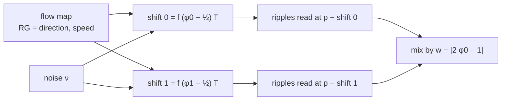

# 🌊 Flow mapping

[◀ Bloom](bloom.md) · [⏫ Techniques](README.md)


| Demo | Layer | Your C++ | Your GLSL | Passes added |
|------|-------|----------|-----------|--------------|
| `10f_FlowingWater` | 🟩 Renderer + `Field` | 6 lines to make the material, 5 uniforms per frame | about 10 lines for the flow | none |

## 🎯 The problem

You want a river that flows round rocks, or a pool that turns round pillars. A real fluid simulation is expensive, and it must run every frame. A texture that only **scrolls** in one direction is cheap, but it looks wrong: water does not go through the rocks; it goes round them.

The technique of this page comes from the water of Portal 2 (A. Vlachos, "Water Flow in Portal 2", SIGGRAPH 2010). The surface stays **one flat square**. Only its textures move, each pixel in its own direction.

## 💡 The idea

### 🌊 1. A flow map

A texture that stores, at each point of the water, which way and how fast the water goes: a 2D vector in its red and green channels. You paint it, or a program computes it from the scene. It does not change from frame to frame.

### 🖼 2. Move the picture along the flow

A picture moved for a time $t$ along the flow $\mathbf{f}$ is read at $\mathbf{p} - \mathbf{f}\,t$. Each pixel has its own $\mathbf{f}$, so the picture moves round the rocks.

### 🔁 3. Start again, often

After a few seconds, two pixels that were neighbours have drifted far apart, and the picture is stretched beyond recognition. So the time only runs over one **cycle** $T$, from $-T/2$ to $+T/2$, then starts again. If it starts again everywhere at once, the whole surface jumps (the **pop**).

### 🧱 4. Two layers, half a cycle apart

Read the picture twice, with two phases half a cycle apart, and mix them. Each layer starts again at the moment its weight is zero, so the jump is never seen. A **noise** added to the phase makes each region start at a different time, so no two places pulse together.

With $\nu(\mathbf{p})$ the noise:

```math
\varphi_0 = \operatorname{fract}\!\left(\frac{t}{T} + \nu\right), \quad
\varphi_1 = \operatorname{fract}\!\left(\varphi_0 + \tfrac12\right), \quad
w = |2\varphi_0 - 1|
```

```math
C(\mathbf{p}) = (1 - w)\;\text{tex}\big(\mathbf{p} - \mathbf{f}\,(\varphi_0 - \tfrac12)\,T\big) + w\;\text{tex}\big(\mathbf{p} - \mathbf{f}\,(\varphi_1 - \tfrac12)\,T\big)
```

When layer 0 starts again ($\varphi_0$ goes from 1 to 0), $w = 1$: only layer 1 is seen.



## 🧩 In Compages

Three things: a flow map as a texture, a material whose `main` reads it, and a few uniforms each frame.

### 🌊 The flow map

In the demo it is computed on the CPU in a `Field<Vector4f>` (one value per point of a `Grid2D`, [fields and grids](../concepts/fields-and-grids.md)), and sent to the GPU in one call. A painted image would come from `gpu::Texture::fromFile()` instead. From [10f_FlowingWater.cpp](../../examples/10_Complete/10f_FlowingWater.cpp):

```cpp
compages::renderer::TextureAsset flow;
flow.name = "Flow map";
COMPAGES_TRY_ASSIGN(flow.texture, compages::gpu::Texture::fromField(m_bake.packed()));
COMPAGES_TRY_ASSIGN(m_flow_map, m_scene.assets().addTexture(flow.name, std::move(flow)));
```

### 🎨 The material

Start from the PBR shader, replace its `main`, name the textures it reads:

```cpp
compages::renderer::shaders::ShaderPair shaders = compages::renderer::shaders::pbr();
shaders.fragment().hook("main", flowing::WATER_MAIN);
COMPAGES_TRY_ASSIGN(
    m_water_material,
    m_scene.assets().createMaterial(
        "Flowing water",
        { .family = compages::renderer::ShaderFamily::PbrMinimal,
          .shaders = std::move(shaders),
          .state = { .depth_test = true, .cull = compages::gpu::CullMode::Back },
          .see_through = std::nullopt,
          .textures = { { .sampler = "flowMap", .texture = m_flow_map },
                        { .sampler = "noiseMap", .texture = m_noise },
                        { .sampler = "rippleMap", .texture = m_ripples },
                        { .sampler = "foamMap", .texture = m_foam } } }));
m_scene.look(m_water, m_water_material);   // m_water is one plane
```

**Each frame**, where the grid lies, the time and the cycle:

```cpp
compages::Grid2D const& grid = m_bake.flow().grid();
compages::gpu::Program& program = water->program;
program.set("flowOrigin", grid.origin);
program.set("flowSpacing", grid.spacing);
program.set("flowCells", Vector2f(float(grid.columns), float(grid.rows)));
program.set("time", m_time);
program.set("cycle", m_cycle);
```

### 🗺 The CPU reads the same field

The crates and the barrel move with `Field::sample()` at their place: the same bilinear value the GPU reads from the texture. The water and the floating things agree, with no read-back from the GPU.

## 🔍 The shader

The part of [FlowingWater/Shaders.hpp](../../examples/10_Complete/FlowingWater/Shaders.hpp) that moves the water. `flowAt()` turns a place in metres into a coordinate of the flow map; `ripple()` reads the normal map of the ripples with a shift:

```glsl
vec4 flowAt(vec2 p)
{
    vec2 uv = ((p - flowOrigin) / flowSpacing + 0.5) / flowCells;
    return texture(flowMap, uv);
}

void main()
{
    vec2 p = vWorldPos.xz;
    vec4 data = flowAt(p);
    vec4 noise = texture(noiseMap, p / 9.0);
    vec2 flow = data.xy * flowScale;
    // ...
    float t = time / cycle + noise.r;
    float phase0 = fract(t);
    float phase1 = fract(t + 0.5);
    float blend = abs(2.0 * phase0 - 1.0);
    vec2 shift0 = flow * ((phase0 - 0.5) * cycle);
    vec2 shift1 = flow * ((phase1 - 0.5) * cycle);
    vec3 r = mix(ripple(p, shift0), ripple(p, shift1), blend);
    // ... r becomes the normal of the water: Fresnel, sky, glints, foam
}
```

The demo stores real speeds in metres per second, in a float texture. Portal 2 used an 8-bit texture, so it stored `flow * 0.5 + 0.5` and decoded it with `(c - 0.5) * 2`. If you paint your flow map in an image editor, decode it the same way.

## 📏 Cost

| What | How much |
|------|----------|
| Passes | none added: the water is one plane drawn with its material |
| Texture reads per pixel | 1 flow + 1 noise + 2 × 2 ripples, plus the foam |
| Memory | the flow map: 193 × 113 points × 16 bytes (RGBA32F) = 350 KB |
| CPU | none per frame for the water; the flow map is computed once |

## 🚧 Limits

- The flow does not react by itself: it is fixed when the map is made. The demo adds a swirl round each floating crate in the shader, from uniforms, so the water seems to answer them.
- It is not a fluid simulation: no waves that travel, no water that rises. For those, see the wave equation of `11b_RippleTank` or the fluid of `11e_Smoke` ([case studies](../case-studies/README.md)).
- A shorter cycle stretches the picture less, but the pulse of the two layers shows more. A longer cycle hides the pulse but stretches more. The demo uses about 2 seconds.

## 🧪 Try it

The demo has a menu **Show** that shows each step of this page:

- **Flow map**: the vector of each point, in colours (`flow * 0.5 + 0.5`, as Portal 2 stored it).
- **1. One phase**: the whole surface jumps at once (the pop).
- **2. Phase offset by noise**: the edges between regions crawl over the surface (in red).
- **3. Two phases blended**: the jump is gone.
- **Cycle**: from 0.5 s to 8 s; watch the stretching grow.

The whole demo is longer than this page: how the flow map is computed from the scene (the distance to the walls, the current that slides along them, the upwellings and vortices), the foam, the pipe. [The flowing water case study](../case-studies/flowing-water.md) follows it step by step.

## 📁 Source

- [examples/10_Complete/10f_FlowingWater.cpp](../../examples/10_Complete/10f_FlowingWater.cpp): the material, the uniforms, the floating things
- [examples/10_Complete/FlowingWater/Shaders.hpp](../../examples/10_Complete/FlowingWater/Shaders.hpp): `WATER_MAIN`
- [examples/10_Complete/FlowingWater/FlowBake.cpp](../../examples/10_Complete/FlowingWater/FlowBake.cpp): the flow map made from the scene
- References: Vlachos, SIGGRAPH 2010 ([PDF](http://www.valvesoftware.com/publications/2010/siggraph2010_vlachos_waterflow.pdf)); Grimes, GDC 2011 ([PDF](https://cdn.fastly.steamstatic.com/apps/valve/2011/gdc_2011_grimes_nonstandard_textures.pdf))

---

[◀ Bloom](bloom.md) · [⏫ Techniques](README.md)
