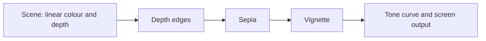

# 🖼 Screen-space filters

[◀ Cel shading](cel-shading.md) · [⏫ Techniques](README.md) · [Next: Bloom ▶](bloom.md)


| Demo | Layer | Your C++ | Your GLSL | Passes added |
|------|-------|----------|-----------|--------------|
| `12a_ScreenFilters` | 🟩 Renderer | 1 list insertion per filter + 1 component assignment | 1 effect function per filter | 1 per filter + final presentation |

## 🎯 The problem

You want dark outlines around visible shapes, or a sepia picture for one camera. Editing every object's material would duplicate the same work and affect other views.

## 💡 The idea

Draw a view into a texture, then process that picture with a full-screen shader. A filter receives colour and depth, so it can compare neighbouring pixels without knowing the original objects.



Each filter reads the previous colour result. The depth remains the original view depth. Filters with nonlinear colour operations or clamping can give different results when moved in the chain.

## 🧩 In Compages

[12a_ScreenFilters.cpp](../../examples/12_Effects/12a_ScreenFilters.cpp) builds a `ScreenEffects` component in `applyFilters()`. For the edge filter, the relevant statements are:

```cpp
compages::renderer::ScreenEffects effects;
effects.filters.push_back({ .name = "Edges", .glsl = EDGES, .values = {} });
// ...the demo appends its other enabled filters here.
m_filtered.set(effects);
```

`EDGES` is the GLSL below. The left camera stays unchanged; the right camera receives the component. [Screen effects](../guides/screen-effects.md) gives the steps for adding and updating filters. [Shader library](../reference/shaders.md#-screen-filters) lists the filter interface.

## 🔍 The shader

The demo estimates an outline from relative jumps in reversed depth:

```glsl
vec3 effect(vec2 uv)
{
    vec2 t = 1.0 / screenSize;
    float d = texture(screenDepth, uv).r;
    float jump = 0.0;
    jump = max(jump, abs(texture(screenDepth, uv + vec2(t.x, 0.0)).r - d));
    jump = max(jump, abs(texture(screenDepth, uv - vec2(t.x, 0.0)).r - d));
    jump = max(jump, abs(texture(screenDepth, uv + vec2(0.0, t.y)).r - d));
    jump = max(jump, abs(texture(screenDepth, uv - vec2(0.0, t.y)).r - d));
    // The depth is reversed (1/distance): a jump counts relative to it.
    float edge = smoothstep(0.08, 0.2, jump / max(d, 1e-6));
    return texture(screenColor, uv).rgb * (1.0 - 0.85 * edge);
}
```

`1.0 / screenSize` is one pixel in texture coordinates. The shader compares four neighbours with the centre. Dividing by `max(d, 1e-6)` scales the threshold relative to reversed depth. `smoothstep` softens the transition, then the result darkens the source colour.

## 📏 Cost

Three enabled filters in this demo mean three full-screen draws, plus final presentation. The Renderer also needs offscreen colour and depth targets; RGBA16F colour uses eight bytes per pixel. This edge filter reads depth five times and colour once per fragment. Cost grows with viewport pixels even when the original scene has few triangles.

## 🚧 Limits

Depth edges cannot reveal hidden geometry. They miss a painted edge on a flat wall, and the threshold's appearance changes with scene depth. This is different from the extra mesh used by [cel outlines](cel-shading.md). Filters run in linear light before tone mapping; do not apply an extra sRGB conversion to their output.

## 🧪 Try it

Run `./build/linux-gcc-debug/bin/Compages-examples 12a_ScreenFilters`.

- Disable **Outlines (depth)**: the right view keeps its other colour filters.
- Change **Amount** for sepia: object materials stay unchanged in the left view.
- Change the edge shader's `0.85` to `0.3` and rebuild: the detected outlines become lighter.

## 📁 Source

- [12a_ScreenFilters.cpp](../../examples/12_Effects/12a_ScreenFilters.cpp): shaders, list order and comparison views.
- [ScreenEffects.hpp](../../include/Compages/Renderer/Components/ScreenEffects.hpp): component and filter values.
- [ScreenPost.cpp](../../src/Renderer/Render/ScreenPost.cpp): target allocation and pass chain.

[◀ Cel shading](cel-shading.md) · [⏫ Techniques](README.md) · [Next: Bloom ▶](bloom.md)
