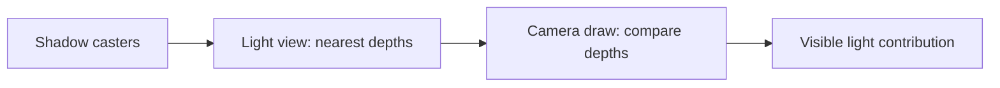

# 🌑 Shadow mapping

[⏫ Techniques](README.md) · [Next: Clustered lighting ▶](clustered-lighting.md)


| Demo | Layer | Your C++ | Your GLSL | Passes added |
|------|-------|----------|-----------|--------------|
| `10a_MvpDemo` | 🟩 Renderer | 1 lamp setup statement | none | 1 sun view; 6 views per shadowed lamp |

## 🎯 The problem

A cube can look lit while its floor receives light through it. You need to know whether another surface blocks the path to the light.

## 💡 The idea

Render the scene from the light first. Store the nearest surface depth in each texel. During the camera draw, compare a surface's depth in that light view with the stored depth. A surface beyond it is in shadow.



The sun needs one directional view. A point lamp needs six views to cover every direction. Filtering several depth comparisons softens the visible edge. This is percentage-closer filtering; it does not simulate a large physical light source.

## 🧩 In Compages

The Scene enables sun shadows by default. [10a_MvpDemo.cpp](../../examples/10_Complete/10a_MvpDemo.cpp) also requests lamp shadows:

```cpp
m_scene.lamp("Lamp", { 1.0f, 0.85f, 0.5f }, 2.0f, 20.0f)
    .add<Circle>()
    .get<compages::world::PointLight>()
    .shadows = true;
```

`Circle` is the demo's routine that moves the lamp. Shadow configuration is the final component assignment. The Renderer makes the shadow targets and redraws casters before the lit picture. [Light the scene](../guides/light-the-scene.md#-shadows) gives the configuration steps.

The sun target fits the shadow-casting objects. A large floor should usually receive shadows without casting them: use `RenderFlags::NoShadowCaster`. Otherwise it spreads the available texels over a much larger region. A bulb enclosing its own lamp should not cast either.

## 🔍 The shader

You write no GLSL for built-in materials. The sun comparison in [ShaderLib.cpp](../../src/Renderer/Procedural/ShaderLib.cpp) is:

```glsl
float nearest = texture(shadowMap, at.xy + vec2(x, y) * step).r;
lit += (at.z - bias <= nearest) ? 1.0 : 0.0;
```

`at.z` is the surface depth in the light view. `nearest` comes from the shadow map. A small `bias` avoids comparing a surface against its own rounded depth. The shader averages a 3 × 3 neighbourhood of these tests.

## 📏 Cost

The default sun map is 2048 × 2048 with `Depth32F`: about 16.8 MB. A shadowed lamp draws nearby casters into six faces. The default 512 × 512 lamp faces occupy an atlas allocated for up to four direct lamps. Each shaded fragment also pays for the depth samples.

Cost follows the number of casters drawn in each light view, not only the number of lights. Increasing a lamp's range can include many more casters.

## 🚧 Limits

Shadow maps have finite resolution. Bias trades surface speckles against shadows that appear detached. Transparent colour is not a physical transmission model for the shadow pass. Clustered lamps beyond the four direct lamps have no shadow maps.

## 🧪 Try it

Run `./build/linux-gcc-debug/bin/Compages-examples 10a_MvpDemo`. Rebuild with `make` after source edits.

- Set the lamp's `shadows` to `false`: the sun shadow remains, while the lamp no longer casts its own.
- Set `m_scene.environment().shadows = false` during setup: this disables sun shadows, independently of the lamp setting.
- Reduce `lamp_shadow_resolution` to 128: lamp shadow edges lose detail.

## 📁 Source

- [10a_MvpDemo.cpp](../../examples/10_Complete/10a_MvpDemo.cpp): the moving lamp and cubes.
- [ShadowPass.cpp](../../src/Renderer/Render/ShadowPass.cpp): targets and caster draws.
- [ShaderLib.cpp](../../src/Renderer/Procedural/ShaderLib.cpp): sun and lamp visibility tests.

[⏫ Techniques](README.md) · [Next: Clustered lighting ▶](clustered-lighting.md)
