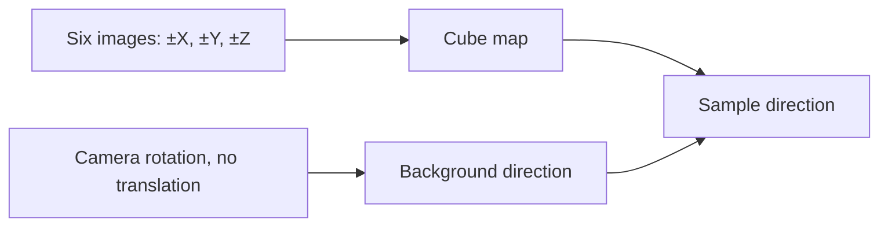

# 🌄 Skybox

[◀ Volumetric fog](volumetric-fog.md) · [⏫ Techniques](README.md) · [Next: Cel shading ▶](cel-shading.md)


| Demo | Layer | Your C++ | Your GLSL | Passes added |
|------|-------|----------|-----------|--------------|
| `06h_Skybox` | 🟩 Renderer | 1 skybox call, after resolving 6 files | none | 1 background draw |

## 🎯 The problem

A plain background has no horizon. A surrounding landscape should turn when the camera turns, but should not slide closer as the camera moves.

## 💡 The idea

Store six images in a cube map. Sample the image with a viewing direction rather than a point on a nearby object. Remove translation from the camera's view transform when drawing the cube.



The landscape behaves as if it were infinitely far away. There is no parallax: a nearby tree painted into the sky stays at the same angular position when the camera translates.

## 🧩 In Compages

[06h_Skybox.cpp](../../examples/06_Scene/06h_Skybox.cpp) resolves six Compages-data files with the gallery's `dataPath()` helper. Their order is:

```cpp
std::array<std::filesystem::path, 6u> faces{ "right.jpg", "left.jpg",
                                             "top.jpg",   "bottom.jpg",
                                             "front.jpg", "back.jpg" };
```

After resolving those paths, it sets the background and ambient light:

```cpp
m_scene.skybox(faces).ambient(0.18f, 0.18f, 0.20f);
```

The order is +X, −X, +Y, −Y, +Z, −Z. Your application supplies its own paths; `dataPath()` belongs to the examples. The Scene prepares the images and background drawable. It keeps ambient light as a separate setting: loading a sky does not calculate illumination from it.

## 🔍 The shader

The vertex shader in [Skybox.cpp](../../src/Renderer/Render/Skybox.cpp) removes translation with `mat4(mat3(view))`:

```glsl
v2f.direction = position;
// The camera turns but never moves away from the sky: the translation
// of the view is dropped.
gl_Position = projection * mat4(mat3(view)) * vec4(position, 1.0);
```

The fragment shader samples `samplerCube sky` with the normalized direction. The Renderer draws this background before scene objects, without depth testing, so ordinary objects cover it. The presentation helper preserves its screen colour when screen effects are enabled.

## 📏 Cost

One cube draw and one cube-map lookup per background fragment. Six square RGB images of side `N` need about `6 × N × N × 3` bytes before mipmaps or driver allocation details. Large source images increase upload time and memory even when the view is small.

## 🚧 Limits

Face images must match in size and meet at their borders. A visible seam can come from incompatible faces or their orientation. A skybox supplies no collision, shadow or image-based lighting. Use geometry for nearby landscape that needs parallax.

## 🧪 Try it

Run `./build/linux-gcc-debug/bin/Compages-examples 06h_Skybox`. Rebuild with `make` after source edits.

- Turn the view: the mountains move across the picture while the cube remains in front.
- Swap `right.jpg` and `left.jpg`: the horizon no longer meets correctly across the cube faces.
- Change the ambient colour: the cube's shading changes while the sky keeps its source colours.

## 📁 Source

- [06h_Skybox.cpp](../../examples/06_Scene/06h_Skybox.cpp): file order and scene setup.
- [Skybox.cpp](../../src/Renderer/Render/Skybox.cpp): image loading, shaders and background draw.
- [Light the scene](../guides/light-the-scene.md): sky, ambient and direct light configuration.

[◀ Volumetric fog](volumetric-fog.md) · [⏫ Techniques](README.md) · [Next: Cel shading ▶](cel-shading.md)
