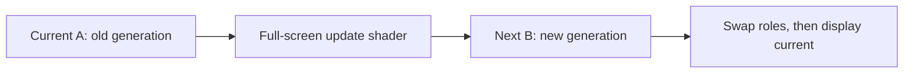

# 🏓 Texture ping-pong

[◀ Bloom](bloom.md) · [⏫ Techniques](README.md) · [Next: Flow mapping ▶](flow-mapping.md)


| Demo | Layer | Your C++ | Your GLSL | Passes added |
|------|-------|----------|-----------|--------------|
| `05b_GameOfLife` | 🟧 GPU | 1 source binding + 1 target scope + 1 draw + 1 swap per step | 1 update fragment shader | 1 update pass per generation |

## 🎯 The problem

A cell's next state depends on its neighbours' old states. Reading a texture while rendering the new state into that same texture creates a feedback hazard. You need each cell to see a complete, unchanged generation.

## 💡 The idea

Keep two textures. Read A and write B, then swap their roles. The next generation reads B and writes A. Swapping changes ownership roles; it does not copy the pixels.



A full-screen triangle starts one fragment per destination texel. That fragment reads neighbours from the old texture and writes one new value. Its result is independent of the order in which other fragments execute.

## 🧩 In Compages

[05b_GameOfLife.cpp](../../examples/05_Simulation/05b_GameOfLife.cpp) creates a `gpu::TexturePingPong` with two R8 textures. It selects nearest filtering so a cell does not blend with its neighbours, and repeat wrapping so opposite edges meet. Setup uploads generation zero to `current()`.

Its complete step and display sequence is:

```cpp
m_step["previous"] = m_field.current();
{
    compages::gpu::RenderPass into(
        m_field.next(), { .clear_color = false, .clear_depth = false });
    m_step.draw(3u);
}
m_field.swap();

m_show["image"] = m_field.current();
m_show.draw(3u);
```

`m_step` and `m_show` are prepared drawables. Their vertex shader makes the full-screen triangle from `gl_VertexID`, so `draw(3u)` needs no vertex buffer. The target sets the update viewport to the state texture's size. Leaving its scope restores the surrounding drawing pass.

Both textures do not need an initial upload here: the first update writes every destination texel. Partial updates would require an explicit policy for untouched texels. [Compute on the GPU](../guides/compute-on-the-gpu.md) shows the related two-buffer compute pattern.

## 🔍 The shader

After counting the eight neighbours, the demo applies Conway's rules:

```glsl
bool alive = texture(previous, v2f.uV).r > 0.5;
bool next = alive ? ((neighbors == 2) || (neighbors == 3))
                  : (neighbors == 3);
oColor = vec4(next ? 1.0 : 0.0);
```

Two or three live neighbours keep a cell alive. Exactly three create a new live cell. The step reads only `previous`; its output is the next target. The display shader colours the resulting zero or one without changing the simulation state.

## 📏 Cost

At 256 × 256, two R8 state textures contain 131,072 bytes, excluding framebuffer objects. Each update reads the centre and eight neighbours and writes one texel. Display needs another draw. Increasing both dimensions by two multiplies cell work and texture storage by four.

## 🚧 Limits

This demo advances one generation per draw, so simulation speed follows the frame rate. The gallery's F6 pause sets elapsed time to zero, but this demo ignores elapsed time and keeps updating. Use a fixed-step schedule if generations must follow simulation time. A fragment render pass writing a target and a later pass sampling that different target need no compute memory barrier. Compute-image or storage-buffer writes have their own barrier requirements.

## 🧪 Try it

Run `./build/linux-gcc-debug/bin/Compages-examples 05b_GameOfLife`. Rebuild with `make` after edits.

- Change `SIZE` to 128: cells become larger in the displayed picture and each generation processes fewer cells.
- Change the birth test from three to four neighbours: the evolving patterns change while the two-texture mechanism stays the same.
- Change both wrap modes to `Wrap::ClampToEdge`: cells at the opposite edges stop being neighbours.

## 📁 Source

- [05b_GameOfLife.cpp](../../examples/05_Simulation/05b_GameOfLife.cpp): texture setup, update and display shaders.
- [PingPong.hpp](../../include/Compages/GPU/PingPong.hpp): texture and buffer pair interfaces.
- [05c_GrayScott.cpp](../../examples/05_Simulation/05c_GrayScott.cpp): two floating-point concentrations using the same pattern.

[◀ Bloom](bloom.md) · [⏫ Techniques](README.md) · [Next: Flow mapping ▶](flow-mapping.md)
