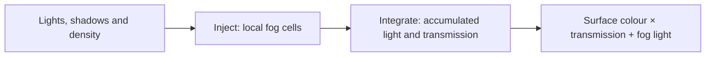

# 🌫 Volumetric fog

[◀ Clustered lighting](clustered-lighting.md) · [⏫ Techniques](README.md) · [Next: Skybox ▶](skybox.md)


| Demo | Layer | Your C++ | Your GLSL | Passes added |
|------|-------|----------|-----------|--------------|
| `06n_VolumetricFog` | 🟩 Renderer | 1 enable assignment, plus optional tuning | none | 2 compute dispatches + background composite |

## 🎯 The problem

Distance fog fades far surfaces, but it cannot show a shaft of sunlight between roof slats. You want light to be visible in the air before it reaches a wall.

## 💡 The idea

Divide the view into a 3D grid. Each cell stores local scattering and extinction: light sent toward the eye and light removed along the path. Integrate those cells from the camera outward.



A cell of this camera-aligned grid is a froxel. For constant extinction `s` across a segment of length `d`, transmission is `exp(-s × d)`. Accumulated light is weighted by the transmission of all nearer segments.

## 🧩 In Compages

The settings in [06n_VolumetricFog.cpp](../../examples/06_Scene/06n_VolumetricFog.cpp) are:

```cpp
compages::renderer::VolumetricFog& fog = m_scene.environment().volumetric;
fog.enabled = true;
fog.density = 0.035f;
fog.height = 0.0f;
fog.falloff = 0.25f;
fog.color = compages::Vector3f(0.85f, 0.88f, 0.95f);
fog.anisotropy = 0.6f;
fog.noise = 0.5f;
fog.distance = 40.0f;
```

`density` sets extinction at `height`. `falloff` makes the air thinner above it. `anisotropy` controls the direction of scattering; positive values brighten views toward a light. `noise` introduces drifting variations. `distance` bounds the computed volume.

This replaces `Environment::fog_density` while enabled. You write no fog shader. The Renderer samples existing light and shadow data, builds the volume, then supplies it to lit materials. Use [light the scene](../guides/light-the-scene.md#-fog-that-the-light-crosses) for setup in an existing scene.

## 🔍 The shader

The integration kernel in [FogVolume.cpp](../../src/Renderer/Render/FogVolume.cpp) walks depth slices. `before` and `after` are the slice's distance bounds:

```glsl
vec4 slice = imageLoad(scattering, ivec3(id, k));
float s = max(slice.a, 1e-6);
float passes = exp(-s * (after - before));
gathered += through * (slice.rgb - slice.rgb * passes) / s;
through *= passes;
imageStore(integrated, ivec3(id, k), vec4(gathered, through));
```

`gathered` is accumulated scattered light and `through` is remaining transmission. The surface shader reads both at the surface depth. A background composite handles rays with no foreground surface.

## 📏 Cost

The volume is 128 × 72 × 64: 589,824 cells. Two RGBA16F textures need about 9.4 MB in total. One compute dispatch fills the local values; another integrates along each depth column. Shadows add their own rendering work before injection. The work repeats for each rendered view using the effect.

## 🚧 Limits

This is a finite-resolution, single-scattering approximation. Thin shafts and nearby density detail can reveal the grid. Fog beyond `distance` keeps the integrated result at that limit. Increasing density cannot recover missing spatial detail. Use plain distance fog when you only need distant haze.

## 🧪 Try it

Run `./build/linux-gcc-debug/bin/Compages-examples 06n_VolumetricFog`.

- Disable **Volumetric**: the hall keeps plain distance fog, while the light shafts disappear.
- Set **Forward (anisotropy)** to zero: scattering becomes less directional.
- Set **Clumps** to zero: the air density loses its drifting variations.

## 📁 Source

- [06n_VolumetricFog.cpp](../../examples/06_Scene/06n_VolumetricFog.cpp): hall, lights and controls.
- [Environment.hpp](../../include/Compages/Renderer/Scene/Environment.hpp): user settings.
- [FogVolume.hpp](../../include/Compages/Renderer/Render/FogVolume.hpp): grid dimensions and method references.
- [FogVolume.cpp](../../src/Renderer/Render/FogVolume.cpp): injection, integration, barriers and background pass.

The implementation follows Wronski's volumetric fog work (SIGGRAPH 2014) and Hillaire's integrated slice method (SIGGRAPH 2015).

[◀ Clustered lighting](clustered-lighting.md) · [⏫ Techniques](README.md) · [Next: Skybox ▶](skybox.md)
