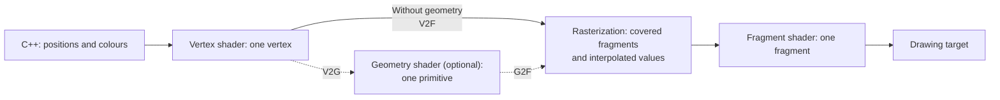

# 🟧 2. The GPU

[◀ Install and run](01-install.md) · [⏫ Tutorials](README.md) · [Next: the World ▶](03-the-world.md)

## 🎯 Goal

Draw a coloured triangle by matching C++ data to shader inputs. Then run a compute shader on twelve numbers and check how GPU results return to the CPU.


You have three corners and their colours. You want the GPU to fill the triangle between them. The GPU layer handles shaders and their data without a World or a Scene.

## ▶ Observe the triangle

```sh
./build/linux-gcc-debug/bin/Compages-examples 01c_Triangle
```

Find the red, green and blue corners. Between them, the colours blend. Keep [01c_Triangle.cpp](../../examples/01_FirstSteps/01c_Triangle.cpp) open as you read. All edits in the first part of this chapter go in that file. After each edit, quit the gallery, run `make`, and launch the same command again.

The gallery already created an OpenGL context and initialized `compages::gpu`. Its `setUp()` runs once; its `draw()` runs for every picture. The snippets below belong to those methods. They are not separate programs.

## 🧩 Shaders are the GPU layer's interface

A **shader** is a small program written in GLSL and executed on the GPU. Your C++ code supplies data and requests a draw. The GPU runs the shader's `main()` for each item that its stage processes. C++ does not call that function directly.

Drawing uses several stages. Each stage receives data, computes a result, and passes outputs to the next stage. The triangle uses a **vertex** shader and a **fragment** shader, with rasterization between them. The dashed path adds an optional geometry stage:



The vertex shader places each vertex through `gl_Position`. Rasterization finds which parts of the target the triangles cover. It also interpolates values such as colour across each triangle. The fragment shader receives those values and computes colour outputs. A fragment is a candidate contribution to a pixel; tests such as depth testing can still reject it.

A **geometry** shader is optional. When present, it receives a whole primitive, such as a triangle, after the vertex stage. It can emit new primitives before rasterization. This triangle demo does not need one. A compute shader runs separately from this drawing chain; you will use one later in this chapter.

A shader **program** links the stages used together. Compilation checks each stage's GLSL; linking checks that their interfaces agree. In Compages, `gpu::Program` represents the linked program. It is not another shader stage. `Drawable::loadSources(vertex, fragment)` compiles and links the two stages for this demo.

The shader declarations are your entry into Compages' first layer, `compages::gpu`. Vertex attributes declare the data needed per vertex. Uniforms declare values shared by a draw, such as a colour or a matrix. C++ supplies those values by their shader names. The GPU layer needs no World entities or Renderer Scene: the shader declares what it needs, and C++ provides it.

## 🔺 Step 1: place three vertices

`#version 450 core` selects the GLSL version used by the GL45 backend. The vertex shader receives `position` and `color` for each corner:

```glsl
#version 450 core

struct V2F
{
    vec3 color;
};

in vec2 position;
in vec3 color;
out V2F v2f;

void main()
{
    v2f.color = color;
    gl_Position = vec4(position, 0.0, 1.0);
}
```

The **fragment shader** computes a colour for each fragment.

```glsl
#version 450 core

struct V2F
{
    vec3 color;
};

in V2F v2f;
out vec4 oColor;

void main()
{
    oColor = vec4(v2f.color, 1.0);
}
```

`vec2`, `vec3` and `vec4` are vectors of two, three and four numbers. `in` receives data; `out` passes a result to the next stage.

### 📦 Note: Group the values passed between stages

The struct `V2F` means *vertex to fragment*. It describes the data passed between those stages; `v2f` is the variable that holds it. Here its only field is `color`. The vertex shader writes `out V2F v2f`, and the fragment shader reads `in V2F v2f`. Both stages declare the same struct definition and variable name. The linker matches their interfaces.

A struct is not required by GLSL. You could pass the colour through separate declarations, `out vec3 vColor` and `in vec3 vColor`. Compages uses structs because they make the exchange more explicit and practical as the data grows. Colour, normal and texture coordinates can be fields of one named interface. When adding a field, keep the declarations consistent in both shaders.

`V2F` and `v2f` are naming conventions, not GLSL keywords. The `in` and `out` qualifiers define the direction. The prefix `v` in the separate variable `vColor` means *varying*: a value passed between stages and, for this floating-point colour, interpolated across the triangle.

Vertex attributes are a different interface: they enter the vertex shader from buffers. GLSL does not allow structs as vertex inputs. Here `in vec2 position` and `in vec3 color` stay separate, and C++ fills each by name. The `V2F` struct groups data exchanged inside the shader program; it does not change those C++ attribute names.

The prefix `o` means *output*: `oColor` is the fragment shader's colour output, written to the drawing target. It is a naming convention, not a GLSL keyword.

The vertex shader receives one vertex at a time. It copies that vertex's colour into `v2f.color` and writes its position into `gl_Position`. The last coordinate, `w`, is 1 here. In this example, the z-axis is forced to `0.0` and no perspective calculation is needed yet.

The GPU fills the triangle between the three vertices. It interpolates `v2f.color` across that area before calling the fragment shader. For example, halfway along the red-green edge, both colours contribute equally. The fragment shader writes that colour with an alpha of 1, which means opaque.

## 📦 Step 2: supply the data by name

The vertex shader asks for two inputs, `position` and `color`. The member `m_triangle` is declared in [01c_Triangle.hpp](../../examples/01_FirstSteps/01c_Triangle.hpp) as `compages::gpu::Drawable`. The remaining lines below belong to `Triangle::setUp()`:

```cpp
COMPAGES_TRY(m_triangle.loadSources(VERTEX_SHADER, FRAGMENT_SHADER));
m_triangle["position"] = { { -0.8f, -0.6f }, { 0.8f, -0.6f }, { 0.0f, 0.8f } };
m_triangle["color"] = { { 1, 0, 0 }, { 0, 1, 0 }, { 0, 0, 1 } };
return m_triangle.prepare();
```

Each attribute has three entries, one for each vertex, in the same order. The first position receives the first colour. Both lists must describe the same number of vertices. A `Drawable` holds the shader and its data together. `prepare()` checks their agreement before drawing.

`COMPAGES_TRY(expression)` returns from the current function if the expression fails. Here `setUp()` returns a `compages::Status`, so the gallery receives the shader compiler's message. A successful call continues to the next line.

At each frame, `Triangle::draw()` runs:

```cpp
compages::gpu::clear({ 0.1f, 0.1f, 0.15f });
m_triangle.draw();
```

The positions go from −1 to 1 across the window, so no camera is needed. `m_triangle["position"] = …` writes into a copy in normal memory. `draw()` sends what changed to the GPU, then draws. Your code has no OpenGL call and no attribute number to keep in mind.

A wrong name such as `m_triangle["colour"]` does not crash the program. Compages keeps the error, with the names the shader really declares, and `prepare()` returns it before the first frame. [Errors](../concepts/errors.md) explains when each kind of error comes back.

Before continuing, change only the first colour to `{ 1, 1, 1 }`. Rebuild: the left corner becomes white and the other corners keep their colours. Restore the red corner. You have now followed one value from C++ to a pixel.

### 🔀 When a geometry shader sits between the stages

You can also use structs between vertex, geometry and fragment shaders. The names describe each connection:

| Connection | Producer output | Consumer input |
|------------|-----------------|----------------|
| Vertex → fragment, without geometry | `out V2F v2f;` | `in V2F v2f;` |
| Vertex → geometry | `out V2G v2g;` | `in V2G v2g[];` |
| Geometry → fragment | `out G2F g2f;` | `in G2F g2f;` |

`V2G` means *vertex to geometry*; `G2F` means *geometry to fragment*. A geometry shader receives all vertices of one primitive, so its input is an array. For triangles, `v2g[0]`, `v2g[1]` and `v2g[2]` hold the three vertices' data. Its output describes one emitted vertex at a time.

The following optional geometry shader passes a triangle through unchanged. For this variant, rename `V2F/v2f` to `V2G/v2g` in the vertex shader above, and to `G2F/g2f` in the fragment shader. Both structs contain the same `vec3 color` field:

```glsl
#version 450 core

layout(triangles) in;
layout(triangle_strip, max_vertices = 3) out;

struct V2G
{
    vec3 color;
};
in V2G v2g[];

struct G2F
{
    vec3 color;
};
out G2F g2f;

void main()
{
    for (int i = 0; i < 3; ++i)
    {
        gl_Position = gl_in[i].gl_Position;
        g2f.color = v2g[i].color;
        EmitVertex();
    }
    EndPrimitive();
}
```

`gl_in` carries built-in vertex outputs, including position. `v2g` carries your own fields. Set `gl_Position` and every `g2f` field before each `EmitVertex()`: output values become undefined after emission. `EndPrimitive()` finishes the emitted triangle. Rasterization then interpolates `g2f.color` for the fragment shader. See Khronos' [geometry shader explanation](https://wikis.khronos.org/opengl/Geometry_Shader) and [GLSL interface matching rules](https://wikis.khronos.org/opengl/Shader_Compilation#Interface_matching).

This variant needs three stages in the linked program. `Drawable::loadSources()` takes only vertex and fragment source; adding a geometry stage is a lower-level task. Compile the stages with `gpu::Shader::fromSource()` and link them with `gpu::Program::link()`. Keep the original two-stage demo for the remaining exercises.

## 🧮 Step 3: compute without drawing

Run the next demo, then open [05a_Compute.cpp](../../examples/05_Simulation/05a_Compute.cpp):

```sh
./build/linux-gcc-debug/bin/Compages-examples 05a_Compute
```

Leave automatic dispatch disabled. Press **dispatch() once**, then **download()**. The GPU row first changes to `1 2 3 4 5 6 7 8 9 10 11 12`. The CPU row stays zero until you download. Both rows then agree.

The data now makes a return trip: CPU → GPU → CPU. The chart draws those numbers so you can observe the computation. The compute shader itself makes no pixels.

A **compute shader** draws nothing. The GPU runs it once per item, on many items at the same time. From [05a_Compute.cpp](../../examples/05_Simulation/05a_Compute.cpp), twelve numbers, each moved by its own index plus one:

```glsl
#version 450 core
layout(local_size_x = 16) in;

layout(std430, binding = 0) buffer Values
{
    int values[];
};

void main()
{
    uint i = gl_GlobalInvocationID.x;
    if (i >= uint(values.length())) { return; }
    values[i] = (values[i] + int(i) + 1) % 60;
}
```

```cpp
COMPAGES_TRY(m_step.loadSource(STEP_SOURCE));
m_on_gpu = std::vector<int>(COUNT, 0);
COMPAGES_TRY_ASSIGN(m_values,
                    compages::gpu::StorageBuffer<int>::from(
                        m_on_gpu, compages::gpu::BufferUsage::Dynamic));
COMPAGES_TRY(m_values.upload());
```

`COUNT` is 12 in the demo. These lines run once in `setUp()`. `COMPAGES_TRY_ASSIGN(destination, expression)` also stops on error; on success it stores the returned value. The numbers live in a **storage buffer**: GPU memory that a shader can read and write. `Dynamic` keeps a CPU mirror, initially filled with zeros. `upload()` sends those initial values to the GPU.

`layout(local_size_x = 16)` groups invocations in sets of sixteen. For twelve values, one group runs, so sixteen invocations start. `gl_GlobalInvocationID.x` identifies each one, from 0 to 15. The guard rejects indices 12 to 15. Always keep it when the item count may not fill a group. `binding = 0` identifies the storage block binding; the helper binds the buffer for you.

Each valid invocation modifies a different element, so no two write the same number. After the first dispatch, element 0 is 1 and element 11 is 12. After the second, they are 2 and 24. `% 60` wraps the values from 59 back toward zero.

## 🔁 Step 4: read the result

The start of `IntroCompute::step()` checks dispatch failure before continuing:

```cpp
if (!compages::gpu::dispatch(m_step, m_values))
{
    return;
}
m_stale = true;
```

This convenience helper uploads pending CPU changes, binds the buffer, dispatches enough groups, and issues a `Barrier::Storage` barrier. A later draw reading the result as vertex attributes still needs `barrier(Barrier::VertexAttrib)`. When calling `ComputeProgram::dispatch()` directly, you must issue the appropriate barrier yourself. A barrier makes writes visible to the next GPU reader; it does not download data.

The demo reads the GPU values into a separate vector to draw the bars:

```cpp
compages::Result<std::vector<int>> read = m_values.read();
if (read)
{
    m_on_gpu = std::move(read.value());
}
```

`read()` returns a new vector. It leaves the buffer's CPU mirror unchanged. The orange bars and CPU row indicate that this mirror is old. The **download()** button calls `m_values.download()` to replace the mirror too. This difference explains how the chart can show GPU results while the CPU row is still zero.

Both reading methods make the CPU wait for GPU results. The demo reads after each dispatch so you can follow twelve numbers. For large simulations, keep the values on the GPU and draw them there; [05f_Galaxy.cpp](../../examples/05_Simulation/05f_Galaxy.cpp) uses that approach.

## 🧪 Try

- In `01c_Triangle.cpp`, move the top corner to `{ 0.0f, 0.3f }`. The triangle gets flatter.
- Write `m_triangle["colour"]`. The console of the gallery lists the names the shader declares.
- In `05a_Compute`, replace `% 60` by `% 20`. The bars wrap sooner.

The Scene of the next pages uses this layer underneath, with shaders it writes for you. [The GPU layer](../concepts/the-gpu-layer.md) explains why the C++ and the shader meet by names. The guides [compute on the GPU](../guides/compute-on-the-gpu.md) and [draw in several passes](../guides/draw-in-several-passes.md) go further.

---

[◀ Install and run](01-install.md) · [⏫ Tutorials](README.md) · [Next: the World ▶](03-the-world.md)
