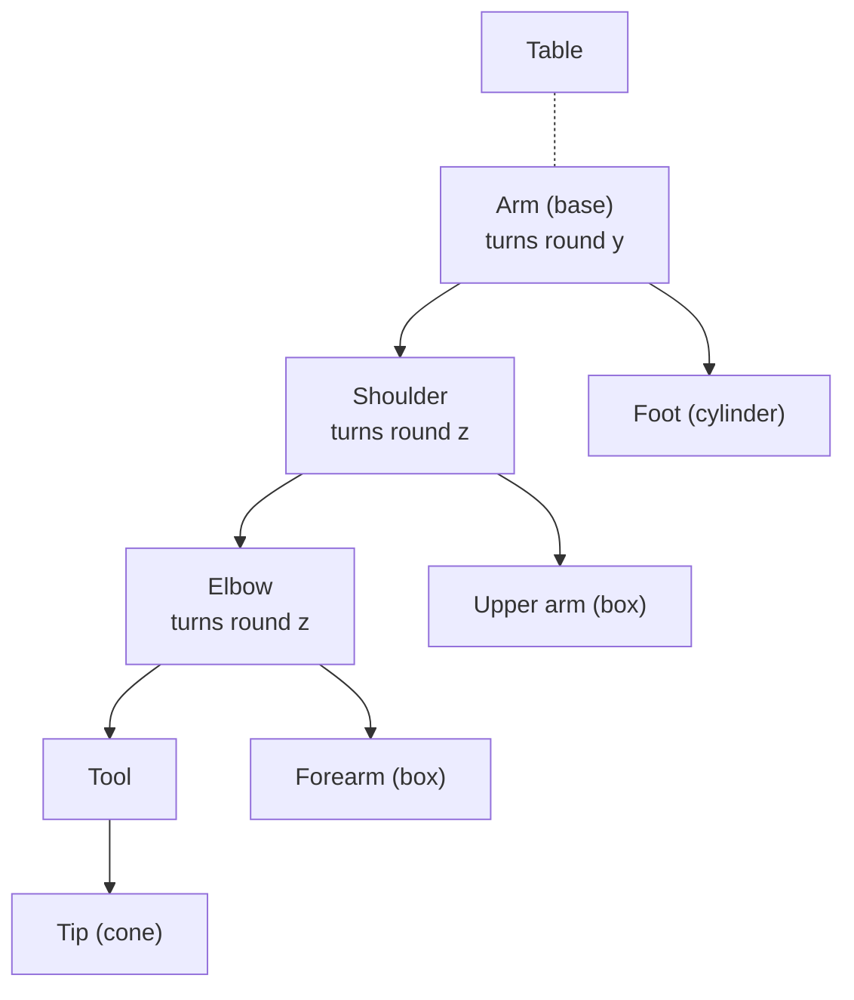

# 🦾 3. Make it move

[◀ A first scene](02-first-scene.md) · [⏫ Tutorials](README.md) · [Next: Values on a grid ▶](04-values-on-a-grid.md)


You will put a robot arm on the table and make it sweep the table. Its three joints are entities in a chain, and a small piece of code attached to the arm, a **routine**, turns them at each frame.

## 🔗 A chain of joints

A robot arm is a chain: the base turns, it carries the shoulder; the shoulder tilts, it carries the elbow; the elbow bends, it carries the tool. The scene graph of the previous page is exactly this chain: each joint is the child of the one before. From [Workshop/Arm.cpp](../../examples/00_Workshop/Workshop/Arm.cpp):

```cpp
arm.base = p_scene.world().entity("Arm").position(-0.45f, TABLE_TOP, 0.0f).revolute({ 0.0f, 1.0f, 0.0f });
arm.shoulder = arm.base.child("Shoulder").position(0.0f, 0.12f, 0.0f).revolute({ 0.0f, 0.0f, 1.0f });
arm.elbow = arm.shoulder.child("Elbow").position(0.0f, 0.5f, 0.0f).revolute({ 0.0f, 0.0f, 1.0f });
arm.tool = arm.elbow.child("Tool").position(0.0f, 0.44f, 0.0f);
```

`child()` makes a new entity under this one. `revolute(axis)` turns the entity into a **revolute joint**: it can only turn round that axis, measured in its parent's axes. The base turns round the vertical (y), the shoulder and the elbow round z, so the arm swings in its own vertical plane. The shoulder is 12 cm above the base, the elbow 50 cm above the shoulder, the tool 44 cm above the elbow: the lengths of the links.

These four entities have no shape. The shapes hang under them:

```cpp
arm.links.push_back(p_scene.cylinder("Foot", grey).parent(arm.base).position(0.0f, 0.05f, 0.0f).scale(0.24f, 0.1f, 0.24f));
arm.links.push_back(p_scene.box("Upper arm", orange).parent(arm.shoulder).position(0.0f, 0.25f, 0.0f).scale(0.08f, 0.5f, 0.08f));
arm.links.push_back(p_scene.box("Forearm", orange).parent(arm.elbow).position(0.0f, 0.2f, 0.0f).scale(0.06f, 0.4f, 0.06f));
```

The upper arm is 50 cm long, and it is moved up by 25 cm, half its length. Without this, the box would be centred on the shoulder and would turn round its middle, like a propeller. A shape that must turn round its end is always placed this way.



## ⏱ A routine moves the joints

A joint has an angle; something must set it. Here a routine does, a struct derived from `compages::world::Routine`, attached to the base:

```cpp
struct Sweep: compages::world::Routine
{
    Sweep(compages::world::Entity p_shoulder, compages::world::Entity p_elbow)
        : shoulder(p_shoulder), elbow(p_elbow)
    {
    }

    void update(float) override
    {
        using units::angle::radian_t;
        const double t = frame().total;
        entity().joint().angle(radian_t(0.7 * std::sin(0.5 * t)));
        shoulder.joint().angle(radian_t(-1.0 - 0.12 * std::sin(0.9 * t)));
        elbow.joint().angle(radian_t(-1.5 - 0.18 * std::sin(1.3 * t)));
    }

    compages::world::Entity shoulder;
    compages::world::Entity elbow;
};

// in buildArm():
arm.base.add<Sweep>(arm.shoulder, arm.elbow);
```

`update()` runs once per frame, while the World moves. `frame().total` is the time since the start, in seconds; `entity()` is the entity the routine is attached to, the base. The base swings by ±0.7 radian (±40°). The shoulder leans forward by about one radian, the elbow bends by 1.5 more, and both breathe a little, so that the tool goes down to the table and up again. Angles carry their unit: `radian_t(…)`, or `30.0_deg` with `using namespace units::literals`.

The angles are computed from the total time, not by adding a little at each frame: a pause or a slow frame never makes the arm drift.

## ▶ Run it

```sh
./build/linux-gcc-debug/bin/Compages-examples 00b_RobotArm
```

The arm sweeps the table from left to right, its tip touching it near the part. **F6** pauses, **F7** advances one frame: watch the three joints move together.

## 🧪 Try

- In `update()`, replace `0.5 * t` by `2.0 * t`: the base sweeps four times faster.
- Give the shoulder limits: `.revolute({ 0.0f, 0.0f, 1.0f }, units::angle::radian_t(-0.9), units::angle::radian_t(0.9))`. The arm no longer reaches the table: an angle outside the limits is kept at the limit.
- Remove `.position(0.0f, 0.25f, 0.0f)` from the upper arm: it turns round its middle, and the elbow floats in the air.

## 💡 What happened

Nothing on this page is about drawing. The joints, the routine and the chain of parents live in the **World**: `world.update()` runs the routines, turns each joint to its angle, then computes where every entity is in the room. The Scene only draws the result. This is why the same arm runs in a unit test, on a server, or in a robot controller with no screen: [the World](../concepts/the-world.md) explains it, and the guide [run without a screen](../guides/run-without-a-screen.md) shows it.

When many entities share the same behaviour (a thousand robots, ten thousand particles), a routine on each is not the best tool: [where does my data live?](../concepts/three-layers.md#-where-does-my-data-live) compares the choices.

---

[◀ A first scene](02-first-scene.md) · [⏫ Tutorials](README.md) · [Next: Values on a grid ▶](04-values-on-a-grid.md)
