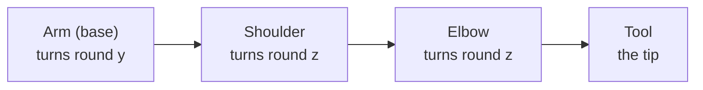

# 🟦 3. The World

[◀ The GPU](02-the-gpu.md) · [⏫ Tutorials](README.md) · [Next: a scene ▶](04-a-scene.md)


The second layer holds the things of a simulation and moves them. It draws nothing and never touches the GPU. On this page you build the robot arm of the picture above, in a `compages::world::World`, and you print where its tip is. No window opens: the picture is for the next page, where the Renderer draws this same arm.

You get there in small steps. Each step adds one idea, gives a whole program, and shows what it prints. Words in bold are in the [glossary](00-glossary.md).

## 🧰 Before you start

You need Compages built (`make`, see [Install and run](01-install.md)). Each step is a small program. Save it as `step.cpp` in the `Compages` folder, then build and run it with these lines:

```sh
export PKG_CONFIG_PATH="$PWD/build/linux-gcc-debug/lib/pkgconfig"
g++ -std=c++20 step.cpp $(pkg-config --cflags Compages) build/linux-gcc-debug/lib/libCompages.a -o step
./step
```

The `export` line is needed once per terminal.

## 📦 Step 1: one entity

An **entity** is one thing of the world: a box, a wheel, a joint of the arm. It has a name and a place. Make a world, put a box one metre along x, and ask where it is:

```cpp
#include <Compages/Compages.hpp>

#include <cstdio>

int main()
{
    compages::world::World world;
    compages::world::Entity box = world.entity("Box").position(1.0f, 0.0f, 0.0f);

    world.update(compages::Frame{});
    const compages::Vector3f where = box.worldPosition();
    std::printf("Box at (%.2f, %.2f, %.2f)\n", double(where.x), double(where.y), double(where.z));
    return 0;
}
```

```text
Box at (1.00, 0.00, 0.00)
```

`world.entity("Box")` makes the entity, and `position()` places it. The calls chain: each one returns the entity. Distances are in metres, and y goes up.

`world.update()` is the step of the World. It computes where every entity really is, and `worldPosition()` reads the result. Read positions after an update, never before. The empty `compages::Frame{}` says "no time has passed": you will give it a time in step 4.

## 🌳 Step 2: a parent and a child

A wheel is fixed to a car. When the car moves, the wheel must follow, and you do not want to move both by hand. Make the wheel a **child** of the car:

```cpp
#include <Compages/Compages.hpp>

#include <cstdio>

static void print(char const* p_name, compages::world::Entity p_entity)
{
    const compages::Vector3f where = p_entity.worldPosition();
    std::printf("%-6s at (%.2f, %.2f, %.2f)\n", p_name, double(where.x), double(where.y), double(where.z));
}

int main()
{
    compages::world::World world;
    compages::world::Entity car = world.entity("Car").position(2.0f, 0.0f, 0.0f);
    compages::world::Entity wheel = car.child("Wheel").position(1.0f, 0.0f, 0.0f);

    world.update(compages::Frame{});
    print("Car", car);
    print("Wheel", wheel);

    car.position(5.0f, 0.0f, 0.0f);   // only the car moves
    world.update(compages::Frame{});
    print("Car", car);
    print("Wheel", wheel);
    return 0;
}
```

```text
Car    at (2.00, 0.00, 0.00)
Wheel  at (3.00, 0.00, 0.00)
Car    at (5.00, 0.00, 0.00)
Wheel  at (6.00, 0.00, 0.00)
```

The position of a child is **local**: it is measured from its parent. The wheel is 1 m from the car, so it is at x = 3 when the car is at x = 2. The code moves only the car, and the wheel follows. This tree of parents and children is the **scene graph**.

## 🔩 Step 3: a joint

A joint of the arm is a child that can only turn round one axis: a **revolute joint**. Give a base a vertical axis, put a tip 50 cm from it, and turn the base:

```cpp
#include <Compages/Compages.hpp>

#include <cstdio>

using namespace compages::si::literals;

int main()
{
    compages::world::World world;
    compages::world::Entity base = world.entity("Base").revolute({ 0.0f, 1.0f, 0.0f });
    compages::world::Entity tip = base.child("Tip").position(0.5f, 0.0f, 0.0f);

    for (compages::si::Radians const angle : { 0.0_deg, 90.0_deg, 180.0_deg })
    {
        base.joint().angle(angle);
        world.update(compages::Frame{});
        const compages::Vector3f where = tip.worldPosition();
        std::printf("angle %5.1f deg   tip at (%+.2f, %.2f, %+.2f)\n",
                    units::angle::degree_t(angle).value(), double(where.x), double(where.y), double(where.z));
    }
    return 0;
}
```

```text
angle   0.0 deg   tip at (+0.50, 0.00, +0.00)
angle  90.0 deg   tip at (+0.00, 0.00, -0.50)
angle 180.0 deg   tip at (-0.50, 0.00, +0.00)
```

`revolute(axis)` makes the entity a joint, and `joint().angle()` sets its angle. The tip turns with its parent, as the wheel did, and stays 50 cm from the axis.

The angle has a type, `compages::si::Radians`, not `float`. `90.0_deg` is converted to radians for you, and the program does not compile if you give it metres or seconds by mistake. The suffixes `_deg`, `_rad`, `_s` come from the line `using namespace compages::si::literals;` (see [units](00-glossary.md#-units)).

## ⏱ Step 4: time and a routine

Until now the program set the angle by hand. A simulation must set it at each step, from the time. A **routine** does this: a small piece of code attached to one entity, which the World calls at each update.

```cpp
#include <Compages/Compages.hpp>

#include <cstdio>

using namespace compages::si::literals;

struct Spin: compages::world::Routine
{
    explicit Spin(compages::si::AngularVelocity p_speed) : speed(p_speed) {}

    void update(compages::si::Seconds) override
    {
        entity().joint().angle(speed * frame().total);   // a speed times a time is an angle
    }

    compages::si::AngularVelocity speed;
};

int main()
{
    compages::world::World world;
    compages::world::Entity base = world.entity("Base").revolute({ 0.0f, 1.0f, 0.0f });
    compages::world::Entity tip = base.child("Tip").position(0.5f, 0.0f, 0.0f);
    base.add<Spin>(0.5_rad_per_s);

    compages::Frame frame;
    frame.elapsed = 1.0_s;
    for (int step = 0; step <= 3; ++step)
    {
        frame.total = double(step) * frame.elapsed;
        world.update(frame);
        const compages::Vector3f where = tip.worldPosition();
        std::printf("t = %.0f s   tip at (%+.2f, %.2f, %+.2f)\n",
                    frame.total.value(), double(where.x), double(where.y), double(where.z));
    }
    return 0;
}
```

```text
t = 0 s   tip at (+0.50, 0.00, +0.00)
t = 1 s   tip at (+0.44, 0.00, -0.24)
t = 2 s   tip at (+0.27, 0.00, -0.42)
t = 3 s   tip at (+0.04, 0.00, -0.50)
```

A `compages::Frame` carries the time. `frame.elapsed` is the time since the previous step, `frame.total` the time since the start. Both are `compages::si::Seconds`. Here the loop moves time forward by one second at each step.

`base.add<Spin>(…)` attaches the routine to the base. In `update()`, `entity()` is that base and `frame()` is the frame of the current step. The angle is a speed of 0.5 rad/s times the total time: the units multiply, and the result is an angle, which `angle()` accepts. After three seconds the base has turned by 1.5 rad, almost a quarter of a turn.

The routine computes the angle from the total time. It does not add a small step to the angle at each frame. So a pause or a slow frame never makes the arm drift.

## 🦾 Step 5: a chain of joints

You now have every piece of the arm. A robot arm is a chain. The base turns and carries the shoulder. The shoulder tilts and carries the elbow. The elbow bends and carries the tip. Each joint is the child of the one before. From [Workshop/Arm.cpp](../../examples/13_Workshop/Workshop/Arm.cpp):

```cpp
arm.base = p_world.entity("Arm").position(-0.45f, TABLE_TOP, 0.0f).revolute({ 0.0f, 1.0f, 0.0f });
arm.shoulder = arm.base.child("Shoulder").position(0.0f, 0.12f, 0.0f).revolute({ 0.0f, 0.0f, 1.0f });
arm.elbow = arm.shoulder.child("Elbow").position(0.0f, UPPER_ARM, 0.0f).revolute({ 0.0f, 0.0f, 1.0f });
arm.tool = arm.elbow.child("Tool").position(0.0f, FOREARM, 0.0f);
```

The base stands on the table, 78 cm above the floor (`TABLE_TOP`). The elbow is 50 cm above the shoulder (`UPPER_ARM`), the tip 46 cm above the elbow (`FOREARM`). The base turns round the vertical axis y, as in step 3. The shoulder and the elbow turn round z, so the arm moves in its own vertical plane.



## 📐 Step 6: aim the tip

The routine of the arm, `FollowPath`, is the routine of step 4 with more maths. It chooses where the **tip** goes, not the angles of the joints. The tip must touch the table, 3 mm above its top, and lift off now and then:

```cpp
void update(compages::si::Seconds) override
{
    using compages::si::Length;
    using compages::si::Radians;
    const compages::si::Seconds t = frame().total;

    // Where the tip goes: how far from the base, how high, and the turn
    // of the base. It touches the table, and lifts off now and then.
    const Length reach = 0.62_m + 0.08_m * units::math::sin(0.7_rad_per_s * t);
    const Length lift = 0.06_m * std::max(0.0, double(units::math::sin(0.45_rad_per_s * t)));
    const Length height = Length(TABLE_TOP) + 3.0_mm + lift - SHOULDER_HEIGHT;
    entity().joint().angle(0.6_rad * units::math::sin(0.5_rad_per_s * t));

    // ... the angles of the shoulder and the elbow, below
}
```

Every value has its unit. `0.7_rad_per_s * t` is an angle that grows with the time, and `units::math::sin` takes it as it is: there is no conversion to a plain number. `units::math` is the maths of the units library: `sin`, `cos`, `atan2`, `hypot`, `abs`… The base swings from side to side, the reach goes in and out, and the lift is zero half of the time: then the tip touches the table.

The tip is at a distance d from the shoulder, and two links of known length must reach it. The law of cosines gives the bend of the elbow. Then the shoulder aims below the point by the angle that the bend creates. This is **inverse kinematics** for two links:

```cpp
const Length l1(UPPER_ARM);
const Length l2(FOREARM);
const Length d = units::math::hypot(reach, height);
const double cos_bend = std::clamp(double((d * d - l1 * l1 - l2 * l2) / (2.0 * l1 * l2)), -1.0, 1.0);
const Radians bend = units::math::acos(units::dimensionless::scalar_t(cos_bend));
const Radians aim = units::math::atan2(reach, height);
const Radians lean = aim - units::math::atan2(l2 * units::math::sin(bend), l1 + l2 * units::math::cos(bend));

// The joints turn round +z: a negative angle leans toward +x.
shoulder.joint().angle(-lean);
elbow.joint().angle(-bend);
```

Square metres divided by square metres has no unit: it is a plain number, the cosine of the bend. `acos` and `atan2` give angles back, so `angle()` takes them directly. Since the path is given for the tip, the tip can never go into the table, whatever the path.

## ▶ Step 7: run the arm

This program builds the arm with `buildArm()`, moves time forward by half a second at each step, and prints where the tip is. Save it as `arm.cpp` in the `Compages` folder:

```cpp
#include "13_Workshop/Workshop/Arm.hpp"

#include <cstdio>

using namespace compages::si::literals;

int main()
{
    compages::world::World world;
    examples::workshop::Arm arm = examples::workshop::buildArm(world);

    compages::Frame frame;
    frame.elapsed = 0.5_s;
    for (int step = 0; step <= 8; ++step)
    {
        frame.total = double(step) * frame.elapsed;
        world.update(frame);
        const compages::Vector3f tip = arm.tool.worldPosition();
        std::printf("t = %.1f s   tip at (%+.3f, %.3f, %+.3f)\n", frame.total.value(), double(tip.x), double(tip.y), double(tip.z));
    }
    return 0;
}
```

It needs the code of the arm too, so the build line has one more file:

```sh
g++ -std=c++20 arm.cpp examples/13_Workshop/Workshop/Arm.cpp -Iexamples \
    $(pkg-config --cflags Compages) build/linux-gcc-debug/lib/libCompages.a -o arm
./arm
```

```text
t = 0.0 s   tip at (+0.170, 0.783, +0.000)
t = 0.5 s   tip at (+0.190, 0.796, -0.096)
t = 1.0 s   tip at (+0.194, 0.809, -0.191)
t = 1.5 s   tip at (+0.183, 0.820, -0.274)
t = 2.0 s   tip at (+0.162, 0.830, -0.338)
t = 2.5 s   tip at (+0.138, 0.837, -0.377)
t = 3.0 s   tip at (+0.119, 0.842, -0.388)
t = 3.5 s   tip at (+0.107, 0.843, -0.374)
t = 4.0 s   tip at (+0.103, 0.841, -0.336)
```

At the start the tip is at 0.783 m: 3 mm above the table top. Then it lifts and goes to the side. At each `world.update(frame)`, the World ran the routine, turned each joint to its angle, and computed where every entity is, through the whole chain of parents.

No OpenGL context was made. The same code runs in a unit test, on a server, or inside a robot controller. To see the arm in a window, run the gallery: `./build/linux-gcc-debug/bin/Compages-examples 13a_Workshop`.

## 🧪 Try

- In step 4, use `2.0_rad_per_s`. The tip goes round four times faster.
- In step 6, replace `0.5_rad_per_s` by `2.0_rad_per_s` in the turn of the base. The tip moves sideways four times faster.
- In step 6, set `lift` to `0.0_m`. The tip stays at 0.783 m: it slides on the table.
- Give the shoulder limits: `.revolute({ 0.0f, 0.0f, 1.0f }, -0.5_rad, 0.5_rad)`. The shoulder cannot lean far enough, and the tip stays above the table. A joint asked to go past a limit stops at the limit.

## 🔗 See also

[The World](../concepts/the-world.md) explains how the scene graph and the ECS share one container. [Write routines](../guides/write-routines.md) shows fixed steps, timers and messages. When thousands of entities share the same behaviour, components and `world.each` are a better tool than a routine on each ([where does my data live?](../concepts/three-layers.md#-where-does-my-data-live)).

---

[◀ The GPU](02-the-gpu.md) · [⏫ Tutorials](README.md) · [Next: a scene ▶](04-a-scene.md)
