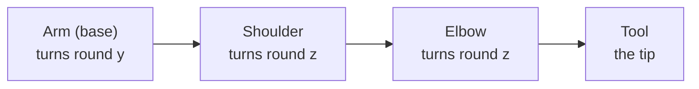

# 🟦 3. The World

[◀ The GPU](02-the-gpu.md) · [⏫ Tutorials](README.md) · [Next: a scene ▶](04-a-scene.md)


The second layer holds the things of a simulation and moves them. It draws nothing and never touches the GPU. You will build the robot arm of the picture above in a `compages::world::World`, move its tip along the table, and print where the tip is. No window opens: the picture is for the next page, where the Renderer draws this same arm.

## 🔗 A chain of joints

A robot arm is a chain. The base turns and carries the shoulder. The shoulder tilts and carries the elbow. The elbow bends and carries the tip. In the World, each joint is an **entity**, and each one is the **child** of the one before. When a parent turns, its children turn with it. From [Workshop/Arm.cpp](../../examples/13_Workshop/Workshop/Arm.cpp):

```cpp
arm.base = p_world.entity("Arm").position(-0.45f, TABLE_TOP, 0.0f).revolute({ 0.0f, 1.0f, 0.0f });
arm.shoulder = arm.base.child("Shoulder").position(0.0f, 0.12f, 0.0f).revolute({ 0.0f, 0.0f, 1.0f });
arm.elbow = arm.shoulder.child("Elbow").position(0.0f, UPPER_ARM, 0.0f).revolute({ 0.0f, 0.0f, 1.0f });
arm.tool = arm.elbow.child("Tool").position(0.0f, FOREARM, 0.0f);
```

Distances are in metres, and y goes up. The base stands on the table, 78 cm above the floor (`TABLE_TOP`). `child()` makes a new entity under this one, and `position()` places it in the axes of its parent: the elbow is 50 cm above the shoulder (`UPPER_ARM`), the tip 46 cm above the elbow (`FOREARM`). `revolute(axis)` makes the entity a **revolute joint**: it can only turn round this axis. The base turns round the vertical axis y. The shoulder and the elbow turn round z, so the arm moves in its own vertical plane.



## ⏱ A routine moves the joints

A joint has an angle, and something must set it. Here a **routine** does: a small piece of code attached to one entity, called at each update of the World.

```cpp
struct FollowPath: compages::world::Routine
{
    FollowPath(compages::world::Entity p_shoulder, compages::world::Entity p_elbow)
        : shoulder(p_shoulder), elbow(p_elbow)
    {
    }

    void update(float) override
    {
        using units::angle::radian_t;
        const double t = frame().total;

        // Where the tip goes: how far from the base, how high, and the turn
        // of the base. It touches the table, and lifts off now and then.
        const double reach = 0.62 + 0.08 * std::sin(0.7 * t);
        const double lift = 0.06 * std::max(0.0, std::sin(0.45 * t));
        const double height = double(TABLE_TOP) + 0.003 + lift - SHOULDER_HEIGHT;
        entity().joint().angle(radian_t(0.6 * std::sin(0.5 * t)));

        // ... the angles of the shoulder and the elbow, below
    }

    compages::world::Entity shoulder;
    compages::world::Entity elbow;
};

// in buildArm():
arm.base.add<FollowPath>(arm.shoulder, arm.elbow);
```

`frame().total` is the time since the start, in seconds. `entity()` is the entity that holds the routine: the base. The routine computes the angles from the total time, not by adding a small step at each frame, so a pause or a slow frame never makes the arm drift. Angles carry their unit: `radian_t(…)`, or `30.0_deg` with `using namespace units::literals`.

The routine chooses where the **tip** goes, not the angles of the joints. The tip must touch the table, 3 mm above its top, and lift off now and then. Two links of known length must reach a point at a distance d. The law of cosines gives the bend of the elbow. Then the shoulder aims below the point by the angle that the bend creates. This is **inverse kinematics** for two links:

```cpp
const double l1 = double(UPPER_ARM);
const double l2 = double(FOREARM);
const double d = std::hypot(reach, height);
const double cos_bend = std::clamp((d * d - l1 * l1 - l2 * l2) / (2.0 * l1 * l2), -1.0, 1.0);
const double bend = std::acos(cos_bend);
const double aim = std::atan2(reach, height);
const double lean = aim - std::atan2(l2 * std::sin(bend), l1 + l2 * cos_bend);

// The joints turn round +z: a negative angle leans toward +x.
shoulder.joint().angle(radian_t(-lean));
elbow.joint().angle(radian_t(-bend));
```

Since the path is given for the tip, the tip can never go into the table, whatever the path.

## ▶ Run it without a screen

This program builds the arm, moves time forward by half a second at each step, and prints where the tip is. Save it as `arm.cpp` in the `Compages` folder:

```cpp
#include "13_Workshop/Workshop/Arm.hpp"

#include <cstdio>

int main()
{
    compages::world::World world;
    examples::workshop::Arm arm = examples::workshop::buildArm(world);

    compages::Frame frame;
    frame.elapsed = 0.5f;
    for (int step = 0; step <= 8; ++step)
    {
        frame.total = float(step) * frame.elapsed;
        world.update(frame);
        const compages::Vector3f tip = arm.tool.worldPosition();
        std::printf("t = %.1f s   tip at (%+.3f, %.3f, %+.3f)\n", double(frame.total), double(tip.x), double(tip.y), double(tip.z));
    }
    return 0;
}
```

```sh
export PKG_CONFIG_PATH="$PWD/build/linux-gcc-debug/lib/pkgconfig"
g++ -std=c++20 arm.cpp examples/13_Workshop/Workshop/Arm.cpp -Iexamples \
    $(pkg-config --cflags Compages) build/linux-gcc-debug/lib/libCompages.a -o arm
./arm
```

```text
t = 0.0 s   tip at (+0.170, 0.783, +0.000)
t = 0.5 s   tip at (+0.190, 0.796, -0.096)
t = 1.0 s   tip at (+0.194, 0.809, -0.191)
t = 1.5 s   tip at (+0.183, 0.820, -0.274)
t = 2.0 s   tip at (+0.162, 0.830, -0.338)
t = 2.5 s   tip at (+0.138, 0.837, -0.377)
t = 3.0 s   tip at (+0.119, 0.842, -0.388)
t = 3.5 s   tip at (+0.107, 0.843, -0.374)
t = 4.0 s   tip at (+0.103, 0.841, -0.336)
```

At the start the tip is at 0.783 m: 3 mm above the table top. Then it lifts and goes to the side. `world.update(frame)` ran the routine, turned each joint to its angle, and computed where every entity is in the room. `worldPosition()` reads the result, through the whole chain of parents.

No OpenGL context was made. The same code runs in a unit test, on a server, or inside a robot controller.

## 🧪 Try

- Replace `0.5 * t` by `2.0 * t` in the turn of the base. The tip moves sideways four times faster.
- Set `lift` to `0.0`. The tip stays at 0.783 m: it slides on the table.
- Give the shoulder limits: `.revolute({ 0.0f, 0.0f, 1.0f }, units::angle::radian_t(-0.5), units::angle::radian_t(0.5))`. The shoulder cannot lean far enough, and the tip stays above the table. A joint keeps an angle outside its limits at the limit.

[The World](../concepts/the-world.md) explains how the scene graph and the ECS share one container. [Write routines](../guides/write-routines.md) shows fixed steps, timers and messages. When thousands of entities share the same behaviour, components and `world.each` are a better tool than a routine on each ([where does my data live?](../concepts/three-layers.md#-where-does-my-data-live)).

---

[◀ The GPU](02-the-gpu.md) · [⏫ Tutorials](README.md) · [Next: a scene ▶](04-a-scene.md)
