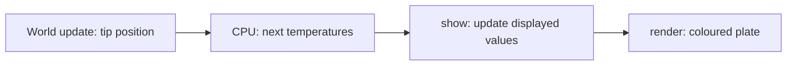

# 🗺 5. Values on a grid

[◀ A scene](04-a-scene.md) · [⏫ Tutorials](README.md) · [Next: a look of your own ▶](06-a-look-of-your-own.md)


The tip of the arm is hot: 300 degrees. Where it touches the steel plate on the table, the plate heats; the heat spreads around and fades.

## 🎯 Goal

Store temperatures in a `Field<float>` on a `Grid2D`, then update them with a CPU heat loop. You will display the values as colours and see a trail appear beneath the moving tool.

## ▶ Observe the trail

```sh
./build/linux-gcc-debug/bin/Compages-examples 13b_HotPlate
```

Compare it with `13a_Workshop`: the arm and the room are the same. A coloured plate now records where the hot tip has been. Pause with **F6**. The arm and the temperatures stop together.

You will first store values without graphics, then follow their update and display in the demo. Open [Workshop/HotPlate.cpp](../../examples/13_Workshop/Workshop/HotPlate.cpp) and [13b_HotPlate.cpp](../../examples/13_Workshop/13b_HotPlate.cpp).

## 🗺 Step 1: store a value at a point

Save this complete program as `field.cpp` in the repository root:

```cpp
#include <Compages/Fields/Field.hpp>

#include <cstdio>

int main()
{
    const compages::Grid2D grid{ .columns = 3, .rows = 3, .origin = { 0.0f, 0.0f }, .spacing = 0.1f };
    compages::Field<float> temperature(grid, 20.0f);
    temperature(1, 1) = 300.0f;
    const compages::Vector2f point = grid.point(1, 1);
    std::printf("Centre (%.1f, %.1f) m: %.0f degrees\n",
                double(point.x), double(point.y), double(temperature(1, 1)));
    std::printf("Corner: %.0f degrees\n", double(temperature(0, 0)));
    return 0;
}
```

```sh
g++ -std=c++20 field.cpp $(pkg-config --cflags Compages) \
    build/linux-gcc-debug/lib/libCompages.a -o field
./field
```

Use the build-tree `PKG_CONFIG_PATH` from chapter 1. The output is:

```text
Centre (0.1, 0.1) m: 300 degrees
Corner: 20 degrees
```

The indices `(1, 1)` select a sample, while `grid.point(1, 1)` gives its position. There are three points per side but only two intervals: each side spans 0.2 m. The grid does not choose what its axes mean. The workshop maps them to room x and z. The temperatures in this demo are plain floats measured in degrees Celsius.

## 📦 Step 2: make the plate's fields

A **grid** says where the points are. A **field** holds one value per point. From [Workshop/HotPlate.cpp](../../examples/13_Workshop/Workshop/HotPlate.cpp):

```cpp
const compages::Grid2D grid{ .columns = 41, .rows = 61, .origin = { -0.25f, -0.45f }, .spacing = 0.015f };
m_temperature = compages::Field<float>(grid, ROOM);
m_next = m_temperature;
```

There are 41 columns along x and 61 rows along z, with one point every 1.5 cm. The first point is at (−0.25, −0.45). This makes a plate of 60 cm by 90 cm under the reach of the arm. `Field<float>(grid, ROOM)` makes 41 × 61 = 2501 temperatures, all at 20 degrees. `m_temperature(i, j)` reads or writes the value of column `i`, row `j`; `grid.point(i, j)` says where that point is, in metres.

A `Grid2D` and a `Field` are plain C++ data in the `compages` namespace, in `<Compages/Fields/…>`. They do not need the World, the GPU or a screen: a unit test or a solver uses them as they are. The concept page [fields and grids](../concepts/fields-and-grids.md) has the whole picture.

The second field, `m_next`, starts with the same values and grid. It will hold the next time step while `m_temperature` stays available for reading. The constants in `HotPlate.cpp` are `ROOM = 20.0f`, `TIP = 300.0f`, `TIP_RADIUS = 0.03f`, `DIFFUSIVITY = 1.0e-4f`, and `COOLING = 0.08f`. Diffusivity is in m²/s; cooling is a rate per second.

## ♨ Step 3: compute one new temperature

At each frame, each point moves toward the mean of its four neighbours: this is the heat equation, in its simplest discrete form. It also loses a little heat to the air, and the points under the tip take its temperature:

```cpp
const float dt = compages::toSeconds(p_seconds);
compages::Grid2D const& grid = m_temperature.grid();
const float rate = DIFFUSIVITY * dt / (grid.spacing * grid.spacing); // < 0.25 to stay stable
const bool touches = (p_tool.y < TABLE_TOP + 0.01f);
for (int j = 1; j < grid.rows - 1; ++j)
{
    for (int i = 1; i < grid.columns - 1; ++i)
    {
        const compages::Vector2f p = grid.point(i, j);
        const float t = m_temperature(i, j);
        const float spread = m_temperature(i - 1, j) + m_temperature(i + 1, j) + m_temperature(i, j - 1) +
                             m_temperature(i, j + 1) - (4.0f * t);
        const bool under = touches && (std::hypot(p.x - p_tool.x, p.y - p_tool.z) < TIP_RADIUS);
        m_next(i, j) = under ? TIP : t + (rate * spread) - (COOLING * dt * (t - ROOM));
    }
}
std::swap(m_temperature, m_next);
```

`spread` is the sum of the four neighbours minus four times the point itself: zero where the temperature is flat, positive in a cold point between warm ones. The new values go into a second field, `m_next`, and the two are swapped at the end: a point must not read a neighbour that was already updated in the same step. The edge points are never written; both fields keep their edges at room temperature.

Take one interior sample at 20 degrees, with neighbours at 20, 20, 20 and 300. Then `spread` is 280. For `dt = 0.05`, `rate` is about 0.0222. Without direct tip contact, that sample warms by about 6.22 degrees in one step. The cooling term is initially zero because the sample starts at room temperature. If the sample is under the touching tip, the conditional assigns 300 instead.

`p_seconds` has type `compages::si::Seconds` in `HotPlate::step()`. Only the numerical loop converts it to a plain float. The distance test uses `p_tool.x` and `p_tool.z` because the grid lies along the table. This is a prescribed heat source, not collision detection or a full steel model.

The step needs to know where the tip is. The demo asks the World, after it moved the arm:

```cpp
m_scene.update(p_frame);                                                     // the arm moves
m_plate.step(std::min(p_frame.elapsed, 0.05_s), m_arm.tool.worldPosition()); // then it heats
```

`worldPosition()` is the place of the tip in the room, through the whole chain of joints of page 3. `Scene::draw()` is `update()` then `render()`; the demo calls the two halves, with its own work in between.

The demo limits this numerical step to 0.05 s. At that limit, `rate` is about 0.0222, below the diffusion limit of 0.25. The cooling term also matters for stability; the chosen constants keep its contribution small. On a slow frame, the cap discards some simulation time instead of solving it in smaller steps. For a time-accurate solver, use several smaller steps to cover the full elapsed time.

## 🎨 Step 4: turn values into colours

```cpp
m_shown = p_scene.show(m_temperature, m_look, "Plate");   // once
m_shown.position(0.0f, TABLE_TOP + 0.003f, 0.0f);         // on the table
// each frame, after step():
p_scene.show(m_shown, m_temperature, m_look);
```

The look says how a value becomes a colour:

```cpp
compages::renderer::FieldLook m_look{ .colors = compages::renderer::ColorMap::Inferno,
                                      .low = 20.0f,
                                      .high = 300.0f,
                                      .relief = 0.0f,
                                      .lit = true };
```

Inferno goes from black (20 degrees, `low`) through purple and orange to pale yellow (300 degrees, `high`): the colours of hot metal. `relief` would raise each point by its value (zero: a flat plate). `lit` lets the sun and the lamp light the plate, like any surface.

The first `show()` makes an entity that draws the field, lying flat on the ground of its grid; `position()` lifts it 3 mm above the table, so that the two surfaces do not fight for the same pixels. The next calls update the displayed field. The GPU turns the values into colours without rebuilding its grid mesh. Changing `low` and `high` changes this visual scale; it never changes a temperature in the field. For a value between them, its fraction along the colour map is `(value - low) / (high - low)`. A temperature of 160 is halfway between 20 and 300.

The setup in `13b_HotPlate.cpp` adds these lines after building and dressing the arm:

```cpp
m_plate.create(m_scene);
m_plate.warmUp(m_scene, m_arm, 12.0_s);
return m_scene.prepare();
```

At each frame it calls `update()`, `step()`, `show()`, then `render()`. It checks the `Status` returned by `show()` and records failures with `gpu::reportError()`. Use that existing error handling when editing the demo. Calling `draw()` here as well would update the World a second time.



## ▶ Run it

```sh
./build/linux-gcc-debug/bin/Compages-examples 13b_HotPlate
```

A glowing trail follows the tip and fades to purple, then black. The demo runs twelve seconds of work before its first frame (`warmUp()`), so that the trail is there at once.

## 🧪 Try

Make these edits in `HotPlate.cpp` or the `m_look` member in [Workshop.hpp](../../examples/13_Workshop/Workshop/Workshop.hpp). Rebuild and rerun `13b_HotPlate` after each change.

- Temporarily replace the assignment to `m_next(i, j)` with `m_next(i, j) = ROOM;`.
  The plate stays at the darkest colour even while the arm moves. Restore the assignment.

- Set `.colors` to `ColorMap::Viridis`: the same values in colours a colour-blind eye reads well.
- Set `.relief = 0.0005f`: the hot points rise, half a millimetre per degree.
- Multiply `COOLING` by 10: the trail is short, only the tip glows.
- Set `DIFFUSIVITY` to `1.0e-2f`: `rate` goes above 0.25 and the step explodes into stripes. An explicit step is only stable for small steps of time; [the heat plate](../case-studies/heat-plate.md) explains the limit.

Most scientific data has this shape: one value per point of a space. In Compages the grid says where the points are, the field holds the values, and the look says how to show them. You compute on the field with plain loops, and the Renderer shows it with one call. The same field can also be sent to your own shader ([show a field](../guides/show-a-field.md)), read under the mouse, or computed on the GPU ([the ripple tank](../case-studies/ripple-tank.md)).

---

[◀ A scene](04-a-scene.md) · [⏫ Tutorials](README.md) · [Next: a look of your own ▶](06-a-look-of-your-own.md)
